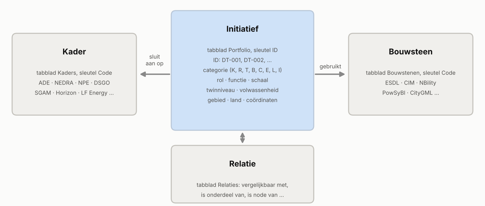
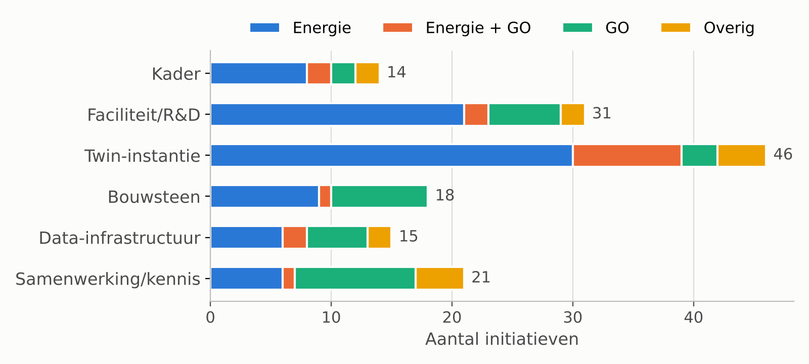
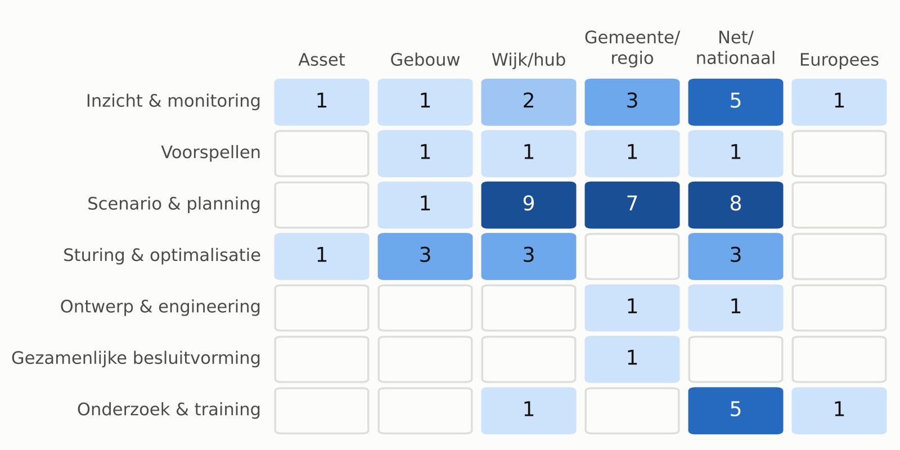
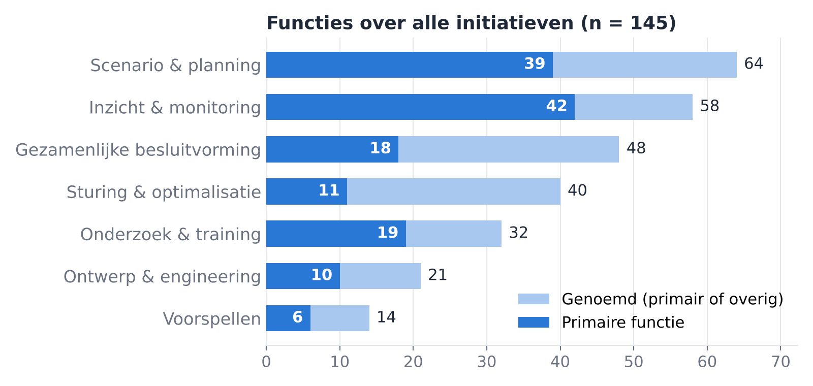
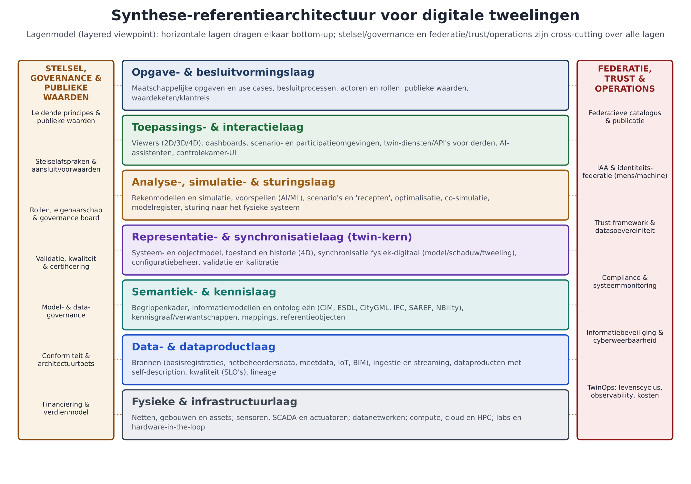
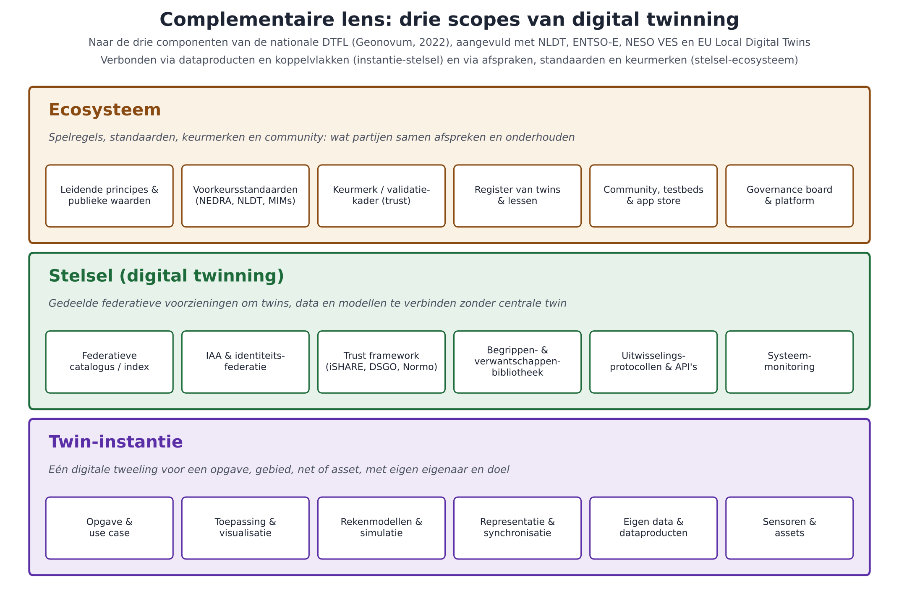

*Publieksversie. Onafhankelijke inventarisatie ten behoeve van de Verkenner Digital Twins; dit is geen officiële publicatie van Energy Innovation NL. Deze versie bevat de inventarisatie, analyse en referentiearchitectuur; interne werkonderdelen voor de verdiepende gesprekken zijn weggelaten. Reacties zijn welkom. Begeleidend bestand: Register digital twins (Register_digital_twins_NL_EU_2026-10_v14_publiek.xlsx) met de volledige gegevens per initiatief.*

**Versiegeschiedenis**

| **Versie** | **Datum**       | **Auteur**                    | **Omschrijving**                                                                                                                                                                                                                                                                                                                                                                                                                                                                                                                                                                                                                                                                                   |
|------------|-----------------|-------------------------------|----------------------------------------------------------------------------------------------------------------------------------------------------------------------------------------------------------------------------------------------------------------------------------------------------------------------------------------------------------------------------------------------------------------------------------------------------------------------------------------------------------------------------------------------------------------------------------------------------------------------------------------------------------------------------------------------------|
| 1          | september 2026  | M. van Glabbeek (Bizz4Mation) | Eerste inventarisatie van digital-twin-initiatieven in Nederland en de EU voor de gebouwde omgeving en het energiedomein.                                                                                                                                                                                                                                                                                                                                                                                                                                                                                                                                                                          |
| 2          | september 2026  | M. van Glabbeek (Bizz4Mation) | Inventarisatie aangevuld en herzien.                                                                                                                                                                                                                                                                                                                                                                                                                                                                                                                                                                                                                                                               |
| 3          | september 2026  | M. van Glabbeek (Bizz4Mation) | Breed register gebouwde omgeving en energie in een apart tabblad (Register GO).                                                                                                                                                                                                                                                                                                                                                                                                                                                                                                                                                                                                                    |
| 4          | oktober 2026    | M. van Glabbeek (Bizz4Mation) | Portfolio energie geordend naar rol, functie, schaal, twinniveau en volwassenheid; koppeling aan ADE, NPE, NEDRA en Europese kaders; uitwerking voor de concept-verkenning.                                                                                                                                                                                                                                                                                                                                                                                                                                                                                                                        |
| 5          | oktober 2026    | M. van Glabbeek (Bizz4Mation) | Zoekgebied verbreed naar EU-breed en een beknopte verkenning van VK, VS, Australië, Japan en Nieuw-Zeeland, conform de offerte van 7 oktober 2026; tabbladen Kaders, Bouwstenen, Relaties en Analyse; coördinaten; artikel van het Nationaal Expertisecentrum Woningbouw verwerkt.                                                                                                                                                                                                                                                                                                                                                                                                                 |
| 6          | oktober 2026    | M. van Glabbeek (Bizz4Mation) | Register GO samengevoegd met het portfolio (29 initiatieven toegevoegd); focus Kern/Rand vervangen door Energie, Energie + GO, GO en Overig; rapport en register op hetzelfde versienummer.                                                                                                                                                                                                                                                                                                                                                                                                                                                                                                        |
| 7          | oktober 2026    | M. van Glabbeek (Bizz4Mation) | 18 initiatieven, 7 bouwstenen en 3 aanbieders toegevoegd uit het rapport Data governance en data delen in het energiedomein (2026); bronlinks aangevuld uit het GitHub-overzicht energie-data/energy-data-governance-project-overview; statussen gecorrigeerd.                                                                                                                                                                                                                                                                                                                                                                                                                                     |
| 8          | oktober 2026    | M. van Glabbeek (Bizz4Mation) | Bijlage synthese-referentiearchitectuur digitale tweelingen toegevoegd, gebaseerd op DTFL en andere referentiearchitecturen; register met tabblad Referentiearchitectuur.                                                                                                                                                                                                                                                                                                                                                                                                                                                                                                                          |
| 9          | 19 oktober 2026 | M. van Glabbeek (Bizz4Mation) | Voorbereiding van de verdiepende gesprekken: samenwerking en deliverables, analysekader ter bespreking, horizontale analyse met 27 werkhypothesen, scopevoorstel, informatiebehoefte per initiatief en interviewinput; afgeleide velden, verificatielijst en tabbladen in het register.                                                                                                                                                                                                                                                                                                                                                                                                            |
| 10         | 19 oktober 2026 | M. van Glabbeek (Bizz4Mation) | Redactie volgens de NEDRA-schrijfwijzer: tekst zelfstandig leesbaar gemaakt, verwijzingen naar eerdere versies en wijzigingsaanleidingen naar deze versiegeschiedenis verplaatst, persoonsnamen vervangen door rollen, derde persoon; versiegeschiedenis en afkortingenlijst toegevoegd; NLDT en ORTESE voluit.                                                                                                                                                                                                                                                                                                                                                                                    |
| 11         | 21 oktober 2026 | M. van Glabbeek (Bizz4Mation) | Drie bronnen verwerkt: de call for proposals van de KIC-partnerschapsronde NWO-TenneT-Topsector Energie, de Datastrategie digital twins voor een toekomstig energiesysteem (RVO, 2026) en de projectpagina Impactanalyse Digital Twins (Energy Innovation NL). Twee initiatieven toegevoegd (DT-010 Datastrategie, DT-027 UTOPYS); DT-013 en DT-087 geverifieerd en aangevuld; H07 en H23 bijgesteld; paragraaf Uitgelichte bronnen en initiatieven.                                                                                                                                                                                                                                               |
| 12         | 21 oktober 2026 | M. van Glabbeek (Bizz4Mation) | Vier bronnen verwerkt: volledige tekst ADE (2025), Inventarisatie Architectuur Data Ecosystemen voor de CDO van IenW (Geonovum, 2025), verkenning Dutch Digital Twin AppStore (WE Labs) en presentatie investeringsvoorstel nDTFL. Acht initiatieven toegevoegd (DT-011, DT-096, DT-097, DT-062, DT-082 t/m DT-085), zes bouwstenen en kader DSSC; DT-002, DT-092 en DT-009 aangevuld; H13, H21, H24, H25 en H27 bijgesteld, H28 toegevoegd. Publieksversie zonder interne werkonderdelen en zonder samenvattingen van bronnen met een voorbehoud tegen tekst- en datamining of verwerking met AI. Redactie: geen verwijzingen naar eerdere versies in de lopende tekst en geen gedachtestreepjes. |
| 13         | 26 oktober 2026 | M. van Glabbeek (Bizz4Mation) | Initiatieven doorlopend genummerd (DT-001 tot en met DT-145) in de volgorde van het register; de vroegere lettercode staat als categorie in een aparte kolom, met een legenda in de paragraaf Opbouw van het register en een kolom Cat. in bijlage B. Figuur 1 opnieuw getekend zonder tellingen.                                                                                                                                                                                                                                                                                                                                                                                                  |
| 14         | 26 oktober 2026 | M. van Glabbeek (Bizz4Mation) | HOLON (DT-146) opgenomen; DT-014 aangevuld met de netsimulatie van het ESP-lab, DT-048 met aanbesteding en opbouw van het Open Urban Platform en DT-091 met de How-to-digital-twin-methode van DMI; hoofdstuk Smart cities; holarchie als principe en de vier rollen van een twin in bijlage A; werkhypothese H29; bronnen: Holontool en rapport Holons, A Digital Energy System v0.83, EPRI (2022) en smart-city-platforms. Figuren 2 en 4 bijgewerkt.                                                                                                                                                                                                                                            |

**Inhoud**

## Samenvatting

Energy Innovation NL laat verkennen wat digital twins kunnen betekenen voor het energiesysteem en welke samenhang en vervolgstappen er nodig zijn. Dit rapport levert daarvoor het portfolio-overzicht: een inventarisatie van digital-twin-initiatieven in Nederland en de EU, met een beknopte blik op het Verenigd Koninkrijk, de Verenigde Staten, Australië, Japan en Nieuw-Zeeland. Het register bevat 146 initiatieven in één tabel: 91 in Nederland, 16 in andere EU/EER-lidstaten, 21 EU-brede programma’s en projecten, en 18 internationaal. Daarnaast bevat het 19 kaders, 40 bouwstenen, 269 onderlinge relaties en 70 aanbieders. Elk initiatief is geduid naar focus, rol, functie, schaal, twinniveau en volwassenheid en, waar mogelijk, gekoppeld aan de Actieagenda Digitalisering Energiesysteem (ADE), de Nederlandse Energie Domein Referentie Architectuur (NEDRA), het Nationaal Plan Energiesysteem (NPE), het Digitaal Stelsel Gebouwde Omgeving (DSGO), het Smart Grid Architecture Model (SGAM), Horizon Europe, LF Energy en de andere kaders.

De focus zegt waar een initiatief over gaat: **Energie** (80), **Energie + GO** (17, energie gekoppeld aan de gebouwde omgeving), alleen **GO** (34, gebouwde omgeving) of **Overig** (14: water, mobiliteit, veiligheid, infra, klimaat of generiek). Het energieportfolio voor de verkenning bestaat uit de eerste twee groepen, samen 97 initiatieven; de andere 48 geven de context van de gebouwde omgeving en andere domeinen waar energie op kan aansluiten.

De vijf belangrijkste bevindingen:

1.  **Nederland staat niet alleen met een nationale systeemtwin.** In 2026 starten in meerdere landen vergelijkbare trajecten: de Nationale Faciliteit Digital Twin Elektriciteitssysteem (NL, juni), EDiT in Zweden (RISE met Svenska kraftnät en Vattenfall, mei 2026 tot 2029) en het Virtual Energy System van de Britse systeembeheerder NESO (National Energy System Operator). Er is geen zichtbare uitwisseling tussen deze trajecten.

2.  **Het VK is het verst met een federatief raamwerk.** NESO bouwt eerst een Common Framework en een Data Sharing Infrastructure, en pas daarna gekoppelde twins. Dat is precies de volgorde die ORTESE (Ontwerpen en Realiseren van een Toekomstbestendig Energiesysteem in Emmen) en TwinTwente in Nederland lokaal hanteren, en een bruikbare referentie voor ADE-actie 1.1.3 in samenhang met Het Normo.

3.  **Twins van distributienetbeheerders (DSO’s) op landelijke schaal bestaan al, maar niet in Nederland.** E.ON heeft een twin over meer dan 700.000 km distributienet uitgerold, eerst voor netaansluitingen; e-distribución (Spanje) investeerde €40 mln. Nederlandse netbeheerders zitten op demonstratieniveau (Liander Gridscale X) of werken met losse modellen.

4.  **Er ligt een open bouwstenenlaag die niemand ‘digital twin’ noemt.** LF Energy telt 41 open-sourceprojecten voor netmodel, -berekening, simulatie en semantiek, waarvan Power Grid Model en OpenSTEF uit Nederland komen (Alliander) en PowSyBl, Dynawo en Grid2Op van RTE. In NEDRA en in de ADE zijn ze nog niet als twin-bouwsteen benoemd.

5.  **De brug tussen gebouwde omgeving en energie is ook internationaal een witte vlek.** Nationale GO-twins (JUNN in Frankrijk, PLATEAU in Japan, Digital Twin Victoria) nemen energie alleen op als zonpotentieel, zoekgebieden of capaciteit. Het Nationaal Expertisecentrum Woningbouw noemt energie als domein in de woningbouwopgave, maar netcongestie niet. Hier kan Nederland voorop lopen, met het DMI-ecosysteem (Dutch Metropolitan Innovations) en de architectuur voor een netwerk van lokale digitale tweelingen (NLDT, programma Zicht op Nederland) als vertrekpunt.

Bijlage A bevat een voorstel voor een **synthese-referentiearchitectuur** voor digitale tweelingen: zeven lagen en twee cross-cutting banden, op basis van de referentiearchitectuur van de Digitale Tweeling Fysieke Leefomgeving (DTFL), NEDRA, NLDT, ENTSO-E, NESO, SGAM en internationale kaders. De synthese laat zien dat de kern van een tweeling (representatie en synchronisatie) en de federatieve stelselvoorzieningen in het energiedomein het minst zijn uitgewerkt.

Nederland is in Europa vooral via onderzoek aangesloten: TU Delft trekt AI-EFFECT en is partner in TwinEU, net als Alliander en Jedlix. In de overige Horizon-projecten in dit register (GRID-PRO, BUILDSPACE, TwinERGY, ExPEDite) speelt Nederland, voor zover vastgesteld, geen of een kleine rol. De duiding is voorlopig en moet in gesprekken met initiatiefnemers (lijn C) en de expertreview worden getoetst.

## Opdracht, scope en aanpak

De offerte van 7 oktober 2026 legt voor lijn B (portfolio en samenhang) drie dingen vast: initiatieven EU-breed inventariseren en ordenen naar functie, schaal en volwassenheid; een beknopte verkenning van het VK, de VS, Australië, Japan en Nieuw-Zeeland; en een koppeling aan ADE, NEDRA, NPE, DSGO en Europese kaders, waaronder Horizon-projecten, LF Energy en SGAM. Lijn E vraagt een datamodel voor een register van initiatieven, bouwstenen, kaders en hun relaties, met een kaart en filters op functie, schaal, volwassenheid, kader en land. Dit rapport en het begeleidende register leveren de inhoud voor beide.

### Opbouw van het register

- **Eén register** met alle initiatieven, van energie tot gebouwde omgeving, in één tabel; de focus (Energie, Energie + GO, GO, Overig) laat zien waar een initiatief over gaat.

- **Zoekgebied: 91 initiatieven in Nederland**, 16 in andere EU/EER-lidstaten (categorie L), 21 EU-brede programma’s en netwerken (categorie E) en 18 internationaal (categorie I), plus kaders, bouwstenen en kennisinitiatieven.

- **Ordening:** rol, functie, schaal, twinniveau en volwassenheid, aangevuld met focus, gebied en land (zie hoofdstuk Ordeningskader en datamodel).

- **Koppeling:** iedere rij heeft kadercodes en bouwsteencodes. Daaruit volgen relaties met kaders en bouwstenen, aangevuld met handmatige relaties zoals ‘vergelijkbaar met’ en ‘is onderdeel van’; in totaal 269.

- **Prototype:** coördinaten per initiatief (indicatief) en een datamodel dat direct als basis voor de interactieve kaart kan dienen.

Elk initiatief heeft een vast volgnummer: DT-001 tot en met DT-146. Het nummer zegt niets over het soort initiatief of de plaats in het register of in dit rapport. Een nieuw initiatief krijgt het eerstvolgende vrije nummer en een nummer wordt nooit hergebruikt, zodat een verwijzing als DT-012 over versies heen geldig blijft. Het soort initiatief staat apart, als categorie met een code van één letter (kolommen Categoriecode en Categorie in het register; kolom Cat. in bijlage B). De tabel hieronder is de legenda.

| **Code** | **Categorie**                         | **Omschrijving**                                                                            | **Aantal** |
|----------|---------------------------------------|---------------------------------------------------------------------------------------------|------------|
| K        | Kader                                 | Beleid, programma, standaard of afsprakenstelsel waarop initiatieven aansluiten (NL en EU). | 11         |
| R        | Faciliteit of R&D (NL)                | Nationale faciliteit, onderzoeksprogramma of testomgeving in Nederland.                     | 16         |
| T        | Twin-instantie (NL)                   | Een concrete digital twin van een net, gebied, gebouw of systeem in Nederland.              | 35         |
| B        | Bouwsteen of data-infrastructuur (NL) | Herbruikbaar model, dataset, platform of datadeelvoorziening in Nederland.                  | 23         |
| C        | Samenwerking of kennis (NL)           | Netwerk, ecosysteem, kennisproject of verkenning in Nederland.                              | 13         |
| E        | EU-breed programma of netwerk         | Europees project, programma of netwerk met partners uit meerdere lidstaten.                 | 17         |
| L        | Initiatief in een EU/EER-lidstaat     | Initiatief in één andere lidstaat van de EU of de EER.                                      | 15         |
| I        | Internationaal (buiten de EU)         | Initiatief buiten de EU, uit de beknopte internationale verkenning.                         | 16         |
|          | Totaal                                |                                                                                             | 146        |

*Tabel: Categorieën van initiatieven met hun code van één letter en het aantal initiatieven in het register (n = 146)*

### Gebruikte bronnen

| **Bron**                                                                                                                                                                                                            | **Wat het oplevert voor de inventarisatie**                                                                                                                                                                                                                                                                             |
|---------------------------------------------------------------------------------------------------------------------------------------------------------------------------------------------------------------------|-------------------------------------------------------------------------------------------------------------------------------------------------------------------------------------------------------------------------------------------------------------------------------------------------------------------------|
| NEDRA verbindt (presentatie Energy Innovation NL op Digital Energy Systems, 11-12-2025)                                                                                                                             | ORTESE uitgewerkt met het NEDRA-denkkader: klantreis, waardeketen in vijf stappen, bouwblokken en rollen per stap, drie lagen afspraken (organisatorisch, semantisch, technisch); koppeling aan 12+ modellen (NBility, USEF, SGAM, OpenADR, EFI/S2, HEMRM, LEAP, MSRA, DATA-X, GAIA-X, OMEGA-X)                         |
| Digital twins: partijen om te kennen (Vakbeurs Energie, PREFAB, Industrial Heat & Power, okt. 2026)                                                                                                                 | 15 aanbieders in vijf categorieën (operationele gebouwtwins, energiesysteemsimulatie, omgeving en ontwerp, BIM en prefab, reality capture) en het advies om op open export (IFC, CSV, ESDL) te toetsen                                                                                                                  |
| Presentatie nationale DTFL (Geonovum, 2022) en Investeringsvoorstel DTFL (EN, 2021)                                                                                                                                 | Fieldlabs, kookboek-aanpak en de vraag ‘kan de nationale DTFL dataspaces verbinden?’, met ‘DT Energie’ als een van de dataspaces. De koppeling GO-energie stond dus al in 2021 op de kaart                                                                                                                              |
| Een perfecte storm (WE Labs, 2023)                                                                                                                                                                                  | Internationale voorbeelden: CReDo (VK), Helsinki Energy and Climate Atlas, New Mexico, NSW, Singapore/CARES                                                                                                                                                                                                             |
| Digital twinning in de woningbouwopgave (Nationaal Expertisecentrum Woningbouw, 29-9-2026)                                                                                                                          | Positionering van digital twinning voor gemeenten in de woningbouwopgave; verwijst naar Zicht op Nederland, Geonovum, DMI, digiGO, Stichting Digitale Tweeling Nederland en de Samenwerkingsagenda Toekomstbestendige Gebiedsontwikkeling                                                                               |
| Data governance en data delen in het energiedomein (Contakt Consulting i.o.v. RVO/Energy Innovation NL, 2026): printoverzichten use cases (69), initiatieven data delen (37) en interoperabiliteit (13), 19-10-2026 | Use cases met digital twins of twin-achtige systeemmodellen, het Datastelsel Verduurzaming Utiliteit (DVU), Europese dataspaces met twin-use cases en internationale interoperabiliteitsstandaarden (OpenFMB, MultiSpeak, ECHONET Lite)                                                                                 |
| Webonderzoek 16-10-2026                                                                                                                                                                                             | CORDIS, LF Energy, RISE, NESO, gov.uk, NREL, MLIT, ORUA en vakmedia (Enlit, Kurrant)                                                                                                                                                                                                                                    |
| Call for proposals KIC ‘Ontgrendel de kracht van de Digital Twin voor netbeheerders’ (NWO, TenneT, Topsector Energie; KIC 2024-2027)                                                                                | Budget, voorwaarden en tijdpad van DT-013; zes onderzoeksdomeinen; DT-definitie; expliciete koppeling met de Nationale Faciliteit (DT-012)                                                                                                                                                                              |
| Datastrategie: digital twins voor een toekomstig energiesysteem (Witteveen+Bos c.s. i.o.v. RVO/Topsector Energie, definitief 30-4-2026)                                                                             | Kader DT-010. De inhoud is niet samengevat vanwege het auteursrechtvoorbehoud (geen tekst- en datamining of verwerking met AI).                                                                                                                                                                                         |
| Projectpagina Impactanalyse Digital Twins in de energiesector (Energy Innovation NL, geraadpleegd 21-10-2026)                                                                                                       | Verificatie DT-087: uitvoerder, domeinen, opleveringen en tijdpad                                                                                                                                                                                                                                                       |
| Webonderzoek 21-10-2026                                                                                                                                                                                             | TenneT-nieuwsbericht over de KIC-call; UTOPYS (NWO Grootschalige Onderzoeksinfrastructuur, DT-027); generieke KIC-call Digital Twinning (KIA Digitalisering)                                                                                                                                                            |
| Actieagenda Digitalisering Energiesysteem, volledige tekst (KGG en TNO, 11-12-2025)                                                                                                                                 | Status en stappen van actie 1.1.3 (digital twin elektriciteitssysteem) en van de acties 1.1.4, 1.2.1, 2.2.2, 4.1.2 en 5.1.1; governance en budget; praktijkvoorbeelden Starlings, VES haven en TenneT Digital Spine (DT-002, DT-062, DT-082)                                                                            |
| Inventarisatie Architectuur Data Ecosystemen t.b.v. CDO IenW (Geonovum, 17-4-2025)                                                                                                                                  | Tien data-ecosystemen langs de technische bouwblokken van de DSSC Blueprint; patronen in trust, identiteit en metadata; drie generieke functies; vijf samenwerkingsscenario’s (DT-096, DT-011, DT-084, DT-085)                                                                                                          |
| De digitale tweeling in de kern van de dagelijkse operatie en beleid, v0.8 (WE Labs i.o.v. VRO, 2025)                                                                                                               | Verkenning Dutch Digital Twin AppStore: hub-spoke met Geonovum, accreditatie en trustcriteria, fasering 2025-2027 (DT-092); verwijzing naar pilots datagedreven gebiedsontwikkeling (DT-097)                                                                                                                            |
| Presentatie investeringsvoorstel nationale DTFL (Geonovum/BZK, 2021-2022)                                                                                                                                           | Modellen per opgave, waaronder de keuzehulp energietransitierekenmodellen (DT-083); dataspace ‘DT Energie’                                                                                                                                                                                                              |
| Webonderzoek 21-10-2026 (tweede ronde)                                                                                                                                                                              | Starlings-pilot (Havenbedrijf Rotterdam), keuzehulp ETRM (RES-handreiking), programma Innovatie en Opschaling Woningbouw                                                                                                                                                                                                |
| A Digital Energy System: Necessity, Value and Execution (Zerbst, conceptversie 0.83, 2026)                                                                                                                          | Vier rollen van een twin (operationeel, voorspellend, training, validatie); twin als validatie-infrastructuur voor AI-agents met begrensde autonomie; gedeelde semantische laag (CIM, IEC 61850, SAREF, Brick, Open Energy Ontology) als voorwaarde; federatief Europees netmodel als doel van ENTSO-E en EU DSO Entity |
| Holontool (ZEnMo, TU/e, TNO, Witteveen+Bos e.a., sinds 2023) en rapport Holons: lokale flex als oplossing voor netcongestie (Energy Innovation NL en RVO, 2026)                                                     | Nieuw initiatief DT-146; holarchie als ordeningsprincipe voor lokale energiesystemen; werkhypothese H29                                                                                                                                                                                                                 |
| Preparing for the 2030 Energy System: a Vision for Electric Utility ICT (EPRI, 2022)                                                                                                                                | Datacentrisch werken met CIM als enterprise semantisch model; capability-model in ArchiMate; bron voor de semantische laag in bijlage A                                                                                                                                                                                 |
| Towards holonic power and energy systems (Rehtanz e.a., 2024) en W3C Holon Graph Community Group (2026)                                                                                                             | Holonische structuren als ICT-architectuur voor netautomatisering; holon als named graph met grenzen en projecties; bouwsteen Holonic Graph Architecture                                                                                                                                                                |
| TU Delft ESP-lab: Digital Twin elektriciteitsnetwerk; iBestuur: Open Urban Platform Rotterdam (2023); DMI-ecosysteem: thema Digital Twins                                                                           | Aanvulling DT-014, DT-048 en DT-091; voorbeelden voor het hoofdstuk smart cities                                                                                                                                                                                                                                        |
| Smart-city-platforms: Smart Cities Marketplace (Europese Commissie), ESCA, Urban Tech Map, European Smart City Model (TU Wien)                                                                                      | Financierings- en kennisroutes voor stedelijke twins; geen twin-initiatieven                                                                                                                                                                                                                                            |

Het artikel van het Nationaal Expertisecentrum Woningbouw plaatst Zicht op Nederland bij het ministerie van BZK; andere bronnen noemen VRO. \[Te bevestigen: actuele departementale naam.\]

### Uitgelichte bronnen en initiatieven

Een aantal primaire bronnen levert meer op dan in een regel van het register past. Hieronder staat per initiatief wat die bronnen voor de verkenning betekenen.

**DT-013 KIC ‘Ontgrendel de kracht van de Digital Twin voor netbeheerders’.** De call valt onder de NWO-programmering voor het KIC 2024-2027 (hoofdlijn Vraag) en wordt gefinancierd door NWO, TenneT en Topsector Energie (nu Energy Innovation NL). Er is ten hoogste EUR 5,76 mln NWO-subsidie beschikbaar voor één consortium, met minimaal 5% cofinanciering en een looptijd van maximaal zes jaar. De procedure kent twee fasen: vooraanmeldingen per domein (deadline 10 februari 2026), daarna synergieworkshops die tot één gezamenlijke aanvraag leiden (deadline 8 september 2026). Het besluit van het NWO-bestuur staat gepland voor januari 2027. 25 augustus 2026 is in de call-tekst de deadline voor de toetsing van buitenlandse organisaties; de Engelstalige TenneT-pagina noemt die datum als deadline en EUR 6,2 mln. Dat verschil is te verifiëren bij NWO.

De call onderscheidt zes onderzoeksdomeinen: (1) assets en componenten (thermodynamische en elektromechanische modellen), (2) elektriciteitsnet (automatisch bijwerken van bestaande EMT- en RMS-modellen), (3) netgebruikers (gedrag van productie, verbruik, opslag en conversie), (4) kritieke OT-systemen in secundaire onderstations, (5) energiemarkten en (6) een digitale backbone voor interoperabiliteit tussen de domeinen en samenwerking tussen partijen. De resultaten moeten samenkomen in een demonstreerbaar DT-systeem. De call definieert een digital twin als een virtuele weergave die toestand, gedrag en prestaties in real time weergeeft; dat ligt op het niveau Tweeling in het begrippenkader van dit rapport, terwijl de meeste Nederlandse twins model of schaduw zijn.

Belangrijk voor H07 en H23: de call stelt dat de Nationale Faciliteit (DT-012) parallel wordt ontwikkeld, buiten de reikwijdte van de call valt, en dat de onderzoeksresultaten naar verwachting in de faciliteit worden gebruikt. Ook wordt verwacht dat meerdere twins worden verbonden volgens federatieprincipes. De relatie DT-013 tot en met DT-012 is daarmee door de financiers zelf vastgelegd; de governance van die overdracht nog niet. Naast deze call liep een generieke KIC-call Digital Twinning (KIA Digitalisering, circa EUR 7 mln, deadline mei 2026) zonder specifieke energiefocus; die is niet als initiatief opgenomen.

**DT-027 UTOPYS: Understanding large and cOmplex Power sYstems.** NWO kende in het programma Grootschalige Onderzoeksinfrastructuur (LSRI) EUR 16,5 mln toe aan een consortium onder leiding van TU Delft met TU/e, UT, RUG, UU, EUR, Radboud Universiteit en CWI, met SURF als partner. Doel is een academische real-time EMT-simulator op de schaal van complete nationale elektriciteitssystemen, voor onderzoek naar instabiliteit, regelaarinteractie, kwetsbaarheden, alternatieve topologieën en marktmechanismen. Modellen en data worden open gedeeld; de horizon is circa tien jaar. UTOPYS is een vierde spoor naast DT-012, DT-013 en DT-014/R4 rond de nationale systeemtwin, weer met TU Delft als spil. De bronnen noemen geen formele relatie met TenneT of de Nationale Faciliteit; dat moet nog worden nagegaan.

**DT-010 Datastrategie digital twins voor een toekomstig energiesysteem.** Opgesteld door een consortium onder leiding van Witteveen+Bos, met CE Delft, TNO, ENTRANCE (Hanze), Gradyent en Quintel, in opdracht van RVO/Topsector Energie; definitief april 2026. Volgens de projectpagina van Witteveen+Bos gaat de strategie over welke data de digitale tweeling van ORTESE (DT-028) nodig heeft, welke kwaliteit die moet hebben en hoe de levering contractueel kan worden geregeld, en is ze bedoeld als blauwdruk voor andere gemeenten. Het document zelf is in deze publieksversie niet samengevat, omdat het auteursrechtvoorbehoud tekst- en datamining en verwerking met AI uitsluit.

**DT-087 Impactanalyse.** IBM voerde de analyse uit in opdracht van het Programma Digitalisering van Topsector Energie en RVO, na een inventarisatie in het Digitaliseringsnetwerk (2022). De analyse behandelt begrippen (twin versus simulatie, typen), de volwassenheid van onderliggende technologie en kansen in vijf deelsectoren: wind op zee, gebouwde omgeving, industrie, nieuw gas en systeemintegratie. Resultaat: een microsite en een intern adviesdocument over innovatiekansen. De resultaten zijn in november 2022 intern gedeeld; brede publicatie was voorzien voor het eerste kwartaal van 2023. De analyse is vier jaar oud en dateert van vóór ADE, NEDRA en de Nationale Faciliteit; de vraag of ze nog actueel is blijft staan.

**DT-002 Actieagenda Digitalisering Energiesysteem.** De ADE is op 11 december 2025 gepubliceerd door KGG, opgesteld met TNO en een brede klankbordgroep. Ze telt vijf thema’s, twaalf actielijnen en 29 acties, en beperkt zich bewust tot het elektriciteitssysteem; warmte, waterstof en andere dragers vallen alleen via de interface binnen de scope. De Topsector Energie (nu Energy Innovation NL) coördineert de uitvoering via het programma Digitalisering, met een structureel budget van 250 duizend euro per jaar; de uitvoering startte in het eerste kwartaal van 2026. Voor digital twins zijn zes acties direct relevant:

- **1.1.3 Digital twin van het elektriciteitssysteem.** De actie noemt drie sporen: de NWO-KIC (DT-013), een kwartiermaker die in opdracht van KGG en Topsector Energie Systeemintegratie de Faciliteit Digital Twin Elektriciteitssysteem voorbereidt (DT-012), en decentrale twins van lokale energiesystemen, onder meer binnen DMI. Een van de stappen is de nationale referentiearchitectuur voor digitale tweelingen te verbinden met de nationale twin. Daarmee legt de ADE zelf de brug naar NLDT en bijlage A.

- **1.1.4 Eisen aan simulatie-tooling.** Uniforme invoer, aannames en uitkomsten van simulatiemodellen voor regionale en lokale energiesystemen, met koppeling aan het data-ecosysteem. De actiehouder is nog niet bepaald (H13, H18).

- **1.2.1 Ecosysteem voor energiedata.** KGG trekt, met onder meer DMI, DSGO, Het Normo, Netbeheer Nederland en VIVET. TenneT ontwikkelt daarbij het concept van een Digital Spine voor realtime uitwisseling van operationele data (DT-082); dezelfde term gebruikte NESO in het VK voor de voorstudie van de Data Sharing Infrastructure (DT-130).

- **2.2.2 Blauwdrukarchitectuur voor digitale coördinatie** in de buurt, op bedrijventerreinen en achter de meter (ElaadNL en Stichting FAN, korte termijn). Relevant voor de overlap tussen hub-twins (H06).

- **4.1.2 Referentiearchitectuur voor het elektriciteitssysteem.** De lopende opdracht richt zich alleen op data-uitwisseling, niet op functionaliteiten (H24).

- **5.1.1 Gebiedsgerichte planningsmodellen.** Plan van eisen, transparante rekenmethodiek, een standaard energiesysteem-ontologie en een verwijzing naar de leidende principes digital twin van Geonovum. Dit is het aanknopingspunt voor de brug tussen gebouwde omgeving en energie.

**DT-062 Starlings.** Pilot van Havenbedrijf Rotterdam met Yokogawa/KBC en Distro Energy, met tot zes bedrijven en twee netbeheerders in het havencluster (circa 2 mln euro, een jaar). Een orkestratieplatform en een cluster-energiemanagementsysteem coördineren virtueel de uitwisseling van stoom, warmte, elektriciteit en andere utilities achter de meter. Eerste resultaten waren voorzien voor 2025; de status is te verifiëren. Het is na ORTESE het tweede Nederlandse multi-commodity-initiatief op clusterschaal, naast en mogelijk complementair aan het Virtual Energy System van dezelfde haven (DT-029).

**DT-082 TenneT Digital Spine (concept).** Alleen bekend uit de ADE; geen primaire bron gevonden. Opgenomen omdat het de datalaag van een nationale systeemtwin kan worden.

**DT-083 Keuzehulp energietransitierekenmodellen.** De werkgroep Energietransitierekenmodellen van Netbeheer Nederland ontwikkelde een keuzehulp en een overzicht van rekenmodellen, waarnaar zowel het investeringsvoorstel nDTFL als de RES-handreiking verwijzen. Actualiteit en beheer zijn te verifiëren. Dit nuanceert H13: een overzicht van beschikbare modellen bestaat, een overzicht van welk model in welke twin draait niet.

**DT-096 Inventarisatie Architectuur Data Ecosystemen voor de CDO van IenW.** Geonovum inventariseerde in 2024-2025 tien data-ecosystemen (BDI/DIL, DSM/NTM, EMDS, DITM, DMI, DSGO, DSO, VTH, NGII/Zicht op Nederland en FDS) langs de technische bouwblokken van de DSSC Blueprint. De ecosystemen vullen elkaar aan: NGII/ZoN is sterk op de dataplane (informatiemodellen, standaarden), DMI op de controlplane (iSHARE, autorisatie- en rollenregister). Voor vertrouwd datadelen bestaan iSHARE (publiek-privaat) en FSC (overheid) naast elkaar, met het Dataspace Protocol als mogelijke convergentie; bij identiteit staan PKIoverheid en self-sovereign identity tegenover elkaar; bij metadata convergeert alles naar DCAT en ODRL. Als eerste gezamenlijke functies noemen de architecten vertrouwen, publicatie en vindbaarheid, en toegangs- en gebruiksbeleid; het rapport schetst vijf scenario’s van niets doen tot Europese samenwerking. Energie en Het Normo zitten niet in de tien ecosystemen (H28). Uit dit rapport zijn ook DT-011 (DSSC Blueprint), DT-084 (FDS) en DT-085 (DSO) opgenomen, en zes bouwstenen: Dataspace Protocol, Decentralised Claims Protocol, Eclipse Dataspace Components, FSC, DCAT-AP met ODRL, en MIM met NEN 3610.

**DT-092 Dutch Digital Twin AppStore.** De verkenning van WE Labs in opdracht van VRO stelt een marktplaats voor gevalideerde en zo mogelijk geaccrediteerde twin-toepassingen voor, op de NLDT-architectuur. Het organisatiemodel is hub-spoke, met Geonovum als hub en coalities van overheden en marktpartijen als spokes; realisatie bij voorkeur binnen DMI. Vertrouwen moet komen van trustcriteria (betrouwbaarheid, herleidbaarheid, reproduceerbaarheid, datakwaliteit, juridische en cyberaspecten, servicelevels) en accreditatie door TO2-instellingen. De fasering loopt van kennisbundeling in 2025 tot opschaling vanaf 2027; een Geonovum-businesscase uit 2021 raamt een besparing van ruim 80 mln euro. Energie en netcongestie worden genoemd als behoeftegebied. Dit is in Nederland het enige uitgewerkte voorstel voor een validatie- en accreditatiemechanisme voor twins (H27). Het document vermeldt ook dat het programma Digitale Tweelingen van Zicht op Nederland de EDIC-samenwerking rond networked Local Digital Twins trekt (DT-009; te verifiëren).

**DT-097 Programma Innovatie en Opschaling Woningbouw.** Uit de Woontop volgde de afspraak om met minimaal tien gemeenten een breed toepasbare blauwdruk voor datagedreven gebiedsontwikkeling te ontwikkelen; de DDTAS-verkenning spreekt van pilots met digital twins. Netcongestie wordt als een van de samenkomende opgaven genoemd. Dit is een kandidaat-ingang voor de use case netcongestie bij woningbouwlocaties (les 5).

**Investeringsvoorstel nDTFL (presentatie).** Bevestigt de duiding van DT-018 en de dataspace ‘DT Energie’ en verwijst naar de keuzehulp energiemodellen (DT-083) als modelbron voor de energietransitie.

**DT-146 HOLON.** Een consortium onder leiding van ZEnMo, met TU/e, TNO, Antea Group, Quintel, Hanzehogeschool Groningen, Hogeschool van Amsterdam en Witteveen+Bos, ontwikkelde in opdracht van RVO binnen het programma Systeemintegratie de Holontool: een agent-based simulatie van lokale energiesystemen met vijf casussen (bedrijventerrein, industriecluster, woonwijk, landbouwbedrijf en gemeente). Een holon is een eenheid die zelf een geheel is en tegelijk deel van een groter geheel; samen vormen ze een holarchie. In september 2026 verscheen het rapport ‘Holons: lokale flex als oplossing voor netcongestie’, in opdracht van Energy Innovation NL en RVO. Woningen, wijken, bedrijventerreinen en gemeenten balanceren daarin eerst zelf en handelen daarna met het niveau erboven. In die simulatie ligt de landelijke piekbelasting 23% lager dan wanneer apparaten alleen op de landelijke prijs reageren; de auteurs noemen de uitkomsten illustratief, geen prognose. Het HOLON-model draait al in de twins van Drechtsteden (DT-031) en Amersfoort (DT-032). Het initiatief is de basis voor werkhypothese H29 en voor het principe holarchie in bijlage A.

**A Digital Energy System (Zerbst, 2026).** Deze uitgebreide analyse (conceptversie 0.83) behandelt digitalisering als middel om flexibiliteit meetbaar, stuurbaar en verhandelbaar te maken. Voor de verkenning zijn drie punten van belang. Ten eerste onderscheidt het vier rollen van een twin die vaak door elkaar lopen: de operationele twin (huidige toestand), de voorspellende twin (vooruitkijken en ‘wat als’), de trainingstwin (een omgeving waarin AI-agents leren) en de validatietwin (waarin beleid en algoritmen worden getoetst voordat ze in het veld worden ingezet). Ten tweede stelt het dat een twin pas bruikbaar is als twin en werkelijkheid aan dezelfde semantiek zijn gekoppeld, met CIM, IEC 61850, IEC 62325, SAREF, Brick, ISO 15926 en de Open Energy Ontology als gelaagde standaarden. Ten derde noemt het de intentie van ENTSO-E en de EU DSO Entity om een federatieve twin van het Europese net te ontwikkelen. De vier rollen zijn in bijlage A naast het inzetspectrum gezet.

**DT-014 ESP-lab TU Delft.** Naast de Control Room of the Future beschrijft TU Delft een digital twin van het elektriciteitsnetwerk: een simulatie van het hele Nederlandse net, met TenneT als partner, om ingrepen als nieuwe windparken, elektrisch laden en cyberaanvallen te testen zonder risico voor het echte net. Daarmee zijn er rond TU Delft drie sporen voor een nationale netsimulatie: dit lab, UTOPYS (DT-027) en de bijdrage aan de Nationale Faciliteit (DT-012). Hoe ze zich tot elkaar verhouden is een vraag voor gesprek G1.

**DT-091 DMI-ecosysteem.** DMI ontwikkelt een How-to-digital-twin-methode: een leeromgeving voor beleidsmakers, planners en experts volgens de NLDT-principes, met casuïstiek en functieprofielen. Als use cases noemt DMI PIOR (grip op ruimteclaims, Eindhoven, 2024) en de Sociale Atlas (sociaal domein, Alkmaar, 2024). Energie staat bij DMI in een apart thema zonder twin-toepassing; de verbinding loopt via DMI x ADE (DT-088).

## Ordeningskader en datamodel

Het register gebruikt de dimensies van het begrippenkader van de verkenning (rol, functie, schaal, twinniveau, volwassenheid), met daarnaast focus, gebied en land. De waarden staan in het tabblad Ordeningskader.

| **Dimensie**                | **Waarden**                                                                                                                                                     |
|-----------------------------|-----------------------------------------------------------------------------------------------------------------------------------------------------------------|
| Focus                       | Energie · Energie + GO · GO · Overig (ander domein of generiek)                                                                                                 |
| Rol in ecosysteem           | Kader · Faciliteit/R&D · Twin-instantie · Bouwsteen · Data-infrastructuur · Samenwerking/kennis                                                                 |
| Functie (primair + overige) | Inzicht & monitoring · Voorspellen · Scenario & planning · Sturing & optimalisatie · Ontwerp & engineering · Gezamenlijke besluitvorming · Onderzoek & training |
| Schaalniveau                | Asset · Gebouw/site · Wijk/bedrijventerrein/hub · Gemeente/regio · Net/nationaal · Europees                                                                     |
| Twinniveau                  | Model · Schaduw · Tweeling (koppeling met de werkelijkheid)                                                                                                     |
| Volwassenheid               | 1 Verkenning · 2 Pilot/PoC · 3 Demonstratie/lab · 4 Operationeel · 5 Opgeschaald                                                                                |
| Gebied en land              | NL · EU-lidstaat (incl. EER) · Europees · Internationaal; ISO-landcode                                                                                          |
| Kaders en bouwstenen        | Codes uit de tabbladen Kaders (18) en Bouwstenen (33)                                                                                                           |

### Datamodel voor het prototype

Het datamodel heeft vier objecten. Een **initiatief** sluit aan op een of meer **kaders** en gebruikt **bouwstenen**; initiatieven hebben onderling **relaties**. In de werkmap is elk object een tabblad met een vaste sleutel, zodat het register zonder herontwerp in een database of een webkaart kan worden geladen.

*Figuur 1: Datamodel van het register (tabbladen Portfolio, Kaders, Bouwstenen en Relaties)*

Voor de filters in het prototype zijn focus, functie, schaal, volwassenheid, kader en land direct beschikbaar als kolommen. Coördinaten zijn indicatief (stad of vestiging van de trekker); EU-brede projecten staan op de vestigingsplaats van de coördinator.

## Het portfolio in cijfers

| **Focus**    | **NL** | **EU-lidstaat** | **Europees** | **Internationaal** | **Totaal** |
|--------------|--------|-----------------|--------------|--------------------|------------|
| Energie      | 50     | 10              | 12           | 9                  | 81         |
| Energie + GO | 11     | 3               | 2            | 1                  | 17         |
| GO           | 23     | 2               | 5            | 4                  | 34         |
| Overig       | 7      | 1               | 2            | 4                  | 14         |
| Totaal       | 91     | 16              | 21           | 18                 | 146        |

*Tabel: Initiatieven naar focus en gebied (tabblad Analyse, tabel 6)*

*Figuur 2: Initiatieven naar rol en focus (n = 146)*

Twin-instanties vormen de grootste groep (46), en ruim vier vijfde daarvan (39) heeft focus Energie of Energie + GO. De GO-initiatieven zijn vooral bouwstenen (3D-basisdata, viewers) en samenwerkingsverbanden; GO-twins zelf zijn er weinig. Europese initiatieven zijn bijna allemaal faciliteiten, onderzoek of kaders: EU-geld gaat naar R&D en federatie, de concrete twins staan bij netbeheerders, gemeenten en bedrijven.

Energie + GO is met 17 initiatieven de kleinste energiegroep. Dat bevestigt de witte vlek tussen beide domeinen: in Nederland gaat het om onder meer Smart Twin, VB Optimum, Enexis x Deventer, TwinTwente, DMI x ADE, de use case Flevoland/Almere, Joule4Joule, TROEF, GO-e en DVU.

*Figuur 3: Twin-instanties en faciliteiten met focus Energie of Energie + GO: primaire functie x schaalniveau (n = 62)*

- **Scenario en planning domineert** (25 van 62), vooral op wijk/hub-niveau (9, vooral Nederlandse energiehubtwins) en net/nationaal (8, faciliteiten en systeemtwins), gevolgd door gemeente/regio (7).

- **Sturing en optimalisatie is zeldzaam** als primaire functie (10): Control Room of the Future, SynergyS, Realtime systeemwerking, Zernike, Ecofactorij, TROEF, Starlings, Open Energy Twin, GRID-PRO en TwinERGY, allemaal met een (beoogde) tweerichtingskoppeling. De operationele tweelingen van Gasunie en Gradyent hebben voorspellen als primaire functie.

- **Gezamenlijke besluitvorming** is als primaire functie alleen bij TwinTwente te vinden, terwijl veel energie-initiatieven het als bijkomende waarde noemen.

- **Volwassenheid:** de opgeschaalde energietwins zitten buiten het elektriciteitsnet in Nederland (Gradyent, Smart Twin) of in het buitenland (E.ON). Nederlandse energietwins staan voor de helft op pilotniveau (15 van 28); de initiatieven uit het datagovernancerapport zijn vooral MOOI-, SBIR- en NWO-projecten, waarvan een deel al is afgerond (EIGEN, TROEF, LEO, TeSopS, GO-e, Realtime systeemwerking).

## Nederland

Het Nederlandse landschap staat in het register onder de categorieën K, R, T, B en C (zie de legenda in de paragraaf Opbouw van het register). Dit hoofdstuk licht de opvallendste initiatieven en patronen toe.

### NEDRA maakt de twin-architectuur concreet met ORTESE

De NEDRA-presentatie van december 2025 laat zien hoe het denkkader een regionale twin ontleedt. De waardeketen van ORTESE heeft vijf stappen: data verzamelen en harmoniseren, het fysieke systeem modelleren, scenario’s bepalen en analyseren, visualiseren en besluit ondersteunen, evalueren en bijsturen. Per stap benoemt NEDRA bouwblokken (bijvoorbeeld netmodellering, configuratiebeheer, flexibiliteits- en congestieanalyse) en rollen (data-eigenaar, systeemmodelleur, scenarioplanner, governance-lead). Afspraken worden op drie lagen vastgelegd: organisatorisch, semantisch en technisch.

Dat is direct bruikbaar voor de verkenning: de vijf stappen vormen een herkenbare referentieketen voor een regionale energietwin, en daarmee een sjabloon om andere twins (Drechtsteden, haven, energiehubs) te vergelijken. In het register is ORTESE (DT-028) daarom als ‘praktijkcase van’ NEDRA (DT-003) gerelateerd.

### Gebouwde omgeving: de woningbouwopgave als ingang

Het Nationaal Expertisecentrum Woningbouw (VNG en Platform31, programma Uitvoeringskracht Woningbouw) positioneert digital twinning voor gemeenten als hulpmiddel bij locatiekeuze, scenario’s, participatie en hergebruik van data, nadrukkelijk ‘geen doel op zich’. Energie wordt genoemd als een van de domeinen waarover gemeenten keuzes maken; netcongestie, in de praktijk een harde rem op woningbouw, wordt niet uitgewerkt. Het artikel noemt geen concrete projecten of cijfers. In het register staat het als DT-090.

De nDTFL-stukken uit 2021-2022 laten zien dat de koppeling met energie al vroeg bedacht was: ‘DT Energie’ stond als een van de dataspaces naast mobiliteit, ondergrond en gebouwde omgeving, en de fieldlab Flevoland/Almere ging uit van 175.000 woningen. Die koppeling is in de NLDT-architectuur nog niet uitgewerkt.

### Nederlandse bouwstenen in internationale open source

Alliander staat aan de basis van twee LF Energy-projecten die als rekenkern van een DSO-twin kunnen dienen: Power Grid Model (netberekening en state estimation voor distributienetten) en OpenSTEF (kortetermijnvoorspelling). Ook Shapeshifter (USEF/UFTP) heeft Nederlandse wortels. Ze staan in het register als DT-069 en in het tabblad Bouwstenen. Geen van deze projecten noemt zichzelf een digital twin.

### Aanbieders: de beurs van oktober 2026

De selectie van exposanten noemt 15 aanbieders, vooral rond gebouwen (Siemens Building X, ACS Climatics, Entune), energiesysteemsimulatie op aansluitingsniveau (EnergyLabs, Wattix, SmartDodos), aquathermie (Extraqt) en de BIM- en prefabketen. Bruikbaar is het advies uit die selectie: vraag bij elke partij of model en data exporteerbaar zijn in een open formaat (IFC, CSV of ESDL). Dat sluit aan op het uitgangspunt ‘open waar het kan’ en kan een eis in uitvragen worden. Met internationale aanbieders als Envelio, Kongsberg Digital, Fugro en OPAL-RT staan er 70 aanbieders in het register.

### Gebouwde omgeving en andere domeinen

Naast het energieportfolio bevat het register 29 Nederlandse en Europese initiatieven uit de gebouwde omgeving en andere domeinen. De meeste zijn GO-bouwstenen, -platforms en -samenwerkingsverbanden waar energie op kan aansluiten. De use case Flevoland/Almere is de enige met een expliciete energiecomponent (Energie + GO).

| **ID** | **Initiatief**                                                                                       | **Focus**    | **Rol**             | **Status**                                                                        |
|--------|------------------------------------------------------------------------------------------------------|--------------|---------------------|-----------------------------------------------------------------------------------|
| DT-017 | Digital Twin as a Service-testbeds (Geonovum)                                                        | GO           | Faciliteit/R&D      | Testbed 1 (2024), Testbed 2 (2025) en Testbed 2026 ‘Processes and Recipes’ lopend |
| DT-018 | Fieldlabs nDTFL (Flevoland/Almere, Utrecht/Amersfoort, RWS, Nijmegen, Zuid-Holland, Breda/Den Bosch) | GO           | Faciliteit/R&D      | Historisch (2021-2022); opgevolgd door nLDT-programma en testbeds                 |
| DT-019 | Rijkswaterstaat: regie op digital twins                                                              | Overig       | Faciliteit/R&D      | Sinds 2022                                                                        |
| DT-020 | Digital Twin Geohub (Universiteit Twente / ITC)                                                      | GO           | Faciliteit/R&D      | Onderzoek                                                                         |
| DT-021 | Centre for BOLD Cities: Urban Digital Twins                                                          | GO           | Faciliteit/R&D      | Onderzoek                                                                         |
| DT-049 | Use case Flevoland / Almere (DMI)                                                                    | Energie + GO | Twin-instantie      | Lopend; woningbouwopgave (100.000 woningen) met mobiliteit en energie             |
| DT-050 | Urban Development Initiative Eindhoven                                                               | GO           | Twin-instantie      | Lopend                                                                            |
| DT-051 | Crowd Safety Manager                                                                                 | Overig       | Twin-instantie      | Operationeel                                                                      |
| DT-052 | Digital Twin-dashboard Den Haag                                                                      | GO           | Twin-instantie      | Sinds 2021                                                                        |
| DT-053 | Provincie Zuid-Holland: fietsbereikbaarheid                                                          | Overig       | Twin-instantie      | 2022                                                                              |
| DT-054 | Waterschapsbedrijf Limburg: twins van 17 zuiveringen                                                 | Overig       | Twin-instantie      | Lopend                                                                            |
| DT-071 | Netherlands3D (open-source framework)                                                                | GO           | Bouwsteen           | Lopend, open source                                                               |
| DT-072 | Digitale Tweeling Nederland (platform en stichting)                                                  | GO           | Data-infrastructuur | Platform sinds jan. 2024; stichting 2026                                          |
| DT-073 | Scenexus (ex-TNO Urban Strategy)                                                                     | GO           | Bouwsteen           | Commercieel                                                                       |
| DT-074 | 3D BAG / 3D Basisvoorziening                                                                         | GO           | Bouwsteen           | Operationeel, open data                                                           |
| DT-075 | 3D Tiles Nederland                                                                                   | GO           | Bouwsteen           | Operationeel                                                                      |
| DT-076 | Groningen in 3D                                                                                      | GO           | Bouwsteen           | Operationeel                                                                      |
| DT-077 | Provincie Noord-Holland: kennis- en dataspace Wonen                                                  | GO           | Data-infrastructuur | Operationeel (ArcGIS Hub)                                                         |
| DT-091 | DMI-ecosysteem (Dutch Metropolitan Innovations)                                                      | GO           | Samenwerking/kennis | Lopend; federatief datadelen, afsprakenstelsel, DT-handboek, demodagen            |
| DT-092 | Dutch Digital Twin AppStore (DDTAS)                                                                  | GO           | Samenwerking/kennis | Verkenning afgerond mei 2025; expertview bij programmaraad nLDT                   |
| DT-093 | VNG/Alkemio Digital Twin Community                                                                   | GO           | Samenwerking/kennis | Opgegaan in de NLDT-community                                                     |
| DT-094 | De Peel: Rathenau-casus digitale tweeling in gebiedsontwikkeling                                     | Overig       | Samenwerking/kennis | Rapport nov. 2023                                                                 |
| DT-095 | Provincie Utrecht: beleidsprocessen en bouwblokken voor digital twins                                | GO           | Samenwerking/kennis | Rapport v1.3, 7-11-2024; 16 beleidsbouwblokken afgeleid van 64 DTC-capabilities   |
| DT-111 | Living-in.EU (beweging van Europese steden)                                                          | GO           | Samenwerking/kennis | Actief                                                                            |
| DT-112 | DUET: Digital Urban European Twins                                                                   | GO           | Faciliteit/R&D      | Afgerond                                                                          |
| DT-113 | BIM2TWIN: twin voor bouwproductie                                                                    | GO           | Faciliteit/R&D      | Afgerond                                                                          |
| DT-143 | OGC Urban Digital Twins Domain Working Group                                                         | GO           | Samenwerking/kennis | Actief; pilotrapport OGC 24-067r1                                                 |
| DT-144 | Digital Twin Consortium                                                                              | Overig       | Samenwerking/kennis | Actief; Capabilities Periodic Table v1.1 (2024)                                   |
| DT-145 | buildingSMART Digital Twin Working Group                                                             | GO           | Samenwerking/kennis | Actief; whitepaper ‘Enabling an Ecosystem of Digital Twins’ (2023)                |

### Twin-functionaliteit in innovatie- en dataprojecten

Het rapport van Contakt Consulting voor RVO en Energy Innovation NL beschrijft 69 use cases met energiedata, 37 initiatieven voor data delen en 13 interoperabiliteitsinitiatieven. Acht use cases noemen expliciet een digital twin; dat zijn ORTESE, OUP Rotterdam, TwinTwente, Drechtsteden, **Ecofactorij** (digital twin en AI-sturing van het private net op een bedrijventerrein), **LEO van ICR3ATE** (twins per aansluiting en energiegemeenschap), **Joule4Joule** (netbewuste wijkenergiesystemen met Enexis, Alliander en Zenmo) en **TROEF** (gebouwtwins in een Internet-of-Energy-platform).

Daarnaast staan er projecten in die twin-functionaliteit bouwen zonder het woord te gebruiken: systeemsimulaties (DEMOSES, TeSopS), real-time netoperatie door alle netbeheerders samen (Realtime systeemwerking), meerschalige hubplanning en -sturing (SYMPHONIE, BACH), asset intelligence (ORKEST), rekentools voor elektrificatie (GO-e), een blauwdruk voor energiehubs (EIGEN) en een digitale schaduw van een warmtenet (Warmtebedrijf Rotterdam). Bijna allemaal zijn het MOOI-projecten: het innovatie-instrumentarium is daarmee na de ADE het kader met de meeste koppelingen (19).

Uit het overzicht data delen komen **DVU** (gebouwverbruik en gebouwkenmerken via iSHARE, in het rapport getagd als ‘digitale tweeling’), de Europese Green Deal Data Space met de use case CO2 Hub & Building Twins en de Oostenrijkse Green Data Hub met een digitale klimaattweeling. Enershare en SYNERGIES zijn afgerond (in 2025 en februari 2026). Het interoperabiliteitsoverzicht levert zeven bouwstenen: WEii, FIWARE, InterConnect SIF, OneNet en drie internationale standaarden die de beknopte landenverkenning aanvullen: OpenFMB en MultiSpeak (VS) en ECHONET Lite (Japan, HEMS/BEMS).

De initiatieven uit dit rapport met een twin-element:

| **ID** | **Initiatief**                                                                         | **Focus**    | **Rol · functie**                          | **Volw.** |
|--------|----------------------------------------------------------------------------------------|--------------|--------------------------------------------|-----------|
| DT-022 | DEMOSES: simulaties van toekomstige energiesystemen                                    | Energie      | Faciliteit/R&D · Scenario & planning       | 3         |
| DT-023 | TeSopS: integraal techno-economisch-sociaal energiesysteemmodel                        | Energie      | Faciliteit/R&D · Scenario & planning       | 3         |
| DT-024 | Realtime systeemwerking voor netwerkverbetering en transportefficiëntie (MOOI)         | Energie      | Faciliteit/R&D · Sturing & optimalisatie   | 2         |
| DT-025 | ORKEST: actief capaciteitsbeheer en asset intelligence (MOOI)                          | Energie      | Faciliteit/R&D · Inzicht & monitoring      | 2         |
| DT-026 | The Green Village: DC smart grid lab (TU Delft)                                        | Energie      | Faciliteit/R&D · Onderzoek & training      | 4         |
| DT-055 | Energy Control Businesspark Ecofactorij: digital twin en AI-sturing privaat net (MOOI) | Energie      | Twin-instantie · Sturing & optimalisatie   | 2         |
| DT-056 | LEO-platform (ICR3ATE): digital twins per aansluiting en energiegemeenschap            | Energie      | Twin-instantie · Voorspellen               | 2         |
| DT-057 | Joule4Joule: netbewuste wijkenergiesystemen met digital twins                          | Energie + GO | Twin-instantie · Scenario & planning       | 2         |
| DT-058 | TROEF: Internet-of-Energy-platform met digital twins van gebouwen (MOOI)               | Energie + GO | Twin-instantie · Sturing & optimalisatie   | 2         |
| DT-059 | SYMPHONIE: meerschalige multi-commodity energiehubs (MOOI)                             | Energie      | Twin-instantie · Scenario & planning       | 2         |
| DT-060 | BACH: Brainport Approach for a Congestion-free Holland (MOOI)                          | Energie      | Twin-instantie · Scenario & planning       | 1         |
| DT-061 | Warmtebedrijf Rotterdam: realtime monitoring warmtedistributienet                      | Energie      | Twin-instantie · Inzicht & monitoring      | 4         |
| DT-078 | EIGEN: blauwdruk en toolset voor energiehubs op bedrijventerreinen                     | Energie      | Bouwsteen · Ontwerp & engineering          | 3         |
| DT-079 | GO-e: rekentools en flexdiensten voor elektrificatie gebouwde omgeving                 | Energie + GO | Bouwsteen · Scenario & planning            | 3         |
| DT-080 | EnergySHR: Energy Data Sharing House (datasets en algoritmen)                          | Energie      | Data-infrastructuur · Onderzoek & training | 4         |
| DT-081 | DVU: Datastelsel Verduurzaming Utiliteit                                               | Energie + GO | Data-infrastructuur · Inzicht & monitoring | 4         |
| DT-114 | SAGE / Green Deal Data Space: use case ‘CO2 Hub & Building Twins’                      | GO           | Data-infrastructuur · Inzicht & monitoring | 2         |
| DT-129 | Green Data Hub (Oostenrijk): data spaces incl. digitale klimaattweeling                | Overig       | Data-infrastructuur · Inzicht & monitoring | 3         |

**Niet opgenomen:** de vele use cases rond energiemanagementsystemen, gebouwoptimalisatie en assetmonitoring (onder meer ruim twintig cases van Spectral, Withthegrid en NOORDERLICHT), energiehandel en energiegemeenschappen zonder systeemmodel. Ze gebruiken real-time data, maar representeren het systeem niet; ze zijn wel bronnen en afnemers voor twins. Spectral, ICR3ATE en Yokogawa/Distro staan als aanbieder in het register. Het rapport bevestigt twee duidingen: OUP Rotterdam is een brede stedelijke twin zonder specifiek energiedoel, en bij TwinTwente onderbouwt de bron niet dat het een energietwin is.

## Europa: EU-breed

Op Europees niveau lopen drie lagen door elkaar: beleid en kaders (Actieplan 2022, Roadmap 2026, Local Digital Twins), sectorsamenwerking (ENTSO-E, DSO Entity, BRIDGE, LF Energy) en onderzoek (Horizon). Daaronder bouwen netbeheerders en overheden in de lidstaten hun eigen twins, vaak zonder verwijzing naar die Europese lagen.

### Kaders en samenwerking op EU-niveau

| **ID** | **Initiatief**                                                                     | **Rol**             | **Status (okt. 2026)**                                                                                                   | **Betekenis voor NL**                                                                                                                  |
|--------|------------------------------------------------------------------------------------|---------------------|--------------------------------------------------------------------------------------------------------------------------|----------------------------------------------------------------------------------------------------------------------------------------|
| DT-004 | EU Strategic Roadmap for Digitalisation and AI in Energy                           | Kader               | Gepresenteerd 3-6-2026 (Tech Sovereignty Package); actie 3: digital twin toolbox-blauwdruk ENTSO-E/DSO Entity medio 2026 | Europese referentie voor NL-twins; best practices 2027                                                                                 |
| DT-005 | EU Actieplan Digitalisering Energiesysteem (2022)                                  | Kader               | Sinds okt. 2022; basis voor ENTSO-E/DSO Entity grid twin                                                                 | Grondslag ADE en TwinEU                                                                                                                |
| DT-007 | SGAM: Smart Grid Architecture Model                                                | Kader               | Referentiemodel sinds 2012; basis voor positionering in Horizon-projecten (o.a. GRID-PRO werkt ‘SGAM-conform’)           | Gedeelde taal om twin-componenten te plaatsen in domeinen, zones en interoperabiliteitslagen; ankerpunt tussen NEDRA en EU-projecten   |
| DT-009 | EU Local Digital Twins: LDT CitiVERSE EDIC, LDT-toolbox en MIMs Plus               | Kader               | EDIC actief; toolbox en conformiteitstesten afgerond sept. 2025                                                          | Europese aansluitvoorwaarden voor lokale twins; energie is er nog geen eigen laag. Kansrijk koppelpunt voor gemeentelijke energietwins |
| DT-099 | ENTSO-E / DSO Entity: digital twin EU-net (use cases, federated approach, toolbox) | Samenwerking/kennis | Use cases 30-1-2026; ‘Towards a Federated Approach’ 20-2-2026; toolbox medio 2026                                        | Federatieprincipes en volwassenheidsniveaus                                                                                            |
| DT-100 | DSO4DT                                                                             | Samenwerking/kennis | 2025-2027                                                                                                                | Kanaal voor NL-DSO’s                                                                                                                   |
| DT-068 | Common European Energy Data Space                                                  | Data-infrastructuur | Deployment sinds eind 2024                                                                                               | EU-datalaag                                                                                                                            |
| DT-109 | BRIDGE-initiatief (cluster Horizon-projecten smart grids, opslag, digitalisering)  | Samenwerking/kennis | Actief; General Assembly 2025 met conclusies en vervolgstappen                                                           | Bestaand kanaal om lessen uit Horizon-twins te bundelen; NL-inbreng loopt nu ad hoc                                                    |
| DT-110 | LF Energy: open-sourcestichting voor energiesoftware                               | Samenwerking/kennis | 41 projecten (okt. 2026); nieuw per 15-9-2026: AssetLife, CityLearn, EnerGNN, Smart HEMS Benchmark                       | Grootste open bron van twin-bouwstenen (netmodel, berekening, simulatie, semantiek), al noemt geen project zich ‘digital twin’         |

**SGAM** verdient een aparte opmerking. Het model (CEN-CENELEC-ETSI, 2012) is al een van de modelbouwblokken in NEDRA en wordt in nieuwe Horizon-projecten expliciet gebruikt; GRID-PRO noemt zijn twin-platform ‘SGAM-conform’. Daarmee is SGAM de meest voor de hand liggende koppeltaal om Nederlandse twins naast Europese projecten te leggen, zonder een nieuwe taxonomie te introduceren.

### Horizon-projecten en Europese faciliteiten

| **ID** | **Project**                                                             | **Functie / schaal**                                | **Looptijd en omvang**                                                                                                                                   | **NL-betrokkenheid**                                                              |
|--------|-------------------------------------------------------------------------|-----------------------------------------------------|----------------------------------------------------------------------------------------------------------------------------------------------------------|-----------------------------------------------------------------------------------|
| DT-098 | TwinEU                                                                  | Inzicht & monitoring / Europees                     | Looptijd 1-1-2024 t/m 31-12-2026; €25,2 mln (EU €20 mln); 8 pilots in 11 landen, o.a. Iberisch schiereiland, Griekenland/Cyprus, Hongarije, Bulgarije    | TU Delft, Alliander, Jedlix (partners)                                            |
| DT-103 | AI-EFFECT: Europese test- en experimenteerfaciliteit voor AI in energie | Onderzoek & training / Europees                     | Loopt tot sept. 2027; demonstraties in NL, DK, PT en DE (multi-energie, congestie, efficiëntie, DER-integratie)                                          | TU Delft (trekker, node Delft AI Energy Lab + Control Room of the Future), TenneT |
| DT-104 | GRID-PRO: programmeerbare onderstations met digital-twin-platform       | Sturing & optimalisatie / Asset / installatie       | Start 1-1-2027 t/m 30-6-2030; €10,8 mln (EU €9,0 mln); demo’s in IT, DE, GR en Zuidoost-Europa (9 pilots)                                                | Geen NL-partners                                                                  |
| DT-105 | TwinERGY: consumentgerichte digital twin voor demand response           | Sturing & optimalisatie / Gebouw / site             | Afgerond (nov. 2020 tot apr. 2024); €7,1 mln; 4 pilotregio’s                                                                                             | Arthur’s Legal (Amsterdam)                                                        |
| DT-106 | BUILDSPACE: gebouwtwins gekoppeld aan stadsdiensten                     | Inzicht & monitoring / Gebouw / site                | Afgerond (feb. 2023 tot jan. 2026); €3,0 mln                                                                                                             | Geen NL-partners                                                                  |
| DT-107 | ExPEDite: planning- en beheertwin voor Positive Energy Districts        | Scenario & planning / Wijk / bedrijventerrein / hub | Lopend (te verifiëren); twin voor het energiesysteem van de RTU-campus                                                                                   | Niet vastgesteld                                                                  |
| DT-108 | Energiedataspace-projecten met twin-output (Enershare, SYNERGIES)       | Inzicht & monitoring / Europees                     | Enershare afgerond medio 2025 (o.a. TwinP2G); SYNERGIES afgesloten 28-2-2026 met twins voor netoperatie en assetmanagement (rapport datagovernance 2026) | Niet vastgesteld                                                                  |
| DT-101 | Destination Earth                                                       | Voorspellen / Europees                              | Fase 3: 2026-2028                                                                                                                                        | TenneT als gebruiker                                                              |

Twee patronen. Ten eerste verschuift de Horizon-portefeuille van brede twins (TwinEU) naar specifieke componenten: stations (GRID-PRO), de consument (TwinERGY), gebouwen gekoppeld aan de stad (BUILDSPACE) en positive energy districts (ExPEDite). Ten tweede is de Nederlandse inbreng geconcentreerd bij TU Delft, met Alliander, TenneT en Jedlix als partners; gemeenten, regio’s en Nederlandse twin-bouwers als ZEnMo of Gradyent komen in deze projecten niet voor.

### Initiatieven in lidstaten

| **ID** | **Land** | **Initiatief**                                                                     | **Rol · functie · schaal**                                           | **Niveau** | **Les voor NL (hypothese)**                                                                                                                                             |
|--------|----------|------------------------------------------------------------------------------------|----------------------------------------------------------------------|------------|-------------------------------------------------------------------------------------------------------------------------------------------------------------------------|
| DT-115 | DE       | E.ON: digital twin van het distributienet (Envelio)                                | Twin-instantie · Inzicht & monitoring · Net / nationaal systeem      | 5          | Bewijs dat een DSO-twin op landelijke schaal kan, met netaansluitingen (410.000 aanvragen in 2024) als eerste use case; relevant voor Liander/Stedin/Enexis             |
| DT-116 | DE       | Open Energy Twin (Fraunhofer Center Digital Energy)                                | Faciliteit/R&D · Sturing & optimalisatie · Net / nationaal systeem   | 2          | Open twin-platform op CIM en IEC 61850 met DSO’s en LF Energy: model voor een open NL-referentie                                                                        |
| DT-117 | DE       | KIT Energy Lab 2.0: digitale tweeling van het Duitse energiesysteem                | Faciliteit/R&D · Scenario & planning · Net / nationaal systeem       | 3          | Hardware-in-the-loop-faciliteit vergelijkbaar met de Nationale Faciliteit en het ESP-lab                                                                                |
| DT-118 | DE       | Connected Urban Twins (Hamburg, Leipzig, München)                                  | Bouwsteen · Gezamenlijke besluitvorming · Gemeente / regio           | 5          | Replicatieblauwdruk voor stedelijke twins; energie beperkt aanwezig                                                                                                     |
| DT-119 | FR       | JUNN: nationale digitale tweeling Frankrijk (jumeau numérique national)            | Kader · Scenario & planning · Net / nationaal systeem                | 2          | Nationale publieke twin-infrastructuur voor alle gemeenten; energietoepassing: zoekgebieden hernieuwbare energie (APER-wet): vergelijkbaar met NLDT plus RES            |
| DT-120 | ES       | e-distribución (Endesa): digital twin van het distributienet                       | Twin-instantie · Inzicht & monitoring · Net / nationaal systeem      | 4          | Grootschalige DSO-twin voor storingsdetectie en voorspellend onderhoud; vergelijkbaar met Liander-assetinventaris                                                       |
| DT-121 | IT       | ENET-RTLab: nationaal real-time lab, twin van het Italiaanse elektriciteitssysteem | Faciliteit/R&D · Onderzoek & training · Net / nationaal systeem      | 3          | Vergelijkbaar met Nationale Faciliteit en ESP-lab: kandidaat voor Europese labkoppeling                                                                                 |
| DT-122 | IT       | Terna: digital twins in assetmanagement (Industrieplan 2024-2028)                  | Twin-instantie · Inzicht & monitoring · Asset / installatie          | 3          | TSO-twin vooral voor assetmanagement, niet voor systeemsturing                                                                                                          |
| DT-123 | SE       | EDiT: nationale digitale tweeling van het elektriciteitsnet (Zweden)               | Faciliteit/R&D · Scenario & planning · Net / nationaal systeem       | 1          | Directe tegenhanger van de NL Nationale Faciliteit: systeemdemonstrator om technische, markt- en regelgevingsoplossingen te toetsen vóór invoering. Uitwisseling zinvol |
| DT-124 | NO       | Tensio: Kognitwin Grid (Noorwegen, EER)                                            | Twin-instantie · Inzicht & monitoring · Gemeente / regio             | 2          | Vroeg voorbeeld van DSO-twin als dienst; Noorwegen is EER-lid, geen EU-lidstaat                                                                                         |
| DT-125 | IE       | ESB Networks: klimaatbestendige netwerktwin (Neara)                                | Twin-instantie · Scenario & planning · Net / nationaal systeem       | 3          | Twin voor weerbaarheid tegen extreem weer; sluit aan op ENTSO-E-use case ‘high impact, low frequency’                                                                   |
| DT-126 | DK       | DanRETwin: digital twin voor energierenovatie van utiliteitsgebouwen               | Twin-instantie · Scenario & planning · Gebouw / site                 | 3          | Gebouwtwin op operationele data voor renovatiekeuzes: aanvulling op Smart Twin (woningen) en VB Optimum                                                                 |
| DT-127 | EE       | Geo3D: Estse nationale 3D-tweeling (Maa- ja Ruumiamet)                             | Bouwsteen · Inzicht & monitoring · Net / nationaal systeem           | 4          | Nationale 3D-basis met energielabels per gebouw: vergelijkbaar met 3D BAG plus EP-online                                                                                |
| DT-128 | FI       | Helsinki Energy and Climate Atlas                                                  | Twin-instantie · Scenario & planning · Gemeente / regio              | 4          | Gemeentelijke energie-atlas op een semantisch 3D-model: voorbeeld voor warmtetransitie in NL-gemeenten                                                                  |
| DT-129 | AT       | Green Data Hub (Oostenrijk): data spaces incl. digitale klimaattweeling            | Data-infrastructuur · Inzicht & monitoring · Net / nationaal systeem | 3          | Dataspace als fundament onder een klimaattweeling; parallel aan DestinE                                                                                                 |

Wat opvalt in de lidstaten:

- **Nationale systeemtwins als lab of demonstrator.** Zweden (EDiT, 52 mln SEK, 2026-2029), Duitsland (KIT Energy Lab 2.0, sinds 2022; Fraunhofer Open Energy Twin) en Italië (ENET-RTLab) kiezen dezelfde vorm als de Nationale Faciliteit: een gedeelde testomgeving waarin oplossingen worden beproefd voordat ze in het echte net komen. EDiT heeft de TSO, de grootste DSO’s en telecombedrijven aan boord.

- **DSO-twins worden ingekocht als platform.** E.ON (Envelio), Tensio (Kongsberg), ESB Networks (Neara) en e-distribución bouwen op commerciële platforms. Het Duitse Open Energy Twin is het enige open alternatief, met LF Energy als geassocieerde partner.

- **Nationale GO-twins nemen energie mee als ruimtevraag.** JUNN (Frankrijk, gelanceerd 13 april 2026, €25 mln publiek plus €14 mln partners) ondersteunt gemeenten bij het aanwijzen van zoekgebieden voor hernieuwbare energie. Estland toont energielabels per gebouw in de nationale 3D-tweeling. Helsinki gebruikt een semantisch 3D-model voor zijn energie- en klimaatatlas.

- **Assetmanagement als eerste toepassing bij TSO’s.** Terna zet twins in voor assetmanagement binnen een digitaliseringsbudget van circa €2 mld; systeemsturing via twins is bij TSO’s nog onderzoek (TwinEU, AI-EFFECT).

## Internationaal: beknopte verkenning

Conform de offerte is de blik buiten Europa beknopt: per land de belangrijkste programma’s en een of twee energievoorbeelden, geselecteerd op relevantie voor Nederland.

| **ID** | **Land** | **Initiatief**                                                           | **Rol · volwassenheid**              | **Kern**                                                                                                                                    |
|--------|----------|--------------------------------------------------------------------------|--------------------------------------|---------------------------------------------------------------------------------------------------------------------------------------------|
| DT-102 | GB       | UK National Digital Twin Programme (o.a. NOVA)                           | Kader · 3 Demonstratie/lab           | Lopend; energiedemonstrator Isle of Wight (zie DT-131); opvolger CDBB/Gemini Principles                                                     |
| DT-130 | GB       | NESO Virtual Energy System (VK)                                          | Data-infrastructuur · 2 Pilot/PoC    | Werkstromen Data Sharing Infrastructure (pilot mei 2025), Common Framework en Advisory Groups; Ofgem stelde een interim DSI-coördinator aan |
| DT-131 | GB       | NDTP-energiedemonstrator Isle of Wight (VK)                              | Twin-instantie · 1 Verkenning        | Behoeften en MVP in voorbereiding; net van 132 kV tot 400 V; netto-nul 2040                                                                 |
| DT-132 | GB       | CReDo: Climate Resilience Demonstrator (VK)                              | Twin-instantie · 3 Demonstratie/lab  | Demonstrator voor sectoroverstijgende data-uitwisseling bij overstromingen                                                                  |
| DT-133 | US       | NREL ARIES: Advanced Research on Integrated Energy Systems (VS)          | Faciliteit/R&D · 4 Operationeel      | Operationeel; Virtual Emulation Environment voor miljoenen apparaten; 24 real-time simulatieclusters; uitbreiding met PV, wind en H2-opslag |
| DT-134 | US       | Tampa Electric x University of South Florida: real-time netwerktwin (VS) | Twin-instantie · 2 Pilot/PoC         | Veldschaaldemonstratie eind 2026; daarna inzet in TECO-controlekamer                                                                        |
| DT-135 | US       | Southern Company: cognitive digital twin voor cyberweerbaarheid (VS)     | Faciliteit/R&D · 2 Pilot/PoC         | Geselecteerd door DOE; onderhandelingen over toekenning                                                                                     |
| DT-136 | US       | New Mexico: smart infrastructure en carbon-neutral energy platform (VS)  | Kader · 1 Verkenning                 | Volgens WE Labs (2023) een tienjarig project van \$20 mld; actuele status te verifiëren                                                     |
| DT-137 | AU       | Digital Twin Victoria (Australië)                                        | Data-infrastructuur · 4 Operationeel | Aangekondigd 2021 (ca. A\$35 mln); statewijd 3D/4D-model incl. nutsvoorzieningen en realtime capaciteit hernieuwbare energie                |
| DT-138 | AU       | NSW Spatial Digital Twin (Australië)                                     | Data-infrastructuur · 4 Operationeel | Sinds feb. 2020; 4D-model van gebouwen, nutsvoorzieningen, terrein en percelen                                                              |
| DT-139 | AU       | Ausgrid x Neara: netwerktwin (Australië)                                 | Twin-instantie · 4 Operationeel      | 3D-twin van het volledige Ausgrid-netwerk voor ontwerp, monitoring en vegetatiebeheer                                                       |
| DT-140 | JP       | Project PLATEAU: open 3D-stadsmodellen (Japan)                           | Bouwsteen · 5 Opgeschaald            | Ca. 250 steden als open data (CityGML, standaard v5.0); PLATEAU Vision 2026; \>100 use cases                                                |
| DT-141 | NZ       | Aotearoa NZ Digital Twins Initiative (Nieuw-Zeeland)                     | Samenwerking/kennis · 1 Verkenning   | In ontwikkeling; zoekt partners; beoogt nationale twin met strategische twins per sector                                                    |
| DT-142 | NZ       | Counties Energy x Fugro ROAMES: distributienettwin (Nieuw-Zeeland)       | Twin-instantie · 4 Operationeel      | Gerealiseerd nov. 2022 tot sept. 2023 met lidar en luchtfoto’s                                                                              |

### Verenigd Koninkrijk

Het VK heeft de langste lijn: van het Centre for Digital Built Britain en de Gemini Principles (2018-2022) naar het National Digital Twin Programme. Voor energie zijn er nu twee sporen. NESO bouwt het **Virtual Energy System** als ‘shared industry asset’: eerst een Common Framework (uitgewerkt door Arup, Energy Systems Catapult en Icebreaker One) en een Data Sharing Infrastructure, gefinancierd via Ofgem en Innovate UK; Ofgem heeft een interim-coördinator voor die infrastructuur aangesteld. Daarnaast modelleert de NDTP-energiedemonstrator op het Isle of Wight het net van 132 kV tot 400 V als beleidsinstrument voor netto-nul in 2040. CReDo liet eerder zien hoe energie-, water- en telecombedrijven data delen om overstromingsrisico’s te voorspellen.

**Les:** het VK regelt raamwerk en datadeling centraal en laat de twins decentraal. Dat is de Nederlandse federatiegedachte, maar dan met een benoemde eigenaar (NESO) en een toezichthouder die meebetaalt.

### Verenigde Staten

De VS werken vooral via nationale labs en gerichte DOE-subsidies. NREL’s **ARIES** combineert hardware tot 20 MW met een Virtual Emulation Environment voor miljoenen apparaten en 24 real-time simulatieclusters. DOE financiert daarnaast twins bij individuele utilities, zoals Tampa Electric met de University of South Florida (\$3,8 mln, veldtest eind 2026) en een twin voor cyberweerbaarheid bij Southern Company (\$2,4 mln). Het door WE Labs (2023) genoemde staatsprogramma van New Mexico (\$20 mld over tien jaar) is niet actueel bevestigd. De Digital Twin Consortium (VS) levert met de Capabilities Periodic Table een capabilitykader dat Geonovum al gebruikt.

**Les:** ARIES is de referentie voor schaal en opzet van de Nationale Faciliteit; de DOE-aanpak (kleine, gerichte subsidies per utility met verplichte demonstratie) is een alternatief voor brede programma’s.

### Australië

Australië kent statewijde ruimtelijke twins: **NSW Spatial Digital Twin** (sinds 2020) en **Digital Twin Victoria** (circa A\$35 mln), beide op het open platform TerriaJS van CSIRO/Data61. Victoria volgt ook realtime capaciteit van hernieuwbare energie. Aan de energiekant bouwen netbeheerders asset- en ontwerptwins voor weerbaarheid tegen extreem weer, zoals Ausgrid met Neara voor het hele netwerk.

**Les:** een publieke twin-infrastructuur op een open platform kan statewijd werken; de koppeling met netbeheer verloopt via assetdata, niet via systeemmodellen.

### Japan

Japan heeft met **Project PLATEAU** (ministerie MLIT) de grootste open, semantische 3D-stadsbasis: circa 250 steden als open data in CityGML, een eigen standaard (versie 5.0), meer dan 100 use cases en 400 organisaties. Energietoepassingen zijn zonpotentieel, hitte-eilanden en energiebeheer op gebiedsniveau. In deze ronde is geen nationale energiesysteemtwin in Japan gevonden; of METI of netbeheerders zoals TEPCO er een hebben, moet nog worden nagegaan.

**Les:** een open, semantisch 3D-model op nationale schaal (vergelijkbaar met 3D BAG en 3D Tiles Nederland) is een voorwaarde om energie-use cases op gebouw- en wijkniveau goedkoop te maken.

### Nieuw-Zeeland

Nieuw-Zeeland heeft geen overheidsprogramma. Het **Aotearoa NZ Digital Twins Initiative** (ORUA, University of Auckland) werkt aan een nationale twin met strategische twins per sector, waaronder energie en geothermie, en zoekt nog partners. Netbeheerders bouwen assettwins, zoals Counties Energy met Fugro ROAMES (lidar, circa 50.000 aansluitingen).

**Les:** zonder publieke trekker blijft het bij onderzoek en losse assettwins. Dat onderstreept het belang van eigenaarschap (deel D).

## Smart cities: stedelijke twins als toepassingsdomein

Smart cities zijn het toepassingsdomein waar digital twins in Europa het verst zijn gestandaardiseerd. Een stedelijke twin combineert een 3D-model van de stad met data over ruimte, mobiliteit, lucht, klimaat en bewoners, en dient vooral voor planning en gezamenlijke besluitvorming. Het register bevat zestien stedelijke twins, platforms en programma’s. De tabel geeft per initiatief aan of energie er een plaats in heeft.

| **ID** | **Initiatief**                                                  | **Schaal en plaats**      | **Energie in de twin**                              |
|--------|-----------------------------------------------------------------|---------------------------|-----------------------------------------------------|
| DT-009 | EU Local Digital Twins (LDT CitiVERSE EDIC, toolbox, MIMs Plus) | Europees                  | Thema, nog geen eigen laag                          |
| DT-111 | Living-in.EU                                                    | Europees                  | Geen; stedenkanaal voor de LDT-afspraken            |
| DT-112 | DUET: Digital Urban European Twins                              | Europees (afgerond)       | Geen; verkeer, lucht en geluid                      |
| DT-143 | OGC Urban Digital Twins Domain Working Group                    | Internationaal            | Geen; open standaarden                              |
| DT-118 | Connected Urban Twins                                           | Hamburg, Leipzig, München | Beperkt                                             |
| DT-119 | JUNN: nationale digitale tweeling Frankrijk                     | Frankrijk, alle gemeenten | Zoekgebieden voor hernieuwbare energie              |
| DT-128 | Helsinki Energy and Climate Atlas                               | Helsinki                  | Warmte en zon op een semantisch gebouwmodel         |
| DT-006 | Programma Digitale Tweeling / NLDT-architectuur                 | Nederland                 | Thema; federatief patroon herbruikbaar voor energie |
| DT-072 | Digitale Tweeling Nederland                                     | Nederland                 | Geen; platform waarop energielagen kunnen landen    |
| DT-071 | Netherlands3D                                                   | Nederland                 | Geen; energielagen mogelijk                         |
| DT-091 | DMI-ecosysteem                                                  | Nederland                 | Apart thema; verbinding via DMI x ADE (DT-088)      |
| DT-048 | Open Urban Platform Rotterdam                                   | Rotterdam                 | Geen in de bronnen                                  |
| DT-050 | Urban Development Initiative Eindhoven                          | Eindhoven                 | Geen expliciete laag                                |
| DT-021 | Centre for BOLD Cities: Urban Digital Twins                     | Nederland (onderzoek)     | Geen; sociale en bestuurlijke kant                  |
| DT-047 | TwinTwente (TwinValley)                                         | Twente                    | Energie naast GO en veiligheid                      |
| DT-049 | Use case Flevoland / Almere (DMI)                               | Almere                    | Energie-infrastructuur bij woningbouw               |

*Tabel: Stedelijke twins en platforms in het register en de plaats van energie daarin (n = 16)*

**Energie is in stedelijke twins zelden een eigen laag.** Vijf van de zestien nemen energie inhoudelijk mee: Helsinki (warmte en zon op een semantisch gebouwmodel), JUNN (zoekgebieden voor hernieuwbare energie), TwinTwente, de use case Flevoland/Almere en, als thema, de Europese LDT-afspraken. De Nederlandse stadsplatforms (Rotterdam, Eindhoven, Digitale Tweeling Nederland, Netherlands3D) bieden ruimte voor energielagen, maar de bronnen noemen geen energietoepassing. Dat sluit aan op H05: in de gebouwde omgeving is de twin vooral een overleginstrument, in energie vooral een rekeninstrument.

**De standaarden liggen er, maar zonder energiemodel.** De Europese minimale interoperabiliteitsmechanismen (MIMs Plus) en NGSI-LD (DT-009), CityGML 3.0 en 3D Tiles (DT-143) en DIN SPEC 91607 (DT-118) beschrijven hoe stedelijke twins data en modellen uitwisselen. De energiestandaarden die in Nederland worden gebruikt, ESDL en CIM, maken daar geen deel van uit. Een koppeling tussen een stedelijke twin en een energietwin vraagt daarom een eigen afspraak over semantiek en koppelvlak (H14).

**Nederland vertaalt de Europese lijn naar gemeenten.** Het programma Digitale Tweeling van Zicht op Nederland (DT-006) en het DMI-ecosysteem (DT-091) brengen de LDT-aanpak naar Nederlandse gemeenten. DMI ontwikkelt daarvoor een How-to-digital-twin-methode volgens de NLDT-principes, met use cases als PIOR (ruimteclaims in Eindhoven) en de Sociale Atlas (Alkmaar). Energie staat bij DMI in een apart thema; de verbinding met twins loopt via DMI x ADE (DT-088).

**Europese smart-city-platforms zijn financierings- en kennisroutes.** De Smart Cities Marketplace van de Europese Commissie (DG Energy) biedt steden technische steun en matchmaking met investeerders en ondersteunde sinds 2018 144 projecten met een geschatte waarde van € 1,4 mld. De European Smart Cities Association (ESCA) helpt steden EU-financiering om te zetten in projecten, en de Urban Tech Map bundelt stedelijke projecten en rapporten. Het zijn geen twin-initiatieven, maar wel kanalen om een stedelijke energie-use case te financieren of te verspreiden.

**Gevolgen voor de verkenning.** Smart cities zijn geen apart spoor naast energie, maar de plek waar de energietwin de gemeente bereikt. Drie aanknopingspunten volgen hieruit: energie als laag in de NLDT-architectuur en de LDT-afspraken (gesprekken G3 en G6); Helsinki en JUNN als voorbeeld voor de warmtetransitie en zoekgebieden in Nederlandse gemeenten; en de holarchie uit bijlage A, waarin de stedelijke twin een niveau is tussen de twins van wijken en hubs en de regionale of nationale systeemtwin (H29).

## Koppeling aan kaders

De tabel toont per kader hoeveel initiatieven erop aansluiten en welke. 47 initiatieven hebben geen expliciete kaderkoppeling. 23 daarvan liggen buiten Nederland, vooral twins van netbeheerders die op eigen of commerciële platforms bouwen. In Nederland gaat het om elf energie-initiatieven (o.a. DigiPACT, Gasunie AGMS, Gradyent, Zernike, DEMOSES, TeSopS, Warmtebedrijf Rotterdam, UTOPYS en de keuzehulp energietransitierekenmodellen) en dertien GO- en overige initiatieven.

| **Code**  | **Kader**                                                                                          | **Wat het zegt over digital twins**                                                                                                                                                                                                                   | **Aantal** | **Gekoppelde initiatieven**                                                                                                                                    |
|-----------|----------------------------------------------------------------------------------------------------|-------------------------------------------------------------------------------------------------------------------------------------------------------------------------------------------------------------------------------------------------------|------------|----------------------------------------------------------------------------------------------------------------------------------------------------------------|
| NPE       | Nationaal Plan Energiesysteem (actualisatie 2026)                                                  | Innovatie als randvoorwaarde voor netcongestie, weerbaarheid en autonomie; twins niet specifiek genoemd (te verifiëren in volledige tekst)                                                                                                            | 8          | DT-001, DT-002, DT-012, DT-028, DT-029, DT-038, DT-044, DT-064                                                                                                 |
| ADE       | Actieagenda Digitalisering Energiesysteem                                                          | Actie 1.1.3 ‘Ontwikkel een digital twin van het elektriciteitssysteem’; twins bij planning (thema 5); 4.1.2 referentiearchitectuur (alleen data-uitwisseling); 1.1.4 eisen aan simulatie-tooling; 5.1.1 planningsmodellen; scope alleen elektriciteit | 20         | DT-002, DT-003, DT-012, DT-013, DT-014, DT-015, DT-024, DT-031, DT-034, DT-035, DT-036, DT-037, DT-040, DT-041, DT-045, DT-062, DT-066, DT-067, DT-082, DT-088 |
| NEDRA     | Nederlandse Energie Domein Referentie Architectuur                                                 | Digital twin als componentbouwblok; ORTESE uitgewerkt als praktijkcase (klantreis, waardeketen, bouwblokken, rollen, afspraken); koppelt aan 12+ modellen (NBility, USEF, SGAM, OpenADR, EFI/S2, HEMRM, LEAP, MSRA, DATA-X, GAIA-X, OMEGA-X)          | 7          | DT-003, DT-007, DT-028, DT-063, DT-065, DT-066, DT-069                                                                                                         |
| NLDT      | Programma Digitale Tweeling / NLDT-architectuur (nLDT)                                             | Federatie van lokale twins; data, rekenmodel en visualisatie ontkoppeld; energie was al in 2021 benoemd als dataspace (‘DT Energie’) in het nDTFL-voorstel                                                                                            | 20         | DT-006, DT-008, DT-017, DT-018, DT-031, DT-047, DT-048, DT-049, DT-071, DT-072, DT-074, DT-075, DT-088, DT-089, DT-090, DT-091, DT-092, DT-093, DT-095, DT-096 |
| DSGO      | Digitaal Stelsel Gebouwde Omgeving                                                                 | Afspraken en federatieve componenten voor gebouwdata; inventarisatie federatieve componenten digitale tweeling (2022)                                                                                                                                 | 4          | DT-008, DT-047, DT-081, DT-096                                                                                                                                 |
| HETNORMO  | Afsprakenstelsel energiedata (Het Normo, Energiewet)                                               | Datalaag en toegang voor twins; roadmap dataproducten noemt twins niet                                                                                                                                                                                | 3          | DT-066, DT-067, DT-081                                                                                                                                         |
| TSE-INNOV | NL innovatie-instrumentarium (MOOI, KIC, Systeemintegratie, energiehubs, Nationaal Groeifonds)     | Financiert R&D en demonstraties; herbruikbaarheid nog geen voorwaarde                                                                                                                                                                                 | 19         | DT-013, DT-016, DT-024, DT-025, DT-028, DT-031, DT-032, DT-033, DT-046, DT-055, DT-056, DT-057, DT-058, DT-059, DT-060, DT-078, DT-079, DT-086, DT-087         |
| SGAM      | Smart Grid Architecture Model                                                                      | Referentiemodel (domeinen, zones, interoperabiliteitslagen) om twin-componenten te positioneren                                                                                                                                                       | 3          | DT-003, DT-007, DT-104                                                                                                                                         |
| EU-AP22   | EU Actieplan Digitalisering Energiesysteem (2022)                                                  | Grondslag voor de digitale tweeling van het Europese elektriciteitsnet (ENTSO-E/DSO Entity)                                                                                                                                                           | 1          | DT-005                                                                                                                                                         |
| EU-RM26   | EU Strategic Roadmap for Digitalisation and AI in Energy (juni 2026)                               | Actie 3: digital twin toolbox-blauwdruk ENTSO-E/DSO Entity medio 2026, best practices 2027                                                                                                                                                            | 3          | DT-004, DT-099, DT-103                                                                                                                                         |
| ENTSOE    | ENTSO-E / EU DSO Entity: TSO-DSO use cases en ‘Towards a Federated Approach’                       | Vier gezamenlijke use cases; federatieprincipes; vijf volwassenheidsniveaus; vijfstappenroute                                                                                                                                                         | 5          | DT-065, DT-070, DT-098, DT-099, DT-100                                                                                                                         |
| CEEDS     | Common European Energy Data Space                                                                  | Datalaag onder Europese energie-twins (TwinEU koppelt eraan)                                                                                                                                                                                          | 4          | DT-068, DT-098, DT-108, DT-114                                                                                                                                 |
| HORIZON   | Horizon 2020 / Horizon Europe (incl. BRIDGE-cluster)                                               | Financiert twin-R&D: TwinEU, AI-EFFECT, GRID-PRO, TwinERGY, BUILDSPACE, ExPEDite, Enershare, SYNERGIES                                                                                                                                                | 11         | DT-014, DT-098, DT-103, DT-104, DT-105, DT-106, DT-107, DT-108, DT-109, DT-112, DT-113                                                                         |
| EU-LDT    | EU Local Digital Twins (LDT CitiVERSE EDIC, LDT-toolbox, MIMs Plus)                                | Europese aansluitvoorwaarden voor stedelijke en lokale twins                                                                                                                                                                                          | 7          | DT-009, DT-047, DT-111, DT-112, DT-118, DT-119, DT-128                                                                                                         |
| DESTINE   | Destination Earth                                                                                  | Klimaat- en weertwins; data gebruikt in netplanning (TenneT)                                                                                                                                                                                          | 2          | DT-038, DT-101                                                                                                                                                 |
| LFE       | LF Energy                                                                                          | Open-source bouwstenen voor netmodel, berekening, simulatie en semantiek (41 projecten); term ‘digital twin’ niet gebruikt                                                                                                                            | 4          | DT-069, DT-070, DT-110, DT-116                                                                                                                                 |
| GEMINI    | Gemini Principles / UK National Digital Twin Programme                                             | Negen principes voor verbonden twins; inspiratiebron DTFL-principes; NESO VES en NDTP-demonstrators bouwen erop voort                                                                                                                                 | 4          | DT-102, DT-130, DT-131, DT-132                                                                                                                                 |
| ISO30173  | ISO/IEC 30173:2023 Digital twin: Concepts and terminology                                          | Begrippen en terminologie; basis voor begrippenkader deel A                                                                                                                                                                                           | 1          | DT-144                                                                                                                                                         |
| DSSC      | Data Spaces Support Centre Blueprint (technische en organisatorische bouwblokken voor data spaces) | Kapstok voor de federatieband: datamodellen, data-uitwisseling, herkomst, identiteit, trust framework, toegangs- en gebruiksbeleid, catalogus; basis voor EU-standaardisatie onder de Data Act                                                        | 4          | DT-011, DT-084, DT-085, DT-096                                                                                                                                 |

Wat de koppeling laat zien:

- **ADE** heeft de meeste koppelingen (18), allemaal Nederlands en allemaal elektriciteit. Multi-commodity twins (ORTESE, haven, SynergyS, Gasunie, Gradyent) vallen er buiten, internationaal is dat bij EDiT en ARIES niet anders.

- **NEDRA** koppelt nu aan zeven initiatieven, waarvan SGAM het enige buitenlandse kader is. Door LF Energy-bouwstenen en SGAM-positionering op te nemen kan NEDRA de plek worden waar Nederlandse en Europese twins naast elkaar worden gelegd.

- **DSGO** raakt drie initiatieven (DT-008, TwinTwente, DVU). De gebouwkant van de energietwin (gebouwflex, renovatietwins als DanRETwin, TROEF) is in het energieportfolio dun vertegenwoordigd en zelden aan DSGO gekoppeld.

- **Het innovatie-instrumentarium** (MOOI, KIC, SBIR, Systeemintegratie) koppelt aan 19 initiatieven. Veel twin-functionaliteit ontstaat dus in MOOI-projecten; herbruikbaarheid en aansluiting op NEDRA zijn daar nog geen voorwaarde.

- **NPE** wordt indirect door alle initiatieven gediend, maar slechts acht verwijzen er expliciet naar. Twins positioneren als instrument voor de NPE-herziening van 2028 is een open kans.

- **Europese kaders** (Roadmap 2026, ENTSO-E, CEEDS, Local Digital Twins) zijn vooral via Europese projecten gekoppeld; Nederlandse twin-instanties verwijzen er niet naar. De digital twin toolbox van ENTSO-E/DSO Entity (Roadmap actie 3) is het eerste moment waarop dat verandert.

## Horizontale analyse: eerste werkhypothesen

Dit hoofdstuk kijkt over de initiatieven heen: welke functies vaker terugkomen, waar initiatieven overlappen of elkaar aanvullen, welke data, modellen, infrastructuur en andere bouwstenen op meerdere plekken terugkomen, waar initiatieven verschillende benaderingen kiezen, en welke afhankelijkheden en witte vlekken er zijn. De uitkomst is een set van 29 werkhypothesen. Ze zijn niet volledig of definitief: ze bundelen wat het deskresearch al laat zien en zijn bedoeld om in de interviews gericht te toetsen.

**Hoe hard is het beeld?** Functie, schaal, rol en focus zijn voor alle 146 initiatieven geduid, maar door de opsteller en op basis van bronnen. 96 duidingen steunen op een primaire bron, 45 op een secundaire bron (vakmedia, het datagovernancerapport) en 4 op een aanname. Geen enkele duiding is al door een initiatiefnemer bevestigd. Voor bouwstenen is het beeld het zwakst: die zijn bij 39 initiatieven vastgelegd, en een zoektocht in de beschrijvingen leverde nauwelijks aanvullingen op. Hypothesen over bouwstenen zijn daarom vooral afgeleid en hebben zekerheid midden of laag. De kolom Zekerheid geeft per hypothese aan hoe sterk de onderbouwing is.

### Functies die vaker terugkomen

*Figuur 4: Functies over alle initiatieven: als primaire functie en in totaal genoemd (n = 146)*

Scenario & planning en inzicht & monitoring zijn de twee hoofdfuncties. Gezamenlijke besluitvorming en sturing & optimalisatie worden veel vaker genoemd dan dat ze de primaire functie zijn: ze zijn vaak ambitie of bijkomende waarde. Bij twin-instanties en faciliteiten komen functies in vaste paren voor (65 van de 77 hebben er precies twee); scenario + besluitvorming en inzicht + sturing komen elk 13 keer voor.

| **ID** | **Werkhypothese**                                                                                                                                                                                                                  | **Onderbouwing**                                                                                                                                                                                                                       | **Zekerheid** |
|--------|------------------------------------------------------------------------------------------------------------------------------------------------------------------------------------------------------------------------------------|----------------------------------------------------------------------------------------------------------------------------------------------------------------------------------------------------------------------------------------|---------------|
| H01    | Scenario & planning is de dominante functie, verdeeld over drie schalen: wijk/hub, net/nationaal en gemeente/regio. Op asset- en gebouwniveau gaat het vrijwel altijd om inzicht of sturing.                                       | 65 van 146 initiatieven noemen scenario & planning, 40 als primaire functie. Van de 25 energie-twins en -faciliteiten met deze primaire functie zitten er 9 op wijk/hub-, 8 op net/nationaal- en 7 op gemeente/regioniveau (figuur 3). | Hoog          |
| H02    | Functies komen in vaste paren voor. Dat wijst op twee archetypen: een plantwin (scenario + gezamenlijke besluitvorming) voor afstemming tussen partijen, en een operationele twin (inzicht + sturing) bij netbeheerders en assets. | Bij 77 twin-instanties en faciliteiten zijn dit de twee meest voorkomende paren (elk 13 keer); 65 van de 77 hebben precies twee functies.                                                                                              | Midden        |
| H03    | Sturing & optimalisatie wordt vaak beoogd maar zelden gerealiseerd. Operationeel sturende twins staan vooral buiten het elektriciteitsnet (gas, warmte, gebouwen, water).                                                          | 40 initiatieven noemen sturing; primair bij 11, waarvan de meeste lab of pilot zijn. Gerealiseerd en operationeel: Gasunie AGMS (DT-039), Gradyent (DT-042), VB Optimum (DT-045) en WBL (DT-054).                                      | Midden        |
| H04    | Voorspellen is als twinfunctie ondervertegenwoordigd, omdat voorspelmodellen (zoals OpenSTEF) door netbeheerders niet als twin worden gezien.                                                                                      | Voorspellen komt 14 keer voor, primair 6 keer. OpenSTEF is bij Alliander operationeel maar staat als bouwsteen in het register.                                                                                                        | Laag          |
| H05    | In de gebouwde omgeving is de twin vooral een overleginstrument, in energie vooral een rekeninstrument. Een brug tussen beide vraagt om beide functies in één toepassing.                                                          | Gezamenlijke besluitvorming: 19 van 34 GO-initiatieven, 16 van 80 energie-initiatieven, 7 van 17 Energie + GO.                                                                                                                         | Midden        |

### Overlap en aanvulling

Initiatieven met dezelfde primaire functie, schaal en focus in Nederland zijn kandidaten voor overlap. Initiatieven die verschillende lagen invullen voor dezelfde opgave, zijn kandidaten voor aanvulling. De grootste clusters:

| **Cluster (functie, schaal, focus)**              | **Initiatieven**                                                          | **Overlap of aanvulling**                                               |
|---------------------------------------------------|---------------------------------------------------------------------------|-------------------------------------------------------------------------|
| Scenario & planning, wijk/hub, Energie            | DT-029, DT-030, DT-031, DT-032, DT-033, DT-046, DT-059 (+ DT-078, DT-079) | Overlap: zeven hub-twins met verschillende modellen (H06, H18)          |
| Scenario & planning, net/nationaal, Energie       | DT-012, DT-015, DT-022, DT-037, DT-038 (+ DT-013, DT-014)                 | Aanvulling: kandidaat-deelsystemen voor de Nationale Faciliteit (H07)   |
| Scenario & planning, gemeente/regio, Energie      | DT-023, DT-028, DT-060                                                    | Overlap in aanpak; DT-028 heeft een herbruikbare doelarchitectuur       |
| Onderzoek & training, gemeente/regio, GO          | DT-017, DT-020, DT-021                                                    | Aanvulling: testbed (DT-017) en universitair onderzoek (DT-020, DT-021) |
| Inzicht & monitoring, net/nationaal, Energie      | DT-025, DT-035 (+ DT-036, DT-069)                                         | Aanvulling: platform, assetdata en open rekenkern (H09)                 |
| Sturing & optimalisatie, net en wijk, Energie     | DT-014, DT-024, DT-016, DT-055                                            | Lab- en projectresultaten zonder zichtbaar vervolg (H03, H11)           |
| Scenario & planning, gemeente/regio, Energie + GO | DT-044, DT-049                                                            | Aanvulling: woningvoorraad (DT-044) en woningbouwopgave (DT-049)        |

| **ID** | **Werkhypothese**                                                                                                                                                                                                                                                                                                                         | **Onderbouwing**                                                                                                                                                                                                                                                                                        | **Zekerheid** |
|--------|-------------------------------------------------------------------------------------------------------------------------------------------------------------------------------------------------------------------------------------------------------------------------------------------------------------------------------------------|---------------------------------------------------------------------------------------------------------------------------------------------------------------------------------------------------------------------------------------------------------------------------------------------------------|---------------|
| H06    | Energiehub-twins overlappen: Nederlandse initiatieven doen hetzelfde type scenario-analyse op wijk/hub-schaal met verschillende modellen, zonder zichtbaar hergebruik.                                                                                                                                                                    | Zeven NL-twins met scenario & planning op wijk/hub-schaal (DT-029, DT-030, DT-031, DT-032, DT-033, DT-046, DT-059), plus blauwdruk EIGEN (DT-078) en GO-e (DT-079). Gebruikte modellen: HOLON (DT-031, DT-032), ESDL/ETM (DT-028), eigen optimizer (DT-033), Gradyent (DT-029).                         | Midden        |
| H07    | Rond de nationale systeemtwin lopen meerdere sporen die elkaar kunnen aanvullen: transportnet-simulatie (DT-015), weerdata uit Destination Earth (DT-038), het Control Room-lab (DT-014), de KIC (DT-013) en de onderzoeksinfrastructuur UTOPYS (DT-027) zijn kandidaat-deelsystemen of kennisbron voor de Nationale Faciliteit (DT-012). | Vijf NL-initiatieven met scenario & planning op net/nationaal niveau (DT-012, DT-015, DT-022, DT-037, DT-038); TU Delft en TenneT zijn bij vrijwel alle betrokken. De KIC-call stelt expliciet dat de resultaten van DT-013 in DT-012 worden gebruikt; voor DT-027 is geen relatie met DT-012 gevonden. | Midden        |
| H08    | In de gebouwde omgeving lopen twee open platformlijnen naast elkaar (Netherlands3D en Digitale Tweeling Nederland), met daarnaast commerciële platforms (Argaleo, Esri) per gemeente.                                                                                                                                                     | DT-071 en DT-072 hebben beide inzicht & monitoring en gezamenlijke besluitvorming op gemeenteschaal; DT-034, DT-052 en DT-053 gebruiken Argaleo, DT-040 en DT-049 Esri.                                                                                                                                 | Midden        |
| H09    | Open rekenkernen (LF Energy) en de twinplatforms van netbeheerders vullen elkaar aan, maar zijn niet verbonden: platforms worden ingekocht, rekenkernen apart ontwikkeld.                                                                                                                                                                 | Liander koopt Gridscale X (Siemens) en assetinventaris (eSmart), terwijl Alliander Power Grid Model en OpenSTEF initieert. Buitenlandse DSO’s gebruiken Envelio, Neara of Kongsberg.                                                                                                                    | Midden        |
| H10    | Het Normo en het Energie Dataportaal leveren de data die regionale en lokale twins nodig hebben, maar de roadmap dataproducten noemt twins niet. De vraag- en aanbodkant zijn nog niet verbonden.                                                                                                                                         | De roadmap van januari 2026 noemt twins niet (DT-067). Energie + GO-twins gebruiken capaciteits- en netdata (DT-049, DT-088, DT-057).                                                                                                                                                                   | Hoog          |
| H11    | Afgeronde MOOI-, SBIR- en NWO-projecten hebben twin-componenten opgeleverd die niet zichtbaar worden hergebruikt.                                                                                                                                                                                                                         | Afgerond: SynergyS (DT-016), TeSopS (DT-023), Realtime systeemwerking (DT-024), LEO (DT-056), TROEF (DT-058), EIGEN (DT-078), GO-e (DT-079). Bij geen van deze is een beheerder of vervolg vastgesteld.                                                                                                 | Midden        |

### Gedeelde bouwstenen: data, modellen, infrastructuur en afspraken

| **Soort**                   | **Bouwstenen die op meerdere plekken terugkomen**                                                                                                 | **Waar (voorbeelden)**                                                                                                                 | **Hoe zeker**                                                 |
|-----------------------------|---------------------------------------------------------------------------------------------------------------------------------------------------|----------------------------------------------------------------------------------------------------------------------------------------|---------------------------------------------------------------|
| Data                        | Basisregistraties en 3D (3D BAG, BGT, BAG, 3D Tiles); netbeheerdersdata (capaciteit, netmodel, aansluitingen); meetdata gebouwen (DVU)            | DT-074, DT-075, DT-071, DT-044, DT-049, DT-057, DT-081                                                                                 | Afgeleid; bouwstenen bij 39 van 146 vastgelegd                |
| Modellen                    | ESDL/ESSIM (3), HOLON (2), ETM (2), CIM (6, vooral Europees), Power Grid Model en OpenSTEF (2), PowSyBl/Dynawo/Grid2Op (2)                        | DT-028, DT-031, DT-032, DT-088, DT-015, DT-099, DT-069, DT-070, DT-110                                                                 | Telling op vastgelegde codes                                  |
| Infrastructuur en platforms | GIS/3D: Esri (2), Argaleo (3), Netherlands3D, TerriaJS (2). Net: Siemens (2), Envelio, Neara (2), eSmart, Kongsberg. Integratie: Technolution (3) | DT-034, DT-040, DT-049, DT-052, DT-053, DT-071, DT-137, DT-138, DT-014, DT-035, DT-036, DT-115, DT-125, DT-139, DT-025, DT-060, DT-079 | Uit trekker/partners; leveranciers worden niet altijd genoemd |
| Afspraken en trust          | iSHARE (3), Het Normo (3), DSGO (3), DMI-afsprakenstelsel; IFC (5) en CityGML (6) als GO-standaarden                                              | DT-008, DT-081, DT-088, DT-066, DT-091, DT-047, DT-048, DT-127, DT-128                                                                 | Telling op vastgelegde codes                                  |

| **ID** | **Werkhypothese**                                                                                                                                                                                                                                                                                                                             | **Onderbouwing**                                                                                                                                                                                                                                                              | **Zekerheid** |
|--------|-----------------------------------------------------------------------------------------------------------------------------------------------------------------------------------------------------------------------------------------------------------------------------------------------------------------------------------------------|-------------------------------------------------------------------------------------------------------------------------------------------------------------------------------------------------------------------------------------------------------------------------------|---------------|
| H12    | Basisregistraties (3D BAG, BGT, BAG) en netbeheerdersdata (capaciteit, netmodel, aansluitingen) zijn de meest gedeelde input van Nederlandse twins.                                                                                                                                                                                           | Afgeleid uit beschrijvingen; bouwsteencodes zijn maar bij 39 van 146 initiatieven bekend. Dit is daarom een werkhypothese, geen telling.                                                                                                                                      | Midden        |
| H13    | Er is geen gedeeld overzicht van welke modellen en rekenkernen in welke twin draaien. Er bestaat wel een keuzehulp voor energietransitierekenmodellen (DT-083), maar die zegt welk model er is, niet welk model in welke twin draait of hoe uitkomsten zich verhouden. In Nederland komen ESDL, HOLON en ETM steeds terug, en in het net CIM. | ESDL 3x, HOLON 2x, ETM 2x, CIM 6x (vooral Europees). Van de 45 twin-instanties hebben er 6 een bouwsteencode. ADE-actie 1.1.4 (eisen aan simulatie-tooling, uniforme invoer en uitkomsten) is het eerste beleidsspoor dat dit adresseert; de actiehouder is nog niet bepaald. | Midden        |
| H14    | Infrastructuur valt uiteen in twee families zonder gemeenschappelijk koppelvlak: GIS/3D-platforms in de gebouwde omgeving (Esri, 3D Tiles, Netherlands3D, TerriaJS) en netbeheerplatforms in energie (Siemens, Envelio, Neara, eSmart, Kongsberg).                                                                                            | Afgeleid uit trekkers en bouwstenen; geen enkel initiatief combineert beide families expliciet.                                                                                                                                                                               | Midden        |
| H15    | Afsprakenstelsels bestaan naast elkaar (Het Normo, DSGO, iSHARE, het DMI-afsprakenstelsel); iSHARE en CIM zijn de enige bouwstenen die domeinen kruisen.                                                                                                                                                                                      | iSHARE bij DT-008, DT-081 en DT-088; Het Normo bij 3 initiatieven; DSGO bij 3.                                                                                                                                                                                                | Midden        |

### Waar initiatieven verschillende benaderingen kiezen

| **Vraagstuk**              | **Benadering A**                                             | **Benadering B**                                                                 | **Waarom het ertoe doet**                                                | **Hyp.** |
|----------------------------|--------------------------------------------------------------|----------------------------------------------------------------------------------|--------------------------------------------------------------------------|----------|
| Nationale systeemtwin      | Centraal model met deelsystemen (DT-012, DT-123, DT-117)     | Federatie van bestaande twins (DT-099, DT-130, DT-098)                           | Bepaalt de investering: één faciliteit of gedeelde stelselvoorzieningen. | H16      |
| Netbeheerderstwin          | Inkoop commercieel platform (DT-035, DT-036, DT-115, DT-139) | Open-source rekenkern (DT-069, DT-070)                                           | Bepaalt lock-in, hergebruik en Nederlandse inbreng in LF Energy.         | H09, H17 |
| Lokale energiesystemen     | Agent-based (HOLON: DT-031, DT-032)                          | Systeembeschrijving (ESDL/ETM: DT-028, DT-063) of optimalisatie (DT-033, DT-059) | Uitkomsten van hub-twins zijn moeilijk vergelijkbaar.                    | H18      |
| Platform gebouwde omgeving | Open nationaal framework (DT-071, DT-072)                    | Commercieel per gemeente (DT-034, DT-040, DT-052)                                | Bepaalt hoe energie in GO-twins kan landen.                              | H08      |
| Datadeling                 | Afsprakenstelsel (DT-066, DT-008)                            | Dataspace-connector (DT-068, DT-108, DT-114) of bilaterale integratie            | Bepaalt hoe twins over organisaties heen data krijgen.                   | H15, H19 |
| Synchronisatie             | Statisch model, periodiek bijgewerkt (de meeste NL-twins)    | Realtime schaduw of tweeling (DT-034, DT-039, DT-042, DT-061)                    | Bepaalt wat ‘digital twin’ in Nederland betekent (lijn A).               | H02, H03 |

| **ID** | **Werkhypothese**                                                                                                                                                                                                                                                                                   | **Onderbouwing**                                                                                                                                                                                                                                                                                                                                                                                                                                                                    | **Zekerheid** |
|--------|-----------------------------------------------------------------------------------------------------------------------------------------------------------------------------------------------------------------------------------------------------------------------------------------------------|-------------------------------------------------------------------------------------------------------------------------------------------------------------------------------------------------------------------------------------------------------------------------------------------------------------------------------------------------------------------------------------------------------------------------------------------------------------------------------------|---------------|
| H16    | Op nationaal niveau zijn er twee benaderingen: een centraal model met deelsystemen (Nationale Faciliteit, EDiT, KIT) tegenover een federatie van bestaande twins (ENTSO-E/DSO Entity, NESO VES, TwinEU).                                                                                            | DT-012 beschrijft ‘zes deelsystemen in één model’; ENTSO-E publiceerde ‘Towards a Federated Approach’ (februari 2026); NESO bouwt eerst Common Framework en Data Sharing Infrastructure.                                                                                                                                                                                                                                                                                            | Midden        |
| H17    | Netbeheerders kiezen verschillend tussen inkopen en zelf (open source) ontwikkelen; ook binnen één organisatie (Alliander/Liander).                                                                                                                                                                 | Zie H09.                                                                                                                                                                                                                                                                                                                                                                                                                                                                            | Midden        |
| H18    | Voor lokale energiesystemen bestaan drie modelbenaderingen naast elkaar: agent-based (HOLON), systeembeschrijving (ESDL/ETM) en optimalisatie (Energy Hub Optimizer, SYMPHONIE). De uitkomsten zijn daardoor moeilijk vergelijkbaar.                                                                | Afgeleid uit beschrijvingen van DT-028, DT-031, DT-032, DT-033, DT-059 en DT-063.                                                                                                                                                                                                                                                                                                                                                                                                   | Midden        |
| H19    | Voor datadeling zijn er drie routes: afsprakenstelsel (Het Normo, DSGO), dataspace-connector (CEEDS, FIWARE, SAGE) en bilaterale integratie in een platform. Nederlandse twins gebruiken vooral de laatste.                                                                                         | Afgeleid; alleen DT-008, DT-081 en DT-088 noemen iSHARE. Europese initiatieven noemen dataspaces (DT-068, DT-108, DT-114).                                                                                                                                                                                                                                                                                                                                                          | Laag          |
| H29    | Holarchie kan lokale twins (woning, wijk, bedrijventerrein, hub) en de nationale systeemtwin verbinden zonder één centraal model: elke twin modelleert en balanceert eerst zijn eigen geheel en wisselt via vaste interfaces een samengevatte toestand en flexibiliteit uit met het niveau erboven. | HOLON (DT-146) past holarchie toe op lokale energiesystemen; het model draait in DT-031 en DT-032. Rehtanz e.a. (2024) stellen holonische structuren voor als ICT-architectuur voor netautomatisering en flexibiliteit. De W3C Holon Graph Community Group (2026) werkt holons uit als named graphs met grenzen en projecties. Zerbst (2026) noemt een gedeelde semantische laag een voorwaarde voor bruikbare twins. Geen twin in het register is expliciet als holarchie opgezet. | Laag          |

### Afhankelijkheden

| **Afhankelijkheid**     | **Wie hangt ervan af**                         | **Van wie**                                         | **Risico**                                    | **Hyp.** |
|-------------------------|------------------------------------------------|-----------------------------------------------------|-----------------------------------------------|----------|
| Netbeheerdersdata LS/MS | Energie + GO-twins, hub-twins, regio’s         | Netbeheerders via Het Normo / Energie Dataportaal   | Tempo en reikwijdte van regionale twins       | H10, H20 |
| Basisregistraties en 3D | Vrijwel alle GO- en Energie + GO-twins         | Kadaster, TU Delft (3D BAG), gemeenten              | Laag; open en operationeel                    | H12      |
| Rekenkernen en modellen | Hub-twins, netbeheerders, Nationale Faciliteit | TNO (ESDL), Quintel (ETM), ZEnMo (HOLON), LF Energy | Continuïteit en vergelijkbaarheid             | H13, H18 |
| Leveranciersplatforms   | Gemeentelijke twins en netbeheerderstwins      | Argaleo, Esri, Gradyent, Siemens e.a.               | Lock-in, eigendom van model en data           | H21      |
| Projectfinanciering     | MOOI/SBIR/NWO-projecten, Horizon-projecten     | RVO, NWO, EU                                        | Twin verdwijnt na afloop                      | H11, H22 |
| Afsprakenstelsels       | Twins die data over domeinen delen             | Het Normo, DSGO, iSHARE, DMI                        | Dubbele aansluiting, onduidelijke voorwaarden | H15      |
| Nationale Faciliteit    | TenneT, DSO’s, kennisinstellingen, ADE 1.1.3   | KGG, TU Delft, TenneT                               | Governance en aanlevering nog niet zichtbaar  | H07, H23 |

| **ID** | **Werkhypothese**                                                                                                                                                              | **Onderbouwing**                                                                                                                                                                                                                      | **Zekerheid** |
|--------|--------------------------------------------------------------------------------------------------------------------------------------------------------------------------------|---------------------------------------------------------------------------------------------------------------------------------------------------------------------------------------------------------------------------------------|---------------|
| H20    | Bijna alle Energie + GO-twins zijn afhankelijk van netbeheerdersdata op LS/MS-niveau. De beschikbaarheid daarvan (via Het Normo en het Energie Dataportaal) bepaalt het tempo. | Afgeleid uit DT-044, DT-049, DT-057, DT-088 en de roadmap DT-067.                                                                                                                                                                     | Midden        |
| H21    | Kennis en continuïteit van veel Nederlandse twins liggen bij een klein aantal leveranciers.                                                                                    | Argaleo bij 3 initiatieven (DT-034, DT-052, DT-053), Esri bij 2 (DT-040, DT-049), Gradyent bij 3 (DT-028, DT-029, DT-042), ZEnMo bij 2 (DT-031, DT-032), Siemens bij 2 (DT-014, DT-035), Technolution bij 3 (DT-025, DT-060, DT-079). | Midden        |
| H22    | Twins zijn afhankelijk van projectfinanciering. Na afloop is vaak onduidelijk wie de twin beheert.                                                                             | 20 van 146 initiatieven zijn afgerond, historisch of opgegaan in een ander initiatief; bij de meeste is geen beheerder of vervolg vastgesteld.                                                                                        | Hoog          |
| H23    | De Nationale Faciliteit is afhankelijk van data en modellen van TenneT en de regionale netbeheerders en van de kennis uit de KIC; de governance daarvan is nog niet zichtbaar. | DT-012 is aangekondigd in juni 2026; KIC DT-013 start pas na toekenning (volledige aanvraag 8-9-2026, besluit januari 2027). De call legt vast dat DT-013-resultaten in DT-012 terechtkomen, maar niet hoe.                           | Laag          |

### Witte vlekken

Naast de internationale witte vlekken in het volgende hoofdstuk levert de horizontale analyse vijf werkhypothesen op over wat in Nederland ontbreekt:

| **ID** | **Werkhypothese**                                                                                                                                                                                                                                                                    | **Onderbouwing**                                                                                                                                                                                                                                                                                                            | **Zekerheid** |
|--------|--------------------------------------------------------------------------------------------------------------------------------------------------------------------------------------------------------------------------------------------------------------------------------------|-----------------------------------------------------------------------------------------------------------------------------------------------------------------------------------------------------------------------------------------------------------------------------------------------------------------------------|---------------|
| H24    | De kern van een tweeling (synchronisatie, validatie, modelregister) is in geen van de Nederlandse kaders belegd.                                                                                                                                                                     | Mapping in bijlage A.4.3: NEDRA en ADE beschrijven data-uitwisseling en bouwblokken, niet wat een twin tot twin maakt. ADE-actie 4.1.2 beperkt de referentiearchitectuur tot data-uitwisseling, niet functionaliteiten.                                                                                                     | Midden        |
| H25    | Er is geen Nederlandse twin die gas, waterstof, warmte en elektriciteit op regionaal of nationaal niveau koppelt; multi-commodity komt alleen lokaal, in labs of als voornemen voor. ORTESE heeft die ambitie op regionale schaal; de nationale beleidskaders blijven elektriciteit. | Multi-commodity bij DT-028, DT-016, DT-026, DT-059, DT-060, DT-062 en Gasunie AGMS (DT-039). ORTESE wil volgens de projectpagina van Witteveen+Bos meerdere multi-commodity energiehubs realiseren. De ADE beperkt zich tot elektriciteit (andere dragers alleen via de interface) en de Nationale Faciliteit (DT-012) ook. | Midden        |
| H26    | Bewoners en eindgebruikers spelen in energietwins zelden een rol; participatie is vooral een GO-functie.                                                                                                                                                                             | Consumentgericht alleen TwinERGY (DT-105, afgerond) en Joule4Joule (DT-057); de Rathenau-casus De Peel (DT-094) wijst op het belang.                                                                                                                                                                                        | Laag          |
| H27    | Er is in het energiedomein geen toets op betrouwbaarheid of herbruikbaarheid van twins voor investerings- en beleidsbesluiten. In de gebouwde omgeving is er een voorstel (accreditatie via de DDTAS), in energie alleen eisen per twin.                                             | DDTAS (DT-092) stelt trustcriteria en accreditatie door TO2-instellingen voor; NESO Common Framework en ENTSO-E-niveaus zijn internationaal het dichtst in de buurt.                                                                                                                                                        | Midden        |
| H28    | Het energiedomein is niet aangesloten op de interdepartementale afstemming van data-ecosystemen. Twins die energie en gebouwde omgeving koppelen moeten daardoor meerdere trust- en identiteitsfamilies overbruggen.                                                                 | De CDO-inventarisatie (DT-096) bevat tien data-ecosystemen, waaronder DMI, DSGO, NGII/ZoN en FDS, maar niet Het Normo of het energiedata-ecosysteem uit ADE-actie 1.2.1. iSHARE (DSGO, DMI), FSC (FDS) en het afsprakenstelsel van Het Normo bestaan naast elkaar.                                                          | Midden        |

## Internationale spiegel: overlap, witte vlekken en lessen

### Overlap

- **Nationale systeemtwins** worden in minstens vijf landen tegelijk opgezet (NL, SE, DE, IT, VK) en daarnaast Europees (TwinEU, AI-EFFECT), zonder zichtbare uitwisseling van modellen of lessen.

- **DSO-twinplatforms** worden per netbeheerder ingekocht; Envelio, Neara, Siemens en Kongsberg leveren vergelijkbare functionaliteit. De open rekenkernen van LF Energy worden daarbij nauwelijks genoemd.

- **Wijk- en hubtwins** (NL-energiehubs, ExPEDite, BUILDSPACE) ontwikkelen parallel modellen voor hetzelfde vraagstuk.

### Witte vlekken

- **Geen multi-commodity systeemtwin**, nergens. Alle nationale initiatieven richten zich op elektriciteit; multi-commodity komt alleen lokaal voor (ORTESE, SynergyS, KIT, Open Energy Twin).

- **GO-energiekoppeling.** Ook internationaal komt energie in GO-twins alleen terug als zonpotentieel, ruimte voor hernieuwbare energie of capaciteit. Netcongestie in de woningbouwopgave is nergens als twin-use case uitgewerkt.

- **Validatie en certificering.** Geen enkel land heeft een toets op betrouwbaarheid of herbruikbaarheid van twins voor investerings- of beleidsbesluiten. ENTSO-E’s vijf volwassenheidsniveaus zijn het dichtst in de buurt.

- **Nederlandse aansluiting op EU-netwerken** is smal: TU Delft en enkele netbeheerders. Regio’s, gemeenten en Nederlandse twinbouwers ontbreken in Horizon en BRIDGE.

- **Japan en energie**: in deze ronde geen energiesysteemtwin gevonden; mogelijk een zoekbeperking (taal) en geen echte afwezigheid.

### Lessen voor Nederland (hypotheses)

1.  **Raamwerk en datadeling vóór twins.** Gebruik het NESO-model (Common Framework plus Data Sharing Infrastructure) als referentie voor ADE-actie 1.1.3, met Het Normo als datadeellaag en NEDRA als raamwerk.

2.  **Benchmark de Nationale Faciliteit** met EDiT, ARIES en KIT Energy Lab 2.0; leg contact met RISE en Svenska kraftnät voor uitwisseling van opzet, governance en use cases.

3.  **Neem open bouwstenen op in NEDRA.** Power Grid Model, OpenSTEF, PowSyBl en Dynawo als componentbouwblokken, met SGAM als positionering. Dat voorkomt dat elke twin zijn eigen rekenkern inkoopt.

4.  **Begin DSO-opschaling bij netaansluitingen.** E.ON laat zien dat dit een use case is met directe waarde (410.000 aanvragen in 2024) en een logische eerste stap naar een DSO-twin op landelijke schaal.

5.  **Maak de woningbouwopgave de brug tussen GO en energie.** Werk met DMI, Geonovum en het Nationaal Expertisecentrum Woningbouw een use case uit voor netcongestie bij woningbouwlocaties, op NLDT-architectuur met ESDL en netbeheerdersdata.

6.  **Organiseer Nederlandse inbreng in Europa breder.** Gebruik BRIDGE, DSO4DT en de ENTSO-E-toolbox om ook regio’s en Nederlandse twinbouwers aan te haken.

## Gevolgen voor de verkenning en het prototype

| **Lijn**        | **Wat deze inventarisatie oplevert**                                                                                                    | **Volgende stap**                                                                                         |
|-----------------|-----------------------------------------------------------------------------------------------------------------------------------------|-----------------------------------------------------------------------------------------------------------|
| A. Begrippen    | Internationale definities en niveaus bevestigen het onderscheid model/schaduw/tweeling; NESO en ENTSO-E gebruiken federatieve begrippen | Begrippenkader toetsen aan ENTSO-E-volwassenheidsniveaus en NESO Common Framework                         |
| B. Portfolio    | 146 initiatieven in één register, geordend naar focus en gekoppeld; figuren 2 en 3; witte vlekken                                       | Duiding valideren met initiatiefnemers; ontbrekende MOOI/KIC-projecten aanvullen                          |
| C. Kennisdeling | Bestaande kanalen in Europa (BRIDGE, DSO4DT, LF Energy) en NL (NEW, NLDT-community)                                                     | Kanalenoverzicht aanvullen; NEW als ingang voor gemeenten toetsen                                         |
| D. Advies       | Internationale referenties voor eigenaarschap (NESO, RISE) en financiering (DOE, Vinnova)                                               | Opties O2/O3 spiegelen aan VK en Zweden                                                                   |
| E. Prototype    | Datamodel, codes, relaties en coördinaten; afgeleide velden voor twinniveau, inzetniveau, scope en betrouwbaarheid                      | Register laden in kaart en filters; na validatie betrouwbaarheid als filter tonen; testen met expertgroep |

**Referentiearchitectuur.** Bijlage A doet een voorstel voor een synthese-referentiearchitectuur voor digitale tweelingen, gebaseerd op DTFL en aangevuld met NEDRA, NLDT, ENTSO-E, NESO, SGAM en internationale kaders. Ze geeft een gemeenschappelijke taal voor lijn A (begrippen), lijn B (duiding van het portfolio) en lijn E (filters in het prototype), en levert een concreet voorstel voor de NEDRA-borging. Het register bevat de componenten als tabblad Referentiearchitectuur.

## Verantwoording en beperkingen

- **Zoekwijze.** Webzoeken per land, per netbeheerder, per programma (Horizon via CORDIS, LF Energy-projectlijst) en per term (digital twin, digitaler Zwilling, jumeau numérique, gemelo digital, digital tvilling), aangevuld met de projectdocumenten. Vakmedia (Enlit, Kurrant) zijn gebruikt voor netbeheerdersprojecten; waar mogelijk is de primaire bron gecontroleerd.

- **Afgeleide velden en werkhypothesen.** Genormaliseerd twinniveau, inzetniveau, energiedragers, NL-rol, scope, betrouwbaarheid, informatiegaten en prioriteiten zijn met vaste regels afgeleid uit de bestaande velden (script bij het register). De werkhypothesen en verificatievragen zijn door de opsteller geformuleerd op basis van het register en de bronnen. Beide zijn bedoeld om in de gesprekken te toetsen, niet als vastgestelde uitkomst.

- **Beknopt is beknopt.** Voor VK, VS, Australië, Japan en Nieuw-Zeeland zijn per land twee tot vier voorbeelden opgenomen. Het overzicht is niet uitputtend.

- **Te verifiëren:** consortium en status van ExPEDite (DT-107) en ENET-RTLab (DT-121); actualiteit New Mexico (DT-136, alleen bron 2023); de relatie Nationale Faciliteit en TU Delft/TenneT-simulatie (DT-012 tot en met DT-015); open-sourcestatus HOLON; departementale plaats van Zicht op Nederland (BZK of VRO).

- **Niet opgenomen uit de bronnen:** de mobiliteits- en logistieke data-ecosystemen uit de CDO-inventarisatie (BDI/DIL, DSM/NTM, EMDS, DITM) en VTH, omdat ze geen twin- of energiecomponent hebben; de ADE-praktijkvoorbeelden GridShield, Merwede/Balanswijk en LUNA, omdat ze geen systeemmodel bevatten (wel relevant voor sturing en datadeling).

- **Niet opgenomen als initiatief:** Tygron (rekenplatform voor ruimtelijke scenario’s, staat op het tabblad Aanbieders; de bronnen noemen geen energiefunctie), de smart-city-platforms Smart Cities Marketplace, ESCA, Urban Tech Map en het European Smart City Model van TU Wien (financierings-, kennis- of benchmarkroutes zonder eigen twin), de DMI-use cases PIOR en Sociale Atlas (opgenomen in DT-091) en de presentatie Smart Grid Overview van NREL (2012), die door ARIES (DT-133) is ingehaald.

- **Niet opgenomen, wel gezien:** Digitale Tweeling Vlaanderen, digitale tweeling Wenen, Singapore (CARES/The World Avatar) en China; voor de eerste twee was geen actuele primaire bron gevonden, de laatste twee vallen buiten het zoekgebied.

- **Noorwegen** is EER-lid en staat onder ‘EU-lidstaat’ omdat het in Europese netwerken (ENTSO-E) meedoet.

- **Selectie uit het datagovernancerapport.** Opgenomen als het project een digital twin noemt of een systeemmodel, simulatie of real-time sturing van een energiesysteem ontwikkelt; EMS-, monitoring- en handelsplatforms zonder systeemrepresentatie zijn niet opgenomen. Volledige links en projectstatus zijn overgenomen uit de brondata van het rapport (GitHub: energie-data/energy-data-governance-project-overview).

- **Focus** is een keuze per initiatief. Twijfelgevallen: ORTESE staat als Energie (twin van het lokale energiesysteem), Open Urban Platform/Schiehaven als GO (CO2-budget van bouwen) en de use case Flevoland/Almere als Energie + GO.

- **Duiding** van functie, schaal, twinniveau en volwassenheid is een voorlopige expertinschatting op basis van openbare bronnen. Kolom ‘Gevalideerd?’ in het register staat overal op ‘nee’.

## Afkortingen

| **Afkorting** | **Betekenis**                                                                              |
|---------------|--------------------------------------------------------------------------------------------|
| ADE           | Actieagenda Digitalisering Energiesysteem                                                  |
| BAG / BGT     | Basisregistratie Adressen en Gebouwen / Basisregistratie Grootschalige Topografie          |
| CIM / CGMES   | Common Information Model / Common Grid Model Exchange Standard                             |
| DMI           | Dutch Metropolitan Innovations (ecosysteem)                                                |
| DSGO          | Digitaal Stelsel Gebouwde Omgeving                                                         |
| DSO / TSO     | distributienetbeheerder / transmissienetbeheerder                                          |
| DSSC          | Data Spaces Support Centre (EU)                                                            |
| DTaaS         | Digital Twin as a Service                                                                  |
| DTFL          | Digitale Tweeling Fysieke Leefomgeving                                                     |
| DVU           | Datastelsel Verduurzaming Utiliteit                                                        |
| EPRI          | Electric Power Research Institute (VS)                                                     |
| ESCA          | European Smart Cities Association                                                          |
| ESDL          | Energy System Description Language                                                         |
| ETM           | Energy Transition Model                                                                    |
| FDS / FSC     | Federatief Datastelsel / Federatieve Service Connectiviteit (standaard)                    |
| GO            | gebouwde omgeving                                                                          |
| GUE           | gegevensuitwisselingsentiteit (de rol van Het Normo)                                       |
| IAA           | identificatie, authenticatie en autorisatie                                                |
| KGG           | Ministerie van Klimaat en Groene Groei                                                     |
| KIC           | Kennis- en Innovatieconvenant                                                              |
| LDT           | Local Digital Twins (EU)                                                                   |
| LS / MS       | laagspanning / middenspanning                                                              |
| MIMs          | Minimal Interoperability Mechanisms (Europese afspraken voor lokale twins en smart cities) |
| MOOI          | Missiegedreven Onderzoek, Ontwikkeling en Innovatie                                        |
| NEDRA         | Nederlandse Energie Domein Referentie Architectuur                                         |
| NESO          | National Energy System Operator (VK)                                                       |
| NGSI-LD       | Next Generation Service Interfaces, Linked Data (ETSI-standaard voor contextinformatie)    |
| NLDT          | netwerk van lokale digitale tweelingen (programma Zicht op Nederland: Digitale Tweelingen) |
| NPE           | Nationaal Plan Energiesysteem                                                              |
| OGC           | Open Geospatial Consortium                                                                 |
| ORTESE        | Ontwerpen en Realiseren van een Toekomstbestendig Energiesysteem in Emmen                  |
| RA            | referentiearchitectuur                                                                     |
| SGAM          | Smart Grid Architecture Model                                                              |
| SHACL         | Shapes Constraint Language (W3C-standaard voor regels op graafdata)                        |
| VES           | Virtual Energy System (NESO, VK)                                                           |
| W3C           | World Wide Web Consortium                                                                  |

## Bronnen

**Projectdocumenten:** Offerte Verkenner Digital Twins, Bizz4Mation (7-10-2026); Verkenning digital twins energiesysteem (concept, oktober 2026); NEDRA verbindt, Digital Energy Systems (11-12-2025); Digital twins: partijen om te kennen (beurzen okt. 2026); presentatie nationale DTFL (Geonovum, 2022); Referentiearchitectuur Stelsel DTFL versie 0.9 (2022); Investeringsvoorstel DTFL (EN, 2021); Een perfecte storm (WE Labs, 2023); Rapport Use Case Schiehaven Noord (concept, 2026); Enabling an Ecosystem of Digital Twins (buildingSMART International, 2023); A Digital Energy System: Necessity, Value and Execution (conceptversie 0.83, 2026); Preparing for the 2030 Energy System (EPRI, 2022); Smart Grid Overview (NREL, 2012).

**Webbronnen (geraadpleegd 16-10-2026):**

- [Nationaal Expertisecentrum Woningbouw: Digital twinning in de woningbouwopgave](https://expertisecentrumwoningbouw.nl/artikelen/digital-twinning-de-woningbouwopgave)

- [CORDIS: TwinEU (101136119)](https://cordis.europa.eu/project/id/101136119)

- [CORDIS: GRID-PRO (101326587)](https://cordis.europa.eu/project/id/101326587)

- [CORDIS: TwinERGY (957736)](https://cordis.europa.eu/project/id/957736)

- [CORDIS: BUILDSPACE (101082575)](https://cordis.europa.eu/project/id/101082575)

- [Stad Riga: ExPEDite](https://www.riga.lv/en/projects/enabling-positive-energy-districts-trough-digital-twins-expedite)

- [TU Delft: AI-EFFECT](https://tudelft.nl/en/2024/eemcs/advancing-ai-integration-in-the-european-energy-sector)

- [Enlit: TwinEU pilots in 11 landen](https://www.enlit.world/library/twineu-to-pilot-digital-twins-across-11-countries)

- [BRIDGE-initiatief](https://bridge-smart-grid-storage-systems-digital-projects.ec.europa.eu)

- [LF Energy: projecten](https://lfenergy.org/our-projects)

- [Runtime Wire: LF Energy voegt projecten toe (sept. 2026)](https://runtimewire.com/article/lf-energy-adds-grid-projects-utility-open-source)

- [Fraunhofer: Open Energy Twin](https://www.digitale-energie.fraunhofer.de/en/projects/021-open-energy-twin-en.html)

- [Kurrant: E.ON digital twin distributienet](https://kurrant.com/kurrantly-news/e-on-deploys-digital-twin-to-support-germanys-energy-transition/)

- [Solarserver: KIT digitale tweeling energiesysteem](https://www.solarserver.de/2022/10/28/digitaler-zwilling-fuer-deutschlands-energiesystem/)

- [Banque des Territoires: Lancering JUNN](https://www.banquedesterritoires.fr/lancement-de-junn-un-jumeau-numerique-national-au-service-de-tous-les-territoires)

- [Kurrant: Endesa digital twin](https://kurrant.com/kurrantly-news/endesa-invests-in-digital-twin-for-enhanced-network-management/)

- [Infobuild: ENET-RTLab](https://www.infobuild.it/approfondimenti/digital-twin-sistema-elettrico-energia/)

- [Enlit: Terna investeringsplan](https://www.enlit.world/library/italy-s-terna-announces-16-5bn-investment-plan-guided-by-twin-transition)

- [RISE: EDiT nationale digitale tweeling elnät](https://www.ri.se/en/energy-and-electrification/project/national-digital-twin-for-the-electricity-grid)

- [Enlit: Tensio Kognitwin Grid](https://www.enlit.world/library/norway-s-tensio-to-trial-power-grid-digital-twin)

- [Enlit: ESB Networks en Neara](https://www.enlit.world/library/esb-networks-to-use-digital-twin-to-mitigate-weather-impacts-on-the-grid)

- [SDU: DanRETwin](https://www.sdu.dk/en/forskning/centreforenergyinformatics/research-projects/danretwin)

- [Maa- ja Ruumiamet: Geo3D](https://maaruum.ee/en/blogi/geo3d-eesti-ruumiandmete-tulevik)

- [NESO: Virtual Energy System](https://neso.energy/future-energy/virtual-energy-system)

- [GOV.UK: NDTP energiedemonstrator](https://www.gov.uk/government/case-studies/energy-system-national-digital-twin-programme-ndtp)

- [NREL: ARIES annual report 2024](https://nrel.gov/aries/annual-report-2024)

- [USF: Tampa Electric digital twin (24-9-2026)](https://www.usf.edu/news/2026/usf-led-project-with-tampa-electric-helps-advance-next-generation-power-grid-intelligence.aspx)

- [Enlit: Southern Company cognitive digital twin](https://www.enlit.world/library/southern-company-services-to-lead-digital-twin-for-cyber-resilience-project)

- [OpenGov Asia: NSW en Victoria digital twins](https://opengovasia.com/?p=85556)

- [Ausgrid: partnerschap met Neara](https://ausgrid.com.au/About-Us/News/Ausgrid-Partners-with-Neara)

- [MLIT: Project PLATEAU](https://www.mlit.go.jp/plateau/en/)

- [ORUA: Aotearoa NZ Digital Twins Initiative](https://orua.auckland.ac.nz/project/aotearoa-new-zealand-digital-twins-initiative/)

- [Data governance 2026: Overzicht use cases](https://data-governance-2026.reports.energiedata.nl/overzicht-use-cases-print.html)

- [Data governance 2026: Initiatieven data delen](https://data-governance-2026.reports.energiedata.nl/initiatieven-data-delen.html)

- [GitHub: energie-data/energy-data-governance-project-overview (brondata rapport)](https://github.com/energie-data/energy-data-governance-project-overview)

- [Data governance 2026: Initiatieven interoperabiliteit](https://data-governance-2026.reports.energiedata.nl/initiatieven-interoperabiliteit.html)

- [Fugro: digital twin Counties Energy](https://www.fugro.com/expertise/case-studies/fugro-roames-delivers-digital-twin-of-new-zealand-power-grid-network)

Webbronnen (geraadpleegd 26-10-2026):

- [Witteveen+Bos: Holontool](https://www.witteveenbos.com/news/holontool)

- [Solar Magazine: rapport Holons, lokale flex als oplossing voor netcongestie (4-9-2026)](https://solarmagazine.nl/nieuws-zonne-energie/i44683/slim-lokaal-flexibiliteitsbeheer-kan-kosten-verzwaren-stroomnet-halveren)

- [IO+: Slimme lokale sturing kan miljarden aan netverzwaring besparen](https://ioplus.nl/nl/posts/slimme-lokale-sturing-kan-miljarden-aan-netverzwaring-besparen)

- [TU Dortmund: Towards holonic power and energy systems](https://eldorado.tu-dortmund.de/items/38beae9d-6e6c-4388-9a0c-6d3bc706367c)

- [W3C: Holon Graph Community Group](https://www.w3.org/community/holon/)

- [The Inference Engineer: Holons, an introduction (Cagle)](https://inferenceengineer.substack.com/p/holons-an-introduction-127)

- [TU Delft: Digital Twin elektriciteitsnetwerk (ESP-lab)](https://www.tudelft.nl/ewi/onderzoek/faciliteiten/esp-lab/infrastructuur/digital-twin-elektriciteitsnetwerk)

- [iBestuur: Rotterdam ontwikkelt Open Urban Platform met Digital Twin (18-1-2023)](https://ibestuur.nl/data-en-ai/toepassingen/rotterdam-ontwikkelt-open-urban-platform-met-digital-twin)

- [DMI-ecosysteem: thema Digital Twins](https://dmi-ecosysteem.nl/thema-digital-twins/)

- [Europese Commissie: Smart Cities Marketplace](https://smart-cities-marketplace.ec.europa.eu/)

- [ESCA: European Smart Cities Association](https://europeansmartcities.eu/)

- [Urban Tech Map](https://www.smartcitieshub.eu/)

- [TU Wien: European Smart City Model](https://www.smart-cities.eu/)

- [Tygron](https://www.tygron.com/)

- [IoT M2M Council: Europe plans digital twin of electricity grid (9-1-2023)](https://iotm2mcouncil.org/iot-library/news/smart-energy-news/europe-plans-digital-twin-of-electricity-grid/)

## Bijlage A: Synthese-referentiearchitectuur digitale tweelingen

*Voorstel (concept). Deze bijlage bundelt de referentiearchitecturen die in het register en de projectdocumenten voorkomen tot één generieke architectuur voor digitale tweelingen in het energiedomein en de gebouwde omgeving. De vorm volgt de Referentie-architectuur voor AI-platformen (kennisdocument, 2026): een lagenmodel met twee cross-cutting banden, een complementaire lens, componenten met relaties, principes en een groeipad.*

### A.1 Inleiding

#### A.1.1 Doel van deze bijlage

In Nederland en Europa bestaan meerdere referentiearchitecturen en raamwerken voor digitale tweelingen naast elkaar: de Referentiearchitectuur Stelsel DTFL, de NLDT-architectuur, NEDRA en ORTESE in het energiedomein, de federatieve aanpak van ENTSO-E en de DSO Entity, en internationaal onder meer het NESO Common Framework, DIN SPEC 91607 en de Capabilities Periodic Table van het Digital Twin Consortium. Ze verschillen in domein en abstractieniveau, maar delen veel bouwstenen.

Deze bijlage doet een voorstel voor één synthese: een gemeenschappelijke taal waarmee initiatieven uit het register te vergelijken zijn, witte vlekken zichtbaar worden en nieuwe initiatieven kunnen worden getoetst. Het is een referentiearchitectuur, geen ontwerp of productkeuze. Waar mogelijk is de DTFL-terminologie aangehouden, omdat die in Nederland het verst is uitgewerkt voor de stelselkant.

#### A.1.2 Hoe deze bijlage te gebruiken

- **Duiden en vergelijken.** Leg een initiatief uit het register langs de lagen: welke lagen vult het in, welke laat het open? Het tabblad Referentiearchitectuur in het register geeft per component voorbeeld-ID’s.

- **Toetsen.** Gebruik de principes (A.7) en het inzetspectrum (A.8.2) als toetslijst voor nieuwe initiatieven of subsidievoorstellen.

- **Ontwerpen.** Gebruik de componenten (A.5) als checklist bij het opstellen van een architectuur voor een concrete twin of voor een gedeelde voorziening.

- **Afstemmen.** Gebruik de mapping (A.4.3) om te laten zien hoe DTFL, NEDRA, SGAM en internationale kaders zich tot elkaar verhouden.

#### A.1.3 Leeswijzer

A.2 beschrijft de uitgangspunten en A.3 de geraadpleegde architecturen. A.4 introduceert het lagenmodel, de complementaire lens van drie scopes en de mapping naar bestaande kaders. A.5 werkt elke laag en band uit in componenten en relaties. A.6 laat met een voorbeeld zien hoe een vraag door de lagen beweegt. A.7 bevat de architectuurprincipes, A.8 het groeipad en A.9 richtlijnen voor hergebruik. A.10 noemt open punten en A.11 de bronnen.

### A.2 Uitgangspunten

- **Domeinoverstijgend.** Eén architectuur voor energie en gebouwde omgeving, omdat de opgaven (netcongestie, warmtetransitie, woningbouw) beide raken. Domeinspecifieke standaarden zitten in de semantieklaag.

- **Federatief.** Uitgangspunt is een stelsel van verbonden twins met verschillende eigenaren, niet één centrale twin (DTFL, ENTSO-E, NESO VES).

- **Leverancier- en platformonafhankelijk.** Componenten zijn generiek benoemd; voorbeelden uit het register zijn illustratief, geen aanbeveling.

- **Gelaagd met scheiding van verantwoordelijkheden.** Elke laag heeft een afgebakende verantwoordelijkheid en communiceert via expliciete relaties met de lagen ernaast.

- **Governance, trust en beveiliging cross-cutting.** Stelselafspraken, federatieve voorzieningen en beveiliging zijn geen aparte laag maar doorsnijden alle lagen.

- **Aansluiten op wat er is.** De synthese voegt geen nieuw raamwerk toe naast DTFL en NEDRA, maar maakt de samenhang zichtbaar. Waar bestaande termen bruikbaar zijn, worden die gebruikt.

- **Geschikt voor het hele spectrum.** Van een statisch digitaal model tot een federatieve, sturende tweeling, zonder dat de architectuur fundamenteel verandert (A.8).

### A.3 Vergelijkingsbasis: geraadpleegde architecturen

De onderstaande architecturen en raamwerken zijn gebruikt. De meeste staan als kader of initiatief in het register; de ID verwijst naar het tabblad Portfolio of Kaders.

| **Architectuur / kader**                                           | **Kernconcept en kenmerkende componenten**                                                                                                                                                                                                                                                                               | **Bron**                                                               |
|--------------------------------------------------------------------|--------------------------------------------------------------------------------------------------------------------------------------------------------------------------------------------------------------------------------------------------------------------------------------------------------------------------|------------------------------------------------------------------------|
| Referentiearchitectuur Stelsel DTFL v0.9 (Geonovum/DTFL, 2022)     | Stelselbenadering: twin-instanties verbonden via federatieve voorzieningen. Leidende principes in vier pijlers (doel, vertrouwen, mensen, effectiviteit), ontwerpprincipes (data als product, domeingeoriënteerd eigendom, selfservice-infrastructuur), stelselafspraken en governance (board, platform, beheeroverleg). | Projectdocument; Geonovum                                              |
| Generieke bouwstenen / federatieve componenten (DSGO/DTFL, 2022)   | Catalogus van federatieve componenten: catalogus/index, lineage, publiceren dataproduct, datasoevereiniteit, ontologie-, verwantschappen- en begrippenbibliotheek, IAA, gebruiks- en betalingsvoorwaarden, vertrouwenskader, compliance en monitoring.                                                                   | Projectdocumenten; DSGO                                                |
| Nationale DTFL en bouwblokken (Geonovum, nDTFL 2022)               | Drie componenten: verzameling twins, stelsel om te delen, ecosysteem van standaarden en spelregels. Functionele bouwblokken van data tot toepassing.                                                                                                                                                                     | Projectpresentaties nDTFL                                              |
| Programma Digitale Tweeling / NLDT-architectuur en DTaaS           | Nationale architectuur voor de fysieke leefomgeving met testbeds ‘Digital Twin as a Service’; scheiding tussen data, modellen, toepassingen en stelselafspraken.                                                                                                                                                         | DT-006, DT-017 in register                                             |
| NEDRA (Energy Innovation NL / netbeheerders)                       | Referentiearchitectuur voor het energiedomein in ArchiMate: bouwblokken, rollen en afspraken op organisatorisch, semantisch en technisch niveau; ORTESE als uitwerking met een waardeketen in vijf stappen.                                                                                                              | DT-003, DT-028 in register                                             |
| ENTSO-E / DSO Entity: digital twin van het EU-net                  | Federatieve benadering: nationale twins van TSO’s en DSO’s gekoppeld via gedeelde use cases, datamodellen (CIM) en volwassenheidsniveaus.                                                                                                                                                                                | DT-099 in register                                                     |
| TwinEU (Horizon Europe)                                            | Pan-Europees federatief twin-concept voor het elektriciteitsnet met koppeling van bestaande twins en dataspaces.                                                                                                                                                                                                         | DT-098 in register                                                     |
| NESO Virtual Energy System en Gemini Principles (VK)               | Ecosysteem van verbonden twins op basis van een Common Framework; Gemini Principles (purpose, trust, function) en Information Management Framework.                                                                                                                                                                      | DT-130, DT-102 in register                                             |
| EU Local Digital Twins en MIMs Plus                                | Europese toolbox en Minimal Interoperability Mechanisms voor lokale twins; reference architecture in ontwikkeling via de LDT CitiVERSE EDIC.                                                                                                                                                                             | DT-009 in register                                                     |
| DIN SPEC 91607 / Connected Urban Twins                             | Duitse specificatie voor stedelijke digitale tweelingen, uit het CUT-programma van Hamburg, Leipzig en München.                                                                                                                                                                                                          | DT-118 in register                                                     |
| ISO/IEC 30173 en Digital Twin Consortium                           | Internationale begrippen en concepten; DTC Capabilities Periodic Table met clusters Data Services, Integration, Intelligence, User Experience, Management en Trustworthiness.                                                                                                                                            | DT-144 in register                                                     |
| buildingSMART en OGC Urban Digital Twins                           | Ecosysteem van twins in de gebouwde omgeving (whitepaper ‘Enabling an Ecosystem of Digital Twins’); OGC-standaarden voor stedelijke twins.                                                                                                                                                                               | DT-143, DT-145; projectbestand                                         |
| SGAM                                                               | Vijf interoperabiliteitslagen (business, functie, informatie, communicatie, component) voor smart grids; gebruikt voor de energiekant van de lagen.                                                                                                                                                                      | DT-007 in register                                                     |
| IDS/Gaia-X, data mesh en FAIR                                      | Dataspaces met connectoren en datasoevereiniteit; data mesh (domeineigenaarschap, data als product, selfservice, federatieve governance); FAIR-principes.                                                                                                                                                                | DT-068, DT-108 in register                                             |
| Referentie-architectuur voor AI-platformen (kennisdocument, 2026)  | Vorm en lagenindeling van deze bijlage; leverancier van de AI-componenten in de analyse- en toepassingslaag.                                                                                                                                                                                                             | Kennisdocument, opgesteld als herbruikbaar uitgangspunt voor Het Normo |
| Holonische energiesystemen (Rehtanz e.a., 2024; HOLON, DT-146)     | Systeem van systemen: autonome holons op elk niveau (asset, woning, wijk, net) die zichzelf regelen en via een deel-geheel-structuur samenwerken; voorgesteld als ICT-architectuur voor netautomatisering en flexibiliteit.                                                                                              | TU Dortmund e.a.; ZEnMo e.a.                                           |
| Holonic Graph Architecture (W3C Holon Graph Community Group, 2026) | Holon als named graph met startsituatie, eventlog, grenzen (SHACL) en projecties; holons verbonden via federatie. Specificatie in ontwikkeling, nog geen standaard.                                                                                                                                                      | W3C Community Group                                                    |
| A Digital Energy System (Zerbst, 2026)                             | Vier rollen van een twin (operationeel, voorspellend, training, validatie); gedeelde semantische laag als voorwaarde; agents met begrensde autonomie op een validatietwin.                                                                                                                                               | Conceptversie 0.83                                                     |
| EPRI ICT-visie 2030 (2022)                                         | Datacentrisch: een enterprise semantisch model (CIM) als constante waar applicaties omheen wisselen; capability-model in ArchiMate.                                                                                                                                                                                      | EPRI                                                                   |

**DSSC-bouwblokken.** De Inventarisatie Architectuur Data Ecosystemen voor de CDO van IenW (2025) gebruikt de technische bouwblokken van de DSSC Blueprint (datamodellen, data-uitwisseling, herkomst en traceerbaarheid, identiteit en attestatie, trust framework, toegangs- en gebruiksbeleid, beschrijving van aanbod, publicatie en vindbaarheid, waardecreërende diensten). Dat is vrijwel één op één de federatieband van deze synthese.

**Wat de vergelijking laat zien.** Drie patronen komen in vrijwel alle architecturen terug: (1) een scheiding tussen de twin zelf en de gedeelde voorzieningen om twins te verbinden; (2) semantiek en dataproducten als fundament, met data bij de bron; (3) een expliciet vertrouwens- of afsprakenkader. De verschillen zitten vooral in de nadruk: DTFL en NLDT zijn sterk in stelsel en governance, NEDRA en SGAM in de energiekant en interoperabiliteit, ENTSO-E en NESO in federatie tussen netbeheerders, en DTC en ISO in generieke capabilities. Geen van de architecturen verbindt energie en gebouwde omgeving volledig; dat is de toegevoegde waarde van deze synthese.

### A.4 Referentiearchitectuur: het lagenmodel

De synthese bestaat uit zeven horizontale lagen die elkaar bottom-up dragen, en twee cross-cutting banden. Figuur A.1 geeft het overzicht; A.5 werkt elke laag uit.

*Figuur A.1: Lagenmodel van de synthese-referentiearchitectuur (layered viewpoint).*

| **Laag / band**                        | **Verantwoordelijkheid**                                           | **Kernvraag**                                                 |
|----------------------------------------|--------------------------------------------------------------------|---------------------------------------------------------------|
| Opgave & besluitvorming                | Waarom de twin bestaat: opgave, besluit, actoren, publieke waarden | Welk besluit wordt hiermee beter, en voor wie?                |
| Toepassing & interactie                | Hoe mensen en systemen de twin gebruiken                           | Wie gebruikt de twin, en hoe?                                 |
| Analyse, simulatie & sturing           | Rekenen, voorspellen, optimaliseren en terugsturen                 | Welke vragen kan de twin beantwoorden, en met welke modellen? |
| Representatie & synchronisatie         | De samenhangende digitale representatie met toestand en historie   | Hoe goed en hoe actueel lijkt de twin op de werkelijkheid?    |
| Semantiek & kennis                     | Gedeelde begrippen, informatiemodellen en relaties                 | Begrijpen twins en bronnen elkaar?                            |
| Data & dataproducten                   | Bronnen en dataproducten, bij de bron beheerd                      | Welke data is beschikbaar, van wie, en hoe goed?              |
| Fysiek & infrastructuur                | Het fysieke systeem en de technische infrastructuur                | Wat wordt getwind, en waar draait het op?                     |
| Stelsel, governance & publieke waarden | Afspraken, rollen, validatie en financiering                       | Wie beslist, en waarom kunnen anderen de twin vertrouwen?     |
| Federatie, trust & operations          | Vinden, vertrouwen, toegang, beveiliging en beheer                 | Hoe worden twins veilig en betrouwbaar verbonden?             |

#### A.4.2 Complementaire lens: drie scopes van digital twinning

Het lagenmodel beschrijft wat er in een digitale tweeling zit. Voor beleid en governance is een tweede vraag even belangrijk: op welke schaal wordt iets georganiseerd? De nationale DTFL onderscheidt drie componenten: een verzameling twins, een stelsel om te delen, en een ecosysteem van standaarden en spelregels. Die indeling is hier als lens overgenomen (figuur A.2). Dezelfde lagen komen in elke scope terug, maar met een andere eigenaar en een ander gewicht.

*Figuur A.2: Drie scopes: twin-instantie, stelsel en ecosysteem.*

| **Scope**                  | **Beschrijving**                                                                               | **Zwaartepunt in het lagenmodel**                                                           | **Typische eigenaar**                                              | **Voorbeelden**                |
|----------------------------|------------------------------------------------------------------------------------------------|---------------------------------------------------------------------------------------------|--------------------------------------------------------------------|--------------------------------|
| Twin-instantie             | Eén digitale tweeling voor een opgave, gebied, net of asset, met eigen eigenaar en doel.       | Alle zeven lagen, in de omvang die de opgave vraagt.                                        | Twin-eigenaar (gemeente, netbeheerder, consortium)                 | DT-028, DT-031, DT-048, DT-115 |
| Stelsel (digital twinning) | Gedeelde federatieve voorzieningen die twins, data en modellen verbinden zonder centrale twin. | Vooral de federatieband en de semantiek- en datalaag (catalogus, IAA, trust, bibliotheken). | Stelselbeheerder (bijv. DSGO, Het Normo, NLDT, ENTSO-E/DSO Entity) | DT-006, DT-008, DT-066, DT-099 |
| Ecosysteem                 | Spelregels, standaarden, keurmerken en community die partijen samen afspreken en onderhouden.  | Vooral de stelselband (principes, afspraken, governance, validatie).                        | Governance board, standaardisatie-organisaties, communities        | DT-003, DT-089, DT-110, DT-144 |

**Waarom deze lens.** De meeste initiatieven in het register zijn twin-instanties. De stelselvoorzieningen (catalogus, IAA, trust, semantiek) zijn in Nederland verspreid over DSGO, Het Normo, NLDT en Energie Dataportaal, en in het energiedomein nog niet voor twins ingericht. Een nationale systeemtwin (DT-012) of een federatieve aanpak zoals ENTSO-E en NESO vraagt juist investering in de stelsel- en ecosysteemscope. De lens helpt bij de keuze welke partij welke scope draagt (lijn D van de verkenning).

**Holarchie als ordening van de scopes.** De drie scopes zijn ook te lezen als niveaus van één holarchie. Elke twin is een holon: een geheel met eigen eigenaar, model en grenzen, en tegelijk deel van een groter geheel. Een gebouw- of hubtwin is deel van een wijk- of gemeentetwin, die weer deel is van een regionale of nationale systeemtwin. Elk niveau modelleert en balanceert eerst zijn eigen geheel en geeft aan het niveau erboven alleen een samengevatte toestand door, zoals belasting, flexibiliteit en beperkingen. Dat sluit aan op de federatieband: een holarchie is federatie met een vaste deel-geheel-structuur. Het HOLON-model (DT-146) past dit toe op lokale energiesystemen; Rehtanz e.a. (2024) stellen het voor als architectuur voor netautomatisering; de W3C Holon Graph Community Group werkt het uit in een semantische vorm. Werkhypothese H29 toetst of dit de lokale twins en de nationale systeemtwin kan verbinden zonder één centraal model.

#### A.4.3 Mapping naar bestaande kaders

De tabel laat zien waar elke laag en band in de belangrijkste bestaande kaders terugkomt. ‘Deels’ betekent dat het kader het onderwerp raakt maar niet volledig dekt.

| **Synthese**                           | **DTFL / nDTFL**                                     | **NEDRA**                                       | **SGAM**                        | **DTC Periodic Table**      | **NLDT / DTaaS**      | **AI-RA**                        |
|----------------------------------------|------------------------------------------------------|-------------------------------------------------|---------------------------------|-----------------------------|-----------------------|----------------------------------|
| Opgave & besluitvorming                | Doelarchitectuur, use cases                          | Waardeketen, rollen, organisatorische afspraken | Business layer                  | (buiten scope)              | Gebruikersvraag       | Business & consumptie            |
| Toepassing & interactie                | Toepassingen, visualisatie                           | Applicatiebouwblokken                           | Function layer (deels)          | User Experience             | Viewer, apps          | Applicatie & experience          |
| Analyse, simulatie & sturing           | Rekenmodellen, recepten                              | Functionele bouwblokken                         | Function layer                  | Intelligence                | Rekenmodellen (DTaaS) | Orchestratie + AI/model services |
| Representatie & synchronisatie         | Digitale tweeling (4D), synchronisatie               | (impliciet)                                     | Information layer               | Integration, Data Services  | Twin-kern             | (geen equivalent)                |
| Semantiek & kennis                     | Ontologie-, verwantschappen- en begrippenbibliotheek | Semantische afspraken                           | Information layer               | Data Services               | Informatiemodellen    | Context & kennis                 |
| Data & dataproducten                   | Dataproducten, basisregistraties, lineage            | Databouwblokken                                 | Information layer               | Data Services               | Databronnen           | Data                             |
| Fysiek & infrastructuur                | Infrastructuur                                       | Technische afspraken                            | Communication + Component layer | Integration (IoT)           | Hosting               | Infrastructuur & compute         |
| Stelsel, governance & publieke waarden | Leidende principes, stelselafspraken, governance     | Organisatorische afspraken, NEDRA-borging       | Domains/Zones (deels)           | Trustworthiness, Management | Stelselafspraken NLDT | Governance, Risk & Compliance    |
| Federatie, trust & operations          | Federatieve componenten, vertrouwenskader            | Technische afspraken, Het Normo                 | Communication layer (security)  | Trustworthiness, Management | Federatie (DTaaS)     | Security, Identity & Operations  |

**DSSC-bouwblokken in de federatieband.** De drie functies die de tien data-ecosystemen in de CDO-inventarisatie als eerste gemeenschappelijk willen inrichten, vertrouwen en identiteit, publicatie en vindbaarheid, en toegangs- en gebruiksbeleid, corresponderen met de componenten IAA en identiteitsfederatie, federatieve catalogus en trust framework in de federatieband (A.5.9). Voor die componenten zijn DCAT en ODRL de convergerende standaarden; voor trust bestaan iSHARE, FSC en het Dataspace Protocol naast elkaar.

**Opvallend.** De representatie- en synchronisatielaag, de kern van een tweeling, heeft in NEDRA en de AI-RA geen eigen plek. NEDRA beschrijft gegevensuitwisseling en bouwblokken, maar niet wat een twin tot twin maakt. Dit is een concreet aanknopingspunt voor de NEDRA-borging uit de verkenning.

### A.5 Lagen, componenten en relaties in detail

Per laag en band volgen een korte toelichting en een tabel met componenten. De kolom Herkomst noemt de architecturen waar het component vandaan komt; de kolom Voorbeelden verwijst naar ID’s in het register. Het register bevat dezelfde tabel als filterbaar tabblad.

#### A.5.1 Opgave- & besluitvormingslaag

De bovenste laag beschrijft waarom een digitale tweeling bestaat: de maatschappelijke opgave, de besluiten die ermee worden genomen en de actoren die daarbij betrokken zijn. Deze laag motiveert alle onderliggende lagen en is het startpunt van elk architectuurtraject (TOGAF fase A). DTFL noemt dit ‘doelgericht op algemeen welzijn’; NEDRA beschrijft het als de waardeketen of klantreis van een use case.

| **Component**                        | **Beschrijving**                                                                                                                                                   | **Relaties (input van / output naar)**                                                                               | **Herkomst**                                           | **ID’s**               |
|--------------------------------------|--------------------------------------------------------------------------------------------------------------------------------------------------------------------|----------------------------------------------------------------------------------------------------------------------|--------------------------------------------------------|------------------------|
| Maatschappelijke opgaven & use cases | De opgaven waarvoor de twin wordt ingezet: netcongestie, warmtetransitie, woningbouw, klimaatadaptatie, ruimtelijke inpassing.                                     | Bepalen welke toepassingen, modellen en data nodig zijn; worden getoetst aan publieke waarden en het afwegingskader. | DTFL (use cases), nDTFL, NEDRA, NPE                    | DT-001, DT-049, DT-090 |
| Besluitprocessen                     | Beleids-, plan- en operationele processen waarin de twin een rol speelt (omgevingsvisie, programmering, netplanning, congestiemanagement).                         | Consumeren scenario’s en inzichten uit de toepassingslaag; leveren terugkoppeling op bruikbaarheid.                  | DTFL (doelarchitectuur), provincie Utrecht-bouwblokken | DT-095, DT-046         |
| Actoren & rollen                     | Overheden, netbeheerders, marktpartijen, bewoners en kennisinstellingen, met rollen als opdrachtgever, data-aanbieder, twin-eigenaar, gebruiker en toezichthouder. | Zijn de bron van rechten (IAA) en van menselijk toezicht; worden vastgelegd in stelselafspraken.                     | DTFL, NEDRA (rollenmodel), DSGO                        | DT-003, DT-008         |
| Waardeketen / klantreis              | De stappen waarlangs een opgave door een twin wordt ondersteund, van vraag tot besluit en monitoring (bijvoorbeeld de vijf ORTESE-stappen).                        | Ordent de inzet van componenten per stap; maakt waarde per actor zichtbaar.                                          | NEDRA/ORTESE, ENTSO-E use cases                        | DT-028, DT-099         |
| Publieke waarden & afwegingskader    | Expliciete waarden (transparantie, inclusie, privacy, rechtvaardigheid) die bij het gebruik van de twin worden gewogen.                                            | Sturen de principes in de stelselband; worden getoetst bij validatie en participatie.                                | DTFL leidende principes, Rathenau, Gemini Principles   | DT-094, DT-102         |

#### A.5.2 Toepassings- & interactielaag

Deze laag bevat de manieren waarop mensen en systemen de twin gebruiken. Hier zit de grootste variatie tussen initiatieven; de laag hoort daarom dun en vervangbaar te zijn, bovenop gestandaardiseerde diensten uit de lagen eronder.

| **Component**                       | **Beschrijving**                                                                                             | **Relaties (input van / output naar)**                                                        | **Herkomst**                            | **ID’s**               |
|-------------------------------------|--------------------------------------------------------------------------------------------------------------|-----------------------------------------------------------------------------------------------|-----------------------------------------|------------------------|
| Viewers 2D/3D/4D                    | Kaart- en 3D-weergave van objecten, netten en scenario’s in ruimte en tijd.                                  | Lezen de representatie en semantiek; tonen resultaten uit de analyselaag.                     | NLDT, Netherlands3D, PLATEAU, CUT       | DT-071, DT-072, DT-140 |
| Dashboards & monitoring-UI          | Overzichten van toestand, KPI’s en signalen voor beleid of operatie.                                         | Lezen toestand en historie; tonen voorspellingen en alarmen.                                  | DTFL, Den Haag, Victoria                | DT-052, DT-137         |
| Scenario- en participatieomgevingen | Omgevingen waarin gebruikers zelf ‘wat als’-vragen stellen en samen varianten vergelijken, ook met bewoners. | Starten rekenmodellen in de analyselaag; leggen keuzes en aannames vast voor herleidbaarheid. | DTFL, DUET, HOLON, ETM                  | DT-031, DT-064, DT-112 |
| Controlekamer-UI                    | Operationele interfaces voor netbeheerders en operators, inclusief beslisondersteuning.                      | Lezen realtime toestand; sturen via de sturingscomponent met menselijke bevestiging.          | Control Room of the Future, TwinEU      | DT-014, DT-098         |
| Twin-diensten & API’s voor derden   | Gepubliceerde diensten waarmee andere twins, apps of marktpartijen functies en resultaten afnemen.           | Worden ontsloten via de federatieve catalogus; vallen onder aansluitvoorwaarden.              | DTFL (service-oriëntatie), DTaaS, DDTAS | DT-017, DT-092         |
| AI-assistenten                      | Conversationele toegang tot twin-data en modellen, bijvoorbeeld om scenario’s uit te leggen.                 | Volgen de AI-referentiearchitectuur; gebruiken de semantieklaag voor grounding.               | AI-RA (bijlage), DTC (Intelligence)     | \-                     |

#### A.5.3 Analyse-, simulatie- & sturingslaag

Hier zitten de rekenmodellen en algoritmen die van een representatie een instrument maken. DTFL spreekt van ‘recepten’: herbruikbare combinaties van data en modellen voor een vraag. In het energiedomein ligt hier ook de koppeling naar sturing van het fysieke systeem (closed loop).

| **Component**                    | **Beschrijving**                                                                                                       | **Relaties (input van / output naar)**                                                          | **Herkomst**                                    | **ID’s**               |
|----------------------------------|------------------------------------------------------------------------------------------------------------------------|-------------------------------------------------------------------------------------------------|-------------------------------------------------|------------------------|
| Rekenmodellen & simulatie        | Fysische en techno-economische modellen: loadflow, energiesysteem-, warmte-, gebouw-, mobiliteits- en klimaatmodellen. | Lezen de representatie en dataproducten; leveren scenario-uitkomsten aan de toepassingslaag.    | nDTFL (rekenmodellen), ESDL/ESSIM, PGM, PowSyBl | DT-063, DT-069, DT-070 |
| Voorspellen (AI/ML)              | Prognoses van vraag, aanbod, belasting en storingen.                                                                   | Getraind op historie in de datalaag; voeden scenario’s en sturing.                              | OpenSTEF, DTC (Intelligence)                    | DT-069, DT-039, DT-056 |
| Scenario’s & recepten            | Vastgelegde combinaties van aannames, modellen en data voor een terugkerende vraag.                                    | Worden beheerd in het modelregister; zijn herbruikbaar over twins heen.                         | DTFL (recepten), NPE-scenario’s                 | DT-001, DT-064         |
| Optimalisatie                    | Zoeken naar beste varianten of inzet (energiehubs, flex, tracés).                                                      | Gebruikt simulatie als evaluatiefunctie; levert voorstellen aan besluitvorming of sturing.      | SYMPHONIE, Energy Hub Optimizer                 | DT-033, DT-059         |
| Co-simulatie & modelkoppeling    | Koppelen van modellen over domeinen en schalen (elektriciteit, warmte, gebouwen, mobiliteit).                          | Wisselt tussentijdse toestand uit via afgesproken interfaces en semantiek.                      | ESSIM, MIMs Plus, NESO VES                      | DT-063, DT-130         |
| Modelregister                    | Catalogus van modellen met versie, geldigheidsdomein, validatiestatus en eigenaar.                                     | Wordt gepubliceerd in de federatieve catalogus; voedt validatie en herleidbaarheid.             | DTFL (model als product), ENTSO-E               | DT-099                 |
| Sturing naar het fysieke systeem | Terugkoppeling van besluiten naar assets (setpoints, schakelacties, flexaanvragen).                                    | Alleen bij een volwaardige tweeling; altijd met mensentoezicht naar risico en cyberbeveiliging. | Kritzinger (tweeling), SGAM (functie), GRID-PRO | DT-104, DT-043         |

#### A.5.4 Representatie- & synchronisatielaag (twin-kern)

Dit is wat een digitale tweeling onderscheidt van een gewone database of een los model: een samenhangende representatie van het fysieke systeem, met toestand en historie, en een afgesproken mate van synchronisatie. Het onderscheid model, schaduw en tweeling (Kritzinger) wordt hier per twin expliciet gemaakt.

| **Component**                  | **Beschrijving**                                                                                                                             | **Relaties (input van / output naar)**                                                 | **Herkomst**                                    | **ID’s**       |
|--------------------------------|----------------------------------------------------------------------------------------------------------------------------------------------|----------------------------------------------------------------------------------------|-------------------------------------------------|----------------|
| Systeem- en objectmodel        | Samenhangende beschrijving van objecten, netten, gebouwen en hun onderlinge relaties.                                                        | Gebaseerd op de informatiemodellen uit de semantieklaag; gevoed uit dataproducten.     | DTFL, ISO/IEC 30173, CIM, IFC                   | DT-065, DT-074 |
| Toestand & historie (4D)       | De actuele toestand en de tijdreeks van eerdere toestanden en plannen.                                                                       | Bijgewerkt via synchronisatie; gelezen door analyse en toepassing.                     | nDTFL (4D), DIN SPEC 91607                      | DT-035, DT-061 |
| Synchronisatie fysiek-digitaal | Mechanismen en frequentie waarmee de twin wordt bijgewerkt: periodiek (model), automatisch eenrichting (schaduw) of tweerichting (tweeling). | Leest uit streaming en ingestie; bepaalt de positie van de twin in het groeipad (A.8). | Kritzinger, ENTSO-E-volwassenheid, DTC          | DT-034, DT-134 |
| Configuratie- & variantbeheer  | Beheer van varianten, plannen en scenario-toestanden naast de werkelijkheid.                                                                 | Maakt ‘wat als’ mogelijk zonder de werkelijkheid te overschrijven; voedt scenario’s.   | buildingSMART, ESDL                             | DT-063         |
| Validatie & kalibratie         | Toetsing of de representatie en modellen voldoende overeenkomen met de werkelijkheid voor het beoogde gebruik.                               | Resultaat wordt vastgelegd als metadata; voedt certificering in de stelselband.        | DTFL (kwaliteit), Gemini, NESO Common Framework | DT-130         |

#### A.5.5 Semantiek- & kennislaag

Semantiek is de lijm tussen twins. Zonder gedeelde begrippen en informatiemodellen blijft elke twin een eiland. DTFL plaatst hier de informatiemodellen- en ontologiebibliotheek, de verwantschappenbibliotheek en de begrippencatalogus; in het energiedomein zijn CIM, ESDL en NBility de dragers, in de gebouwde omgeving CityGML, IFC en de basisregistraties.

| **Component**                      | **Beschrijving**                                                                                                 | **Relaties (input van / output naar)**                                                    | **Herkomst**                                  | **ID’s**                       |
|------------------------------------|------------------------------------------------------------------------------------------------------------------|-------------------------------------------------------------------------------------------|-----------------------------------------------|--------------------------------|
| Begrippenkader                     | Eenduidige definities van begrippen (wat is een aansluiting, een gebouw, een energiehub).                        | Basis voor informatiemodellen; gepubliceerd in de begrippencatalogus (NL-SBB/SKOS).       | DTFL (begrippencatalogus), NEDRA              | DT-003                         |
| Informatiemodellen & ontologieën   | Gestandaardiseerde modellen per domein: CIM/CGMES, ESDL, NBility, CityGML, IFC, SAREF, IMBAG/IMGeo, MIM-conform. | Bepalen structuur van dataproducten en representatie; beheerd in de ontologiebibliotheek. | DTFL, NEDRA, MIMs Plus, OGC, buildingSMART    | DT-063, DT-065, DT-143, DT-145 |
| Kennisgraaf / verwantschappen      | Relaties tussen objecten uit verschillende bronnen (dit gebouw hoort bij deze aansluiting en dit net).           | Verbindt dataproducten over domeinen; voedt representatie en AI-grounding.                | DTFL (verwantschappenbibliotheek), Gemini IMF | \-                             |
| Mappings & vertalingen             | Vastgelegde vertalingen tussen modellen (bijvoorbeeld CIM naar ESDL, IFC naar CityGML).                          | Maakt co-simulatie en federatie mogelijk zonder één verplicht model.                      | NEDRA, ENTSO-E (federated), MIMs              | \-                             |
| Referentieobjecten & identificatie | Duurzame identificatoren voor objecten (BAG-id, EAN, net-id) zodat bronnen te koppelen zijn.                     | Gebruikt door ingestie en kennisgraaf; afgestemd met basisregistraties.                   | DTFL (identificatie), DSGO                    | DT-074, DT-008                 |

#### A.5.6 Data- & dataproductlaag

Data blijft bij de bron en wordt aangeboden als dataproduct: vindbaar, begrijpelijk, betrouwbaar, adresseerbaar en semantisch interoperabel (DTFL, data mesh). Basisregistraties vormen het ruimtelijke fundament; in het energiedomein komen daar netbeheerdersdata, meetdata en marktdata bij, ontsloten via afsprakenstelsels als Het Normo en dataspaces.

| **Component**                      | **Beschrijving**                                                                                                   | **Relaties (input van / output naar)**                                             | **Herkomst**                                   | **ID’s**               |
|------------------------------------|--------------------------------------------------------------------------------------------------------------------|------------------------------------------------------------------------------------|------------------------------------------------|------------------------|
| Bronnen & basisregistraties        | BGT, BRT, BAG, BRO, BRK, beeldmateriaal, 3D Basisvoorziening; netbeheerdersdata, meet- en marktdata, BIM-modellen. | Leveren aan ingestie en dataproducten; blijven onder beheer van de bronhouder.     | DTFL, nDTFL, Energie Dataportaal               | DT-067, DT-074, DT-075 |
| Ingestie & streaming               | Periodieke en realtime aanvoer (batch, events, IoT-streams).                                                       | Voedt toestand en historie; past kwaliteitscontroles toe.                          | DTFL, DTC (Data Services)                      | DT-035, DT-061         |
| Dataproducten met self-description | Data aangeboden als product met eigenaar, metadata, gebruiksvoorwaarden en servicelevel.                           | Worden gepubliceerd in de federatieve catalogus; gebruikt door alle lagen erboven. | DTFL (data als product), data mesh, IDS/Gaia-X | DT-067, DT-068         |
| Datakwaliteit & SLO’s              | Afgesproken kwaliteitsniveaus (actualiteit, volledigheid, nauwkeurigheid) en de meting daarvan.                    | Vastgelegd in het dataproduct; bewaakt door compliance en monitoring.              | DTFL (kwaliteit data), Het Normo               | DT-066                 |
| Lineage & herkomst                 | Vastlegging van herkomst en bewerkingen van data tot in scenario-uitkomsten.                                       | Maakt resultaten herleidbaar; nodig voor validatie en aansprakelijkheid.           | DTFL (data lineage)                            | \-                     |
| Dataspace-connectoren              | Technische koppelpunten waarmee data onder voorwaarden tussen partijen wordt gedeeld.                              | Gebruiken trust framework en IAA; sluiten aan op Europese dataspaces.              | IDS/Gaia-X, CEEDS, DSGO                        | DT-068, DT-108, DT-008 |

#### A.5.7 Fysieke & infrastructuurlaag

De onderste laag bevat het fysieke systeem dat wordt getwind en de infrastructuur waarop de twin draait. In het energiedomein valt dit samen met de componentlaag van SGAM; voor de gebouwde omgeving gaat het om gebouwen, openbare ruimte en installaties.

| **Component**                | **Beschrijving**                                                                                     | **Relaties (input van / output naar)**                                                | **Herkomst**                    | **ID’s**               |
|------------------------------|------------------------------------------------------------------------------------------------------|---------------------------------------------------------------------------------------|---------------------------------|------------------------|
| Netten, gebouwen & assets    | Het fysieke systeem: elektriciteits-, gas- en warmtenetten, gebouwen, installaties, openbare ruimte. | Zijn het onderwerp van representatie; ontvangen sturing bij een volwaardige tweeling. | SGAM (component), ISO/IEC 30173 | DT-036, DT-115         |
| Sensoren, SCADA & actuatoren | Meet- en stuurmiddelen in het veld en in de bedrijfsvoering.                                         | Leveren streams aan ingestie; voeren stuurcommando’s uit.                             | SGAM, DTC                       | DT-041, DT-024         |
| Datanetwerken                | Communicatie tussen veld, systemen en twins.                                                         | Dragen streaming en sturing; vallen onder cyberbeveiliging.                           | SGAM (communicatie)             | \-                     |
| Compute, cloud & HPC         | Rekenkracht en opslag voor simulatie, AI en visualisatie, soeverein waar nodig.                      | Draagt alle lagen; kosten en locatie worden bewaakt in TwinOps.                       | Destination Earth, Gaia-X       | DT-101, DT-038         |
| Labs & hardware-in-the-loop  | Fysieke testomgevingen waarin twins worden gevalideerd tegen echte apparatuur.                       | Leveren validatie voor modellen en sturing; onderdeel van testbeds.                   | ESP-lab, ARIES, ENET-RTLab      | DT-014, DT-133, DT-121 |

#### A.5.8 Cross-cutting: Stelsel, governance & publieke waarden

Deze band bevat de afspraken die nodig zijn om twins van verschillende eigenaren samen te laten werken en publiek vertrouwen te verdienen. Hij komt vrijwel één op één uit de DTFL-referentiearchitectuur (leidende principes, stelselafspraken, governance) en is aangevuld met validatie en financiering uit NESO, Gemini en ENTSO-E.

| **Component**                            | **Beschrijving**                                                                                                                                                                | **Relaties (input van / output naar)**                                    | **Herkomst**                              | **ID’s**               |
|------------------------------------------|---------------------------------------------------------------------------------------------------------------------------------------------------------------------------------|---------------------------------------------------------------------------|-------------------------------------------|------------------------|
| Leidende principes & publieke waarden    | De DTFL-pijlers doel, vertrouwen, mensen en effectiviteit, uitgewerkt in ontwerpprincipes (A.7).                                                                                | Sturen alle ontwerpkeuzes; worden getoetst in de architectuurtoets.       | DTFL, Gemini Principles                   | DT-006, DT-102         |
| Stelselafspraken & aansluitvoorwaarden   | Afspraken over aansluiten, kwaliteit, privacy, informatiebeveiliging, autorisatie, doorlevering, aansprakelijkheid, contractering, correctieplicht, eigenaarschap en financiën. | Vastgelegd per stelsel; afgedwongen via het trust framework.              | DTFL stelselafspraken, Het Normo, DSGO    | DT-066, DT-008         |
| Rollen, eigenaarschap & governance board | Wie beslist over standaarden, voorzieningen en toetreding (DTFL: Governance Board, Platform, Overleg Beheer).                                                                   | Stuurt het ecosysteem; koppelt aan bestuurlijke kaders (ADE, NLDT).       | DTFL, NLDT, NESO                          | DT-002, DT-006, DT-130 |
| Validatie, kwaliteit & certificering     | Toetsing en eventueel keurmerk van twins, modellen en dataproducten voor een bepaald gebruik.                                                                                   | Gebruikt validatieresultaten uit de twin-kern; voorwaarde voor federatie. | Gemini, NESO Common Framework, DTC        | \-                     |
| Model- & datagovernance                  | Eigenaarschap, levenscyclus en verantwoording van modellen en data.                                                                                                             | Werkt via catalogus en modelregister; sluit aan op DAMA en de AI-RA.      | DTFL, AI-RA                               | \-                     |
| Conformiteit & architectuurtoets         | Toets van nieuwe initiatieven aan principes, standaarden en de RA (zie A.9).                                                                                                    | Gebruikt het register en de mapping in A.4.3.                             | NEDRA, NORA, DTFL                         | DT-003                 |
| Financiering & verdienmodel              | Wie betaalt voor gedeelde voorzieningen en hoe kosten en baten worden verdeeld.                                                                                                 | Raakt eigenaarschap en continuïteit; zie optie O2/O3 in de verkenning.    | DTFL (financiële aspecten), NESO, Vinnova | \-                     |

#### A.5.9 Cross-cutting: Federatie, trust & operations

Deze band bevat de technische en operationele voorzieningen die federatie mogelijk maken: één twin hoeft niet alles te bevatten als twins elkaar kunnen vinden, vertrouwen en aanroepen. Het zijn de DTFL-federatieve componenten, aangevuld met beveiliging en beheer.

| **Component**                                 | **Beschrijving**                                                                                                                         | **Relaties (input van / output naar)**                               | **Herkomst**                                   | **ID’s**       |
|-----------------------------------------------|------------------------------------------------------------------------------------------------------------------------------------------|----------------------------------------------------------------------|------------------------------------------------|----------------|
| Federatieve catalogus & publicatie            | Index van twins, dataproducten, modellen en diensten met metadata; publicatieproces.                                                     | Verbindt alle lagen; doorzocht door toepassingen en andere twins.    | DTFL (federatieve catalogus), DCAT-AP, ENTSO-E | DT-067, DT-017 |
| IAA & identiteitsfederatie                    | Identificatie, authenticatie en autorisatie van mensen en machines over organisaties heen (eHerkenning, iSHARE, verifiable credentials). | Voorwaarde voor toegang tot dataproducten en diensten; logt gebruik. | DTFL, iSHARE, DSGO                             | DT-008         |
| Trust framework & datasoevereiniteit          | Afsprakenstelsel en techniek waarmee de aanbieder voorwaarden aan gebruik stelt en die worden nageleefd.                                 | Concretiseert stelselafspraken; gebruikt door dataspace-connectoren. | DTFL, Het Normo, IDS/Gaia-X, CEEDS             | DT-066, DT-068 |
| Compliance & systeemmonitoring                | Bewaking van naleving, beschikbaarheid, kwaliteit en gebruik van stelselvoorzieningen.                                                   | Rapporteert aan governance; voedt correctieplicht en verbetering.    | DTFL (compliance, monitoring)                  | \-             |
| Informatiebeveiliging & cyberweerbaarheid     | Beveiliging van data, modellen en vooral sturingskoppelingen (NIS2, IEC 62351, BIO).                                                     | Extra zwaar bij tweerichtingskoppeling met kritieke infrastructuur.  | SGAM, Southern Company, DTFL                   | DT-135         |
| TwinOps: levenscyclus, observability & kosten | Beheer van versies, uitrol, prestaties en kosten van twins en modellen.                                                                  | Draagt continuïteit na de projectfase; koppelt aan financiering.     | DTC (Management), AI-RA (MLOps/FinOps)         | \-             |

### A.6 Typisch interactiepatroon door de lagen heen

Het voorbeeld laat zien hoe een vraag door de architectuur beweegt bij een federatief scenario dat energie en gebouwde omgeving verbindt. Een gemeente wil weten of een nieuwe woningbouwlocatie met ongeveer 1.200 woningen binnen de netcapaciteit past, en welke energievariant het minst knelt. Niet elke laag is bij elke vraag actief, maar het patroon toont de volledige keten.

1.  **Opgave.** De gemeente formuleert de vraag in het kader van de woningbouwprogrammering; de rollen zijn vastgelegd: gemeente als opdrachtgever, netbeheerder als data- en modelaanbieder (opgave- en besluitvormingslaag).

2.  **Toepassing.** Een planner opent de scenario-omgeving van de gemeentelijke twin, tekent de locatie in en definieert twee varianten: all-electric en aansluiting op een warmtenet (toepassingslaag).

3.  **Vinden.** De twin zoekt via de federatieve catalogus de benodigde dataproducten en diensten: 3D BAG en BGT, de capaciteitskaart en het netmodel van de netbeheerder, warmtebronnen en een rekendienst voor netbelasting (federatieband).

4.  **Vertrouwen en toegang.** De gemeente authenticeert met eHerkenning; de netbeheerder levert onder de voorwaarden van het afsprakenstelsel (bijvoorbeeld Het Normo). Gevoelige netdata verlaat de netbeheerder niet: de netbeheerder rekent zelf en levert alleen het resultaat (‘het model gaat naar de data’) (federatieband, datasoevereiniteit).

5.  **Begrijpen.** Gebouwen en aansluitingen worden gekoppeld via referentieobjecten (BAG-id, aansluiting) en vastgelegde mappings tussen bijvoorbeeld IMBAG, ESDL en CIM (semantieklaag).

6.  **Rekenen.** Een vraagprofiel per variant wordt berekend (bijvoorbeeld met ESDL/ESSIM of ETM) en via co-simulatie doorgegeven aan de loadflowberekening van de netbeheerder (analyselaag).

7.  **Representeren.** De varianten worden opgeslagen als scenario-toestanden naast de actuele toestand, met de validatiestatus van de gebruikte modellen zichtbaar (representatielaag).

8.  **Besluiten en hergebruiken.** De uitkomst gaat met aannames, versies en herkomst (lineage) terug naar de planner en vervolgens naar het college. Het scenario wordt in de catalogus gepubliceerd, zodat provincie en netbeheerder het kunnen hergebruiken in hun eigen planning; het gebruik wordt gelogd voor monitoring en kostenverdeling (beide banden).

Dit patroon is in delen al zichtbaar in het register: Flevoland/Almere (DT-049), Drechtsteden (DT-031), Joule4Joule (DT-057) en het ORTESE-concept (DT-028). Geen van deze initiatieven doorloopt het nog volledig federatief over organisatiegrenzen heen.

### A.7 Architectuurprincipes

De principes zijn afgeleid uit de leidende en ontwerpprincipes van DTFL, aangevuld met de gemeenschappelijke patronen uit A.3 en de lessen uit het register. Ze zijn bedoeld als startpunt voor principes van een concreet stelsel of programma (TOGAF Preliminary Phase), niet om ongewijzigd over te nemen.

| **Principe**                                 | **Verklaring**                                                                                                                                             | **Rationale**                                                                                                                      | **Implicaties**                                                                                                                                                                                                       |
|----------------------------------------------|------------------------------------------------------------------------------------------------------------------------------------------------------------|------------------------------------------------------------------------------------------------------------------------------------|-----------------------------------------------------------------------------------------------------------------------------------------------------------------------------------------------------------------------|
| Doelgericht op algemeen welzijn              | Een twin begint bij een opgave en een besluit, niet bij technologie.                                                                                       | Voorkomt technologiegedreven twins zonder gebruik.                                                                                 | Elke twin heeft een beschreven opgave, eigenaar en beoogd besluit (laag 1); geen twin zonder use case.                                                                                                                |
| Federatief boven centraal                    | Twins worden verbonden via afspraken en voorzieningen, niet samengevoegd in één platform.                                                                  | Past bij verdeeld eigenaarschap in energie en gebouwde omgeving; zo werken DTFL, ENTSO-E en NESO VES ook.                          | Investeer eerst in catalogus, IAA, trust en semantiek; vermijd ‘de’ centrale twin.                                                                                                                                    |
| Data blijft bij de bron, als product         | Bronhouders bieden data aan als dataproduct met eigenaar, metadata en servicelevel.                                                                        | Beperkt duplicatie en houdt verantwoordelijkheid waar de kennis zit (data mesh).                                                   | Dataproducten volgen de DTFL-kenmerken: vindbaar, begrijpelijk, betrouwbaar, adresseerbaar, interoperabel.                                                                                                            |
| Semantiek eerst                              | Gedeelde begrippen en informatiemodellen gaan vóór koppelingen.                                                                                            | Zonder semantiek blijven twins eilanden; koppelingen achteraf zijn duur.                                                           | Hergebruik CIM, ESDL, NBility, CityGML, IFC en basisregistraties; leg mappings vast in plaats van nieuwe modellen.                                                                                                    |
| Synchronisatie expliciet en passend          | Elke twin maakt bekend of hij model, schaduw of tweeling is, en waarom.                                                                                    | Voorkomt verwarring over begrippen en overschatting van mogelijkheden.                                                             | Neem het niveau (A.8.2) op in de metadata en in het register.                                                                                                                                                         |
| Open standaarden en open source waar het kan | Koppelvlakken en kerncomponenten volgen open standaarden; gedeelde bouwstenen bij voorkeur open source.                                                    | Voorkomt lock-in en maakt hergebruik over regio’s mogelijk (LF Energy, Netherlands3D).                                             | Pas de ‘pas toe of leg uit’-lijst en NEDRA-voorkeursstandaarden toe; leg afwijkingen vast in een ADR.                                                                                                                 |
| Herleidbaar en gevalideerd                   | Elk resultaat is herleidbaar tot data, modellen, aannames en versie, en het model is gevalideerd voor dit gebruik.                                         | Besluiten op basis van twins moeten uitlegbaar en toetsbaar zijn.                                                                  | Lineage, modelregister en validatiestatus zijn verplichte onderdelen; scenario’s worden met aannames bewaard.                                                                                                         |
| Mensen houden de regie                       | De mate van menselijk toezicht hangt af van de impact; sturing van kritieke infrastructuur vraagt altijd menselijke verantwoordelijkheid.                  | Publiek vertrouwen en veiligheid (DTFL-pijler mensen, AI-verordening).                                                             | Leg per toepassing vast wie beslist; geen automatische sturing zonder expliciet mandaat.                                                                                                                              |
| Security en privacy by design                | Beveiliging en privacy zijn vanaf het ontwerp onderdeel van elke laag, extra zwaar bij tweerichtingskoppelingen.                                           | Twins raken kritieke infrastructuur en soms persoonsgegevens (slimme meters, woningen).                                            | Scheid lees- en stuurkoppelingen; aggregeer of pseudonimiseer gebruiksdata; volg NIS2 en BIO.                                                                                                                         |
| Inclusief en participatief                   | Belanghebbenden, ook bewoners, worden betrokken bij vraag, gebruik en duiding.                                                                             | Twins sturen ruimtelijke keuzes die mensen raken (Rathenau-casus De Peel).                                                         | Plan participatie in de toepassingslaag; maak aannames begrijpelijk voor niet-experts.                                                                                                                                |
| Adaptief en groeiend                         | De architectuur ondersteunt groei van model naar federatieve tweeling zonder breuk.                                                                        | De meeste initiatieven starten klein; herbouw na een pilot is verspilling.                                                         | Kies vanaf de start componenten die later in de federatie passen (catalogusmetadata, IAA, semantiek).                                                                                                                 |
| Continuïteit geborgd                         | Eigenaarschap, beheer en financiering zijn geregeld voorbij de projectfase.                                                                                | Veel initiatieven in het register stoppen na de subsidie.                                                                          | Leg in de stelselband vast wie beheert en betaalt; koppel aan TwinOps.                                                                                                                                                |
| Holarchie: elke twin is geheel en deel       | Een twin modelleert en regelt zijn eigen geheel en wisselt met het niveau erboven en eronder alleen een samengevatte toestand uit via vaste koppelvlakken. | Houdt twins van verschillende eigenaren en schalen beheersbaar zonder één centraal model; lokale autonomie vergroot de veerkracht. | Per twin vastleggen wat hij aan het hogere en lagere niveau levert (belasting, flexibiliteit, beperkingen); gedeelde semantiek voor die samenvatting; geen twin die de interne modellen van andere niveaus overneemt. |

### A.8 Groeipad: van model naar federatieve tweeling

#### A.8.1 Crawl, walk, run

Niet elke laag hoeft vanaf de start volledig te zijn ingevuld. De indeling hieronder helpt bepalen welke componenten in welke fase prioriteit krijgen. Belangrijk is dat de keuzes in de crawl-fase de latere federatie niet blokkeren: metadata, identificatie en semantiek moeten vanaf het begin passen.

| **Fase**                    | **Toepassing / analyse**                                                                                   | **Representatie / semantiek / data**                                                                      | **Stelsel / federatie / operations**                                                                         |
|-----------------------------|------------------------------------------------------------------------------------------------------------|-----------------------------------------------------------------------------------------------------------|--------------------------------------------------------------------------------------------------------------|
| Crawl: model en schaduw     | Eén opgave, één gebied; viewer en enkele rekenmodellen; scenario’s handmatig.                              | Basisregistraties en enkele bronnen; bestaande informatiemodellen hergebruikt; periodieke synchronisatie. | Eigen toegang; metadata al volgens catalogusafspraken; eenvoudige validatie.                                 |
| Walk: tweeling en koppeling | Meerdere use cases; voorspellen en optimalisatie; participatieomgeving; eerste sturing met mens in de lus. | Dataproducten met SLO’s; automatische synchronisatie; kennisgraaf over domeinen; mappings.                | Aansluiting op een trust framework (Het Normo, DSGO); modelregister; monitoring.                             |
| Run: federatie              | Twins roepen elkaar aan; co-simulatie over domeinen en schalen; twin-diensten voor derden.                 | Federatieve toegang tot dataproducten van meerdere bronhouders; lineage tot in uitkomsten.                | Volledige stelselafspraken, identiteitsfederatie mens en machine, certificering, TwinOps en kostenverdeling. |

#### A.8.2 Inzetspectrum: zes niveaus van twinning

Het onderscheid model, schaduw en tweeling (Kritzinger e.a.) is in de verkenning het uitgangspunt voor het begrippenkader. Voor positionering is een fijnere indeling in zes niveaus bruikbaar. Synchronisatie en governance-intensiteit lopen gelijk op: hoe meer een twin het fysieke systeem raakt of over organisaties heen werkt, hoe zwaarder de stelselband moet zijn ingevuld. Het spectrum sluit aan bij de volwassenheidsniveaus van ENTSO-E en het inzetspectrum in de AI-RA.

| **Niveau**                | **Synchronisatie**                                     | **Governance-intensiteit** | **Typering**                                    | **Voorbeelden**        |
|---------------------------|--------------------------------------------------------|----------------------------|-------------------------------------------------|------------------------|
| 1\. Digitaal model        | Geen: handmatig bijgewerkt                             | Minimaal                   | Statische representatie voor ontwerp of analyse | DT-074, DT-140         |
| 2\. Digitale schaduw      | Automatisch, eenrichting (fysiek naar digitaal)        | Basis                      | Actueel beeld en monitoring                     | DT-035, DT-052         |
| 3\. Voorspellende schaduw | Automatisch, eenrichting, met prognoses                | Midden                     | Diagnose en voorspelling                        | DT-039, DT-042         |
| 4\. Scenario-tweeling     | Eenrichting plus varianten en ‘wat als’                | Midden-hoog                | Advies voor plan- en beleidsbesluiten           | DT-031, DT-049, DT-001 |
| 5\. Sturende tweeling     | Tweerichting: besluiten terug naar het fysieke systeem | Hoog                       | Operationele sturing onder mandaat              | DT-043, DT-104         |
| 6\. Federatieve tweeling  | Tweerichting tussen twins van verschillende eigenaren  | Maximaal                   | Organisatie-overstijgende samenwerking          | DT-099, DT-130         |

De volwassenheidsscore in het register (kolom Volwassenheid) meet hoe ver een initiatief is in ontwikkeling en gebruik. Het inzetspectrum meet iets anders: welk soort twin het is. Een volwassen digitaal model (niveau 1) kan waardevoller zijn dan een experimentele sturende tweeling (niveau 5). Voor het prototype is het spectrum een kandidaat-filter naast volwassenheid.

**Vier rollen van een twin.** Naast het inzetniveau is de rol van een twin van belang (Zerbst, 2026): een operationele twin toont de huidige toestand, een voorspellende twin kijkt vooruit en rekent varianten door, een trainingstwin is een omgeving waarin AI-agents leren zonder risico voor het echte systeem, en een validatietwin toetst beleid en algoritmen voordat ze in het veld worden ingezet. Eén platform kan alle vier de rollen vervullen. Voor sturende en federatieve tweelingen (niveau 5 en 6) zijn de trainings- en validatierol een voorwaarde; die ontbreken nog in het register.

### A.9 Richtlijnen voor hergebruik

- **Portfoliotoets.** Leg nieuwe initiatieven langs de zeven lagen en twee banden: welke componenten levert het, welke hergebruikt het, welke ontbreken? Leg het resultaat vast in het register.

- **Stelsel vóór instanties.** Investeer bij nationale of regionale programma’s eerst in de federatieband en de semantieklaag (catalogus, IAA, trust, informatiemodellen), zoals NESO en ENTSO-E doen. Dan kunnen lokale twins later aansluiten.

- **Prototype.** Gebruik laag, scope en inzetniveau als extra filters in het prototype, naast focus, functie, schaal en volwassenheid.

- **NEDRA-borging.** Neem de representatie- en synchronisatielaag en de twin-specifieke componenten (modelregister, validatie, synchronisatie) op als bouwblokken in NEDRA. Laat DTFL leidend zijn voor de stelselband.

- **ADR’s.** Leg keuzes per laag (welk informatiemodel, welk trust framework, welke viewer) vast in Architecture Decision Records, zodat de onderbouwing herleidbaar blijft.

- **Levend document.** Werk de synthese bij na de gesprekken en expertreview, en wanneer de EU LDT-referentiearchitectuur, de NESO Common Framework en de ENTSO-E-roadmap verder zijn uitgewerkt (TOGAF fase H).

- **Geen productkeuze.** Deze bijlage beschrijft een referentiearchitectuur. Voorbeelden uit het register zijn illustratief.

### A.10 Open punten

- **Validatie met eigenaren.** De synthese moet worden getoetst bij de eigenaren van DTFL (Geonovum/provincie Flevoland), NLDT, NEDRA en Het Normo. Is de vertaling van hun begrippen juist?

- **Plaats van AI.** AI-componenten zitten nu in de analyse- en toepassingslaag. Bij agents die zelf twins aanroepen of sturen, moet de koppeling met de AI-RA verder worden uitgewerkt.

- **Certificering.** Er is in Nederland nog geen keurmerk of validatiekader voor twins. NESO en Gemini zijn de dichtstbijzijnde referenties.

- **Financiering van de stelselband.** Wie betaalt de gedeelde voorzieningen? Dit hangt samen met de eigenaarschapsopties in de verkenning.

- **Status DTFL-documenten.** De DTFL-referentiearchitectuur is versie 0.9 uit 2022. Of er een latere versie is, moet worden nagevraagd.

### A.11 Bronnen

- Geonovum / Digitale Tweeling Flevoland: Referentiearchitectuur Stelsel DTFL, versie 0.9 (februari 2022). Projectdocument.

- DSGO / DTFL: Generieke bouwstenen stelsel nationale digital twin ecosysteem en Inventarisatie federatieve componenten (mei 2022). Projectdocumenten.

- Geonovum: Presentaties nationale DTFL en bouwblokken (juli 2022); Architectuur digitale tweeling, Open Geodag (april 2022). Projectdocumenten.

- Infoconsultatie RA-DTFL (februari 2022) en DTFL Investeringsvoorstel. Projectdocumenten.

- buildingSMART International: Enabling an Ecosystem of Digital Twins: an update (2023). Projectdocument.

- Rapport Use Case Schiehaven Noord v3 (januari 2026). Projectdocument.

- NEDRA, ORTESE, NLDT-architectuur, ENTSO-E/DSO Entity, TwinEU, NESO VES, EU Local Digital Twins, Connected Urban Twins, Digital Twin Consortium, OGC en buildingSMART: zie de bronlinks bij de betreffende ID’s in het register (tabbladen Portfolio en Kaders) en de bronnenlijst van dit rapport.

- ISO/IEC 30173:2023 Digital twin: Concepts and terminology.

- DIN SPEC 91607: Digitale Zwillinge für Städte und Kommunen (2024).

- Kritzinger, W., Karner, M., Traar, G., Henjes, J. en Sihn, W. (2018). Digital Twin in manufacturing: a categorical literature review and classification. IFAC-PapersOnLine 51(11).

- Rehtanz, C., Ulbig, A., Palaniappan, R., Faulwasser, T., Saidi, S., Schmeink, A. en Wietfeld, C. (2024). Towards holonic power and energy systems: a novel ICT architecture as enabler for resilience. TU Dortmund.

- Zerbst, J. (2026). A Digital Energy System: Necessity, Value and Execution. Conceptversie 0.83.

- EPRI (2022). Preparing for the 2030 Energy System: a Vision for Electric Utility ICT. White paper.

- W3C Holon Graph Community Group (2026). Cagle, K., Holons: an introduction (keynote, 19 juni 2026).

- Centre for Digital Built Britain (2018). The Gemini Principles.

- CEN-CENELEC-ETSI Smart Grid Coordination Group (2012). Smart Grid Reference Architecture (SGAM).

- Referentie-architectuur voor AI-platformen, kennisdocument, opgesteld als herbruikbaar uitgangspunt voor Het Normo (augustus 2026). Vorm en lagenindeling.

## Bijlage B: volledig portfolio-overzicht

Alle 146 initiatieven met de belangrijkste ordeningsvelden. Bronnen, trekkers, status, kaders en coördinaten staan in het register (tabblad Portfolio).

| **ID** | **Cat.** | **Initiatief**                                                                                                   | **Focus**    | **Gebied / land**    | **Rol**             | **Primaire functie**        | **Schaal**                    | **Niveau** |
|--------|----------|------------------------------------------------------------------------------------------------------------------|--------------|----------------------|---------------------|-----------------------------|-------------------------------|------------|
| DT-001 | K        | Nationaal Plan Energiesysteem (NPE), actualisatie 2026                                                           | Energie      | NL / NL              | Kader               | Scenario & planning         | Net / nationaal systeem       | \-         |
| DT-002 | K        | Actieagenda Digitalisering Energiesysteem (ADE)                                                                  | Energie      | NL / NL              | Kader               | Inzicht & monitoring        | Net / nationaal systeem       | \-         |
| DT-003 | K        | NEDRA: Nederlandse Energie Domein Referentie Architectuur                                                        | Energie      | NL / NL              | Kader               | Ontwerp & engineering       | Net / nationaal systeem       | 3          |
| DT-004 | K        | EU Strategic Roadmap for Digitalisation and AI in Energy                                                         | Energie      | Europees / EU        | Kader               | Inzicht & monitoring        | Europees                      | \-         |
| DT-005 | K        | EU Actieplan Digitalisering Energiesysteem (2022)                                                                | Energie      | Europees / EU        | Kader               | Inzicht & monitoring        | Europees                      | \-         |
| DT-006 | K        | Programma Digitale Tweeling / NLDT-architectuur                                                                  | GO           | NL / NL              | Kader               | Gezamenlijke besluitvorming | Gemeente / regio              | 3          |
| DT-007 | K        | SGAM: Smart Grid Architecture Model                                                                              | Energie      | Europees / EU        | Kader               | Ontwerp & engineering       | Europees                      | \-         |
| DT-008 | K        | DSGO: Digitaal Stelsel Gebouwde Omgeving                                                                         | Energie + GO | NL / NL              | Kader               | Gezamenlijke besluitvorming | Gebouw / site                 | 4          |
| DT-009 | K        | EU Local Digital Twins: LDT CitiVERSE EDIC, LDT-toolbox en MIMs Plus                                             | GO           | Europees / EU        | Kader               | Gezamenlijke besluitvorming | Europees                      | 3          |
| DT-010 | K        | Datastrategie digital twins voor een toekomstig energiesysteem (RVO/Topsector Energie, 2026)                     | Energie      | NL / NL              | Kader               | Gezamenlijke besluitvorming | Gemeente / regio              | 3          |
| DT-011 | K        | DSSC Blueprint: bouwblokken voor data spaces (Data Spaces Support Centre)                                        | Overig       | Europees / EU        | Kader               | Gezamenlijke besluitvorming | Europees                      | 3          |
| DT-012 | R        | Nationale Faciliteit Digital Twin Elektriciteitssysteem                                                          | Energie      | NL / NL              | Faciliteit/R&D      | Scenario & planning         | Net / nationaal systeem       | 1          |
| DT-013 | R        | KIC ‘Unlocking Digital Twin Capabilities for Electricity Utilities’                                              | Energie      | NL / NL              | Faciliteit/R&D      | Onderzoek & training        | Net / nationaal systeem       | 1          |
| DT-014 | R        | Control Room of the Future en Digital Twin elektriciteitsnetwerk (ESP-lab TU Delft)                              | Energie      | NL / NL              | Faciliteit/R&D      | Sturing & optimalisatie     | Net / nationaal systeem       | 3          |
| DT-015 | R        | TU Delft / TenneT simulatie Nederlands transportnet                                                              | Energie      | NL / NL              | Faciliteit/R&D      | Scenario & planning         | Net / nationaal systeem       | 3          |
| DT-016 | R        | SynergyS: Smart Multi-Commodity Energy System                                                                    | Energie      | NL / NL              | Faciliteit/R&D      | Sturing & optimalisatie     | Wijk / bedrijventerrein / hub | 3          |
| DT-017 | R        | Digital Twin as a Service-testbeds (Geonovum)                                                                    | GO           | NL / NL              | Faciliteit/R&D      | Onderzoek & training        | Gemeente / regio              | 3          |
| DT-018 | R        | Fieldlabs nDTFL (Flevoland/Almere, Utrecht/Amersfoort, RWS, Nijmegen, Zuid-Holland, Breda/Den Bosch)             | GO           | NL / NL              | Faciliteit/R&D      | Gezamenlijke besluitvorming | Gemeente / regio              | 3          |
| DT-019 | R        | Rijkswaterstaat: regie op digital twins                                                                          | Overig       | NL / NL              | Faciliteit/R&D      | Inzicht & monitoring        | Net / nationaal systeem       | 3          |
| DT-020 | R        | Digital Twin Geohub (Universiteit Twente / ITC)                                                                  | GO           | NL / NL              | Faciliteit/R&D      | Onderzoek & training        | Gemeente / regio              | 3          |
| DT-021 | R        | Centre for BOLD Cities: Urban Digital Twins                                                                      | GO           | NL / NL              | Faciliteit/R&D      | Onderzoek & training        | Gemeente / regio              | 3          |
| DT-022 | R        | DEMOSES: simulaties van toekomstige energiesystemen                                                              | Energie      | NL / NL              | Faciliteit/R&D      | Scenario & planning         | Net / nationaal systeem       | 3          |
| DT-023 | R        | TeSopS: integraal techno-economisch-sociaal energiesysteemmodel                                                  | Energie      | NL / NL              | Faciliteit/R&D      | Scenario & planning         | Gemeente / regio              | 3          |
| DT-024 | R        | Realtime systeemwerking voor netwerkverbetering en transportefficiëntie (MOOI)                                   | Energie      | NL / NL              | Faciliteit/R&D      | Sturing & optimalisatie     | Net / nationaal systeem       | 2          |
| DT-025 | R        | ORKEST: actief capaciteitsbeheer en asset intelligence (MOOI)                                                    | Energie      | NL / NL              | Faciliteit/R&D      | Inzicht & monitoring        | Net / nationaal systeem       | 2          |
| DT-026 | R        | The Green Village: DC smart grid lab (TU Delft)                                                                  | Energie      | NL / NL              | Faciliteit/R&D      | Onderzoek & training        | Wijk / bedrijventerrein / hub | 4          |
| DT-027 | R        | UTOPYS: academische real-time EMT-simulator voor nationale elektriciteitssystemen (NWO LSRI)                     | Energie      | NL / NL              | Faciliteit/R&D      | Onderzoek & training        | Net / nationaal systeem       | 1          |
| DT-028 | T        | ORTESE Emmen: digital twin/shadow lokaal energiesysteem (incl. PRIME)                                            | Energie      | NL / NL              | Twin-instantie      | Scenario & planning         | Gemeente / regio              | 2          |
| DT-029 | T        | Port of Rotterdam: Virtual Energy System (VES)                                                                   | Energie      | NL / NL              | Twin-instantie      | Scenario & planning         | Wijk / bedrijventerrein / hub | 2          |
| DT-030 | T        | DigiPACT: haven-twin voor emissiereductie                                                                        | Energie      | NL / NL              | Twin-instantie      | Scenario & planning         | Wijk / bedrijventerrein / hub | 2          |
| DT-031 | T        | Digital Twin Drechtsteden (HOLON/ZEnMo)                                                                          | Energie      | NL / NL              | Twin-instantie      | Scenario & planning         | Wijk / bedrijventerrein / hub | 4          |
| DT-032 | T        | Amersfoort De Wieken-Vinkenhoef energiehub-twin                                                                  | Energie      | NL / NL              | Twin-instantie      | Scenario & planning         | Wijk / bedrijventerrein / hub | 2          |
| DT-033 | T        | Energy Hub Optimizer: ECAH Amsterdamse haven                                                                     | Energie      | NL / NL              | Twin-instantie      | Scenario & planning         | Wijk / bedrijventerrein / hub | 2          |
| DT-034 | T        | TU Delft campusnet-twin (Argaleo)                                                                                | Energie      | NL / NL              | Twin-instantie      | Inzicht & monitoring        | Wijk / bedrijventerrein / hub | 3          |
| DT-035 | T        | Liander: Gridscale X LV Insights                                                                                 | Energie      | NL / NL              | Twin-instantie      | Inzicht & monitoring        | Net / nationaal systeem       | 3          |
| DT-036 | T        | Liander: digitale assetinventaris (Grid Vision)                                                                  | Energie      | NL / NL              | Bouwsteen           | Inzicht & monitoring        | Asset / installatie           | 4          |
| DT-037 | T        | Stedin: netmodellen en scenario’s                                                                                | Energie      | NL / NL              | Twin-instantie      | Scenario & planning         | Net / nationaal systeem       | 2          |
| DT-038 | T        | TenneT: netplanning met Destination Earth-data                                                                   | Energie      | NL / NL              | Twin-instantie      | Scenario & planning         | Net / nationaal systeem       | 3          |
| DT-039 | T        | Gasunie: AGMS netbesturing                                                                                       | Energie      | NL / NL              | Twin-instantie      | Voorspellen                 | Net / nationaal systeem       | 4          |
| DT-040 | T        | Enexis x gemeente Deventer: tracéontwerp                                                                         | Energie + GO | NL / NL              | Twin-instantie      | Ontwerp & engineering       | Gemeente / regio              | 4          |
| DT-041 | T        | Digital Twin LS Flex                                                                                             | Energie      | NL / NL              | Twin-instantie      | Inzicht & monitoring        | Wijk / bedrijventerrein / hub | 2          |
| DT-042 | T        | Gradyent warmtenet-twins                                                                                         | Energie      | NL / NL              | Twin-instantie      | Voorspellen                 | Gemeente / regio              | 5          |
| DT-043 | T        | Warmtecentrale Zernike Groningen                                                                                 | Energie      | NL / NL              | Twin-instantie      | Sturing & optimalisatie     | Gebouw / site                 | 3          |
| DT-044 | T        | Smart Twin: woningvoorraad warmtetransitie                                                                       | Energie + GO | NL / NL              | Twin-instantie      | Scenario & planning         | Gemeente / regio              | 5          |
| DT-045 | T        | VB Optimum gebouw-twin (o.a. Avans)                                                                              | Energie + GO | NL / NL              | Twin-instantie      | Voorspellen                 | Gebouw / site                 | 4          |
| DT-046 | T        | Energiehub-twins provincie Utrecht                                                                               | Energie      | NL / NL              | Twin-instantie      | Scenario & planning         | Wijk / bedrijventerrein / hub | 2          |
| DT-047 | T        | TwinTwente (TwinValley)                                                                                          | Energie + GO | NL / NL              | Twin-instantie      | Gezamenlijke besluitvorming | Gemeente / regio              | 1          |
| DT-048 | T        | Open Urban Platform Rotterdam / Schiehaven Noord                                                                 | GO           | NL / NL              | Twin-instantie      | Gezamenlijke besluitvorming | Gemeente / regio              | 4          |
| DT-049 | T        | Use case Flevoland / Almere (DMI)                                                                                | Energie + GO | NL / NL              | Twin-instantie      | Scenario & planning         | Gemeente / regio              | 2          |
| DT-050 | T        | Urban Development Initiative Eindhoven                                                                           | GO           | NL / NL              | Twin-instantie      | Scenario & planning         | Gemeente / regio              | 3          |
| DT-051 | T        | Crowd Safety Manager                                                                                             | Overig       | NL / NL              | Twin-instantie      | Inzicht & monitoring        | Gemeente / regio              | 5          |
| DT-052 | T        | Digital Twin-dashboard Den Haag                                                                                  | GO           | NL / NL              | Twin-instantie      | Inzicht & monitoring        | Gemeente / regio              | 4          |
| DT-053 | T        | Provincie Zuid-Holland: fietsbereikbaarheid                                                                      | Overig       | NL / NL              | Twin-instantie      | Scenario & planning         | Gemeente / regio              | 3          |
| DT-054 | T        | Waterschapsbedrijf Limburg: twins van 17 zuiveringen                                                             | Overig       | NL / NL              | Twin-instantie      | Sturing & optimalisatie     | Asset / installatie           | 4          |
| DT-055 | T        | Energy Control Businesspark Ecofactorij: digital twin en AI-sturing privaat net (MOOI)                           | Energie      | NL / NL              | Twin-instantie      | Sturing & optimalisatie     | Wijk / bedrijventerrein / hub | 2          |
| DT-056 | T        | LEO-platform (ICR3ATE): digital twins per aansluiting en energiegemeenschap                                      | Energie      | NL / NL              | Twin-instantie      | Voorspellen                 | Wijk / bedrijventerrein / hub | 2          |
| DT-057 | T        | Joule4Joule: netbewuste wijkenergiesystemen met digital twins                                                    | Energie + GO | NL / NL              | Twin-instantie      | Scenario & planning         | Wijk / bedrijventerrein / hub | 2          |
| DT-058 | T        | TROEF: Internet-of-Energy-platform met digital twins van gebouwen (MOOI)                                         | Energie + GO | NL / NL              | Twin-instantie      | Sturing & optimalisatie     | Gebouw / site                 | 2          |
| DT-059 | T        | SYMPHONIE: meerschalige multi-commodity energiehubs (MOOI)                                                       | Energie      | NL / NL              | Twin-instantie      | Scenario & planning         | Wijk / bedrijventerrein / hub | 2          |
| DT-060 | T        | BACH: Brainport Approach for a Congestion-free Holland (MOOI)                                                    | Energie      | NL / NL              | Twin-instantie      | Scenario & planning         | Gemeente / regio              | 1          |
| DT-061 | T        | Warmtebedrijf Rotterdam: realtime monitoring warmtedistributienet                                                | Energie      | NL / NL              | Twin-instantie      | Inzicht & monitoring        | Gemeente / regio              | 4          |
| DT-062 | T        | Starlings: virtuele uitwisseling van energie en utilities in het havencluster Rotterdam                          | Energie      | NL / NL              | Twin-instantie      | Sturing & optimalisatie     | Wijk / bedrijventerrein / hub | 2          |
| DT-063 | B        | ESDL + ESSIM / MapEditor                                                                                         | Energie      | NL / NL              | Bouwsteen           | Scenario & planning         | Gemeente / regio              | 4          |
| DT-064 | B        | Energy Transition Model (ETM)                                                                                    | Energie      | NL / NL              | Bouwsteen           | Scenario & planning         | Gemeente / regio              | 5          |
| DT-065 | B        | CIM/CGMES en NBility                                                                                             | Energie      | NL / NL              | Bouwsteen           | Inzicht & monitoring        | Net / nationaal systeem       | 4          |
| DT-066 | B        | Het Normo: afsprakenstelsel energiedata                                                                          | Energie      | NL / NL              | Data-infrastructuur | Inzicht & monitoring        | Net / nationaal systeem       | 4          |
| DT-067 | B        | Energie Dataportaal + roadmap dataproducten netbeheerders                                                        | Energie      | NL / NL              | Data-infrastructuur | Inzicht & monitoring        | Net / nationaal systeem       | 3          |
| DT-068 | B        | Common European Energy Data Space                                                                                | Energie      | Europees / EU        | Data-infrastructuur | Inzicht & monitoring        | Europees                      | 2          |
| DT-069 | B        | Power Grid Model en OpenSTEF (LF Energy, oorsprong Alliander)                                                    | Energie      | NL / NL              | Bouwsteen           | Inzicht & monitoring        | Net / nationaal systeem       | 4          |
| DT-070 | B        | PowSyBl, Dynawo en Grid2Op (LF Energy, oorsprong RTE)                                                            | Energie      | EU-lidstaat / FR     | Bouwsteen           | Scenario & planning         | Net / nationaal systeem       | 4          |
| DT-071 | B        | Netherlands3D (open-source framework)                                                                            | GO           | NL / NL              | Bouwsteen           | Inzicht & monitoring        | Gemeente / regio              | 4          |
| DT-072 | B        | Digitale Tweeling Nederland (platform en stichting)                                                              | GO           | NL / NL              | Data-infrastructuur | Inzicht & monitoring        | Gemeente / regio              | 4          |
| DT-073 | B        | Scenexus (ex-TNO Urban Strategy)                                                                                 | GO           | NL / NL              | Bouwsteen           | Scenario & planning         | Gemeente / regio              | 4          |
| DT-074 | B        | 3D BAG / 3D Basisvoorziening                                                                                     | GO           | NL / NL              | Bouwsteen           | Inzicht & monitoring        | Net / nationaal systeem       | 5          |
| DT-075 | B        | 3D Tiles Nederland                                                                                               | GO           | NL / NL              | Bouwsteen           | Inzicht & monitoring        | Gemeente / regio              | 4          |
| DT-076 | B        | Groningen in 3D                                                                                                  | GO           | NL / NL              | Bouwsteen           | Inzicht & monitoring        | Gemeente / regio              | 4          |
| DT-077 | B        | Provincie Noord-Holland: kennis- en dataspace Wonen                                                              | GO           | NL / NL              | Data-infrastructuur | Inzicht & monitoring        | Gemeente / regio              | 4          |
| DT-078 | B        | EIGEN: blauwdruk en toolset voor energiehubs op bedrijventerreinen                                               | Energie      | NL / NL              | Bouwsteen           | Ontwerp & engineering       | Wijk / bedrijventerrein / hub | 3          |
| DT-079 | B        | GO-e: rekentools en flexdiensten voor elektrificatie gebouwde omgeving                                           | Energie + GO | NL / NL              | Bouwsteen           | Scenario & planning         | Gemeente / regio              | 3          |
| DT-080 | B        | EnergySHR: Energy Data Sharing House (datasets en algoritmen)                                                    | Energie      | NL / NL              | Data-infrastructuur | Onderzoek & training        | Net / nationaal systeem       | 4          |
| DT-081 | B        | DVU: Datastelsel Verduurzaming Utiliteit                                                                         | Energie + GO | NL / NL              | Data-infrastructuur | Inzicht & monitoring        | Gebouw / site                 | 4          |
| DT-082 | B        | TenneT Digital Spine: realtime uitwisseling van operationele data tussen netgebruikers en TSO (concept)          | Energie      | NL / NL              | Data-infrastructuur | Inzicht & monitoring        | Net / nationaal systeem       | 1          |
| DT-083 | B        | Keuzehulp en overzicht energietransitierekenmodellen (werkgroep ETRM, Netbeheer Nederland)                       | Energie      | NL / NL              | Bouwsteen           | Scenario & planning         | Gemeente / regio              | 4          |
| DT-084 | B        | Federatief Datastelsel (FDS)                                                                                     | Overig       | NL / NL              | Data-infrastructuur | Gezamenlijke besluitvorming | Net / nationaal systeem       | 2          |
| DT-085 | B        | Digitaal Stelsel Omgevingswet (DSO)                                                                              | GO           | NL / NL              | Data-infrastructuur | Inzicht & monitoring        | Net / nationaal systeem       | 5          |
| DT-086 | C        | Learning Communities Systeemintegratie                                                                           | Energie      | NL / NL              | Samenwerking/kennis | Onderzoek & training        | Wijk / bedrijventerrein / hub | 4          |
| DT-087 | C        | Impactanalyse Digital Twins in de energiesector                                                                  | Energie      | NL / NL              | Samenwerking/kennis | Onderzoek & training        | Net / nationaal systeem       | 4          |
| DT-088 | C        | DMI x ADE: federatieve energie-twins en living labs                                                              | Energie + GO | NL / NL              | Samenwerking/kennis | Gezamenlijke besluitvorming | Gemeente / regio              | 1          |
| DT-089 | C        | NLDT-community / Zicht op Nederland                                                                              | GO           | NL / NL              | Samenwerking/kennis | Onderzoek & training        | Gemeente / regio              | 4          |
| DT-090 | C        | Nationaal Expertisecentrum Woningbouw: digital twinning in de woningbouwopgave                                   | GO           | NL / NL              | Samenwerking/kennis | Gezamenlijke besluitvorming | Gemeente / regio              | 4          |
| DT-091 | C        | DMI-ecosysteem (Dutch Metropolitan Innovations)                                                                  | GO           | NL / NL              | Samenwerking/kennis | Gezamenlijke besluitvorming | Gemeente / regio              | 4          |
| DT-092 | C        | Dutch Digital Twin AppStore (DDTAS)                                                                              | GO           | NL / NL              | Samenwerking/kennis | Onderzoek & training        | Gemeente / regio              | 1          |
| DT-093 | C        | VNG/Alkemio Digital Twin Community                                                                               | GO           | NL / NL              | Samenwerking/kennis | Onderzoek & training        | Gemeente / regio              | 4          |
| DT-094 | C        | De Peel: Rathenau-casus digitale tweeling in gebiedsontwikkeling                                                 | Overig       | NL / NL              | Samenwerking/kennis | Gezamenlijke besluitvorming | Gemeente / regio              | 1          |
| DT-095 | C        | Provincie Utrecht: beleidsprocessen en bouwblokken voor digital twins                                            | GO           | NL / NL              | Samenwerking/kennis | Gezamenlijke besluitvorming | Gemeente / regio              | 1          |
| DT-096 | C        | Inventarisatie Architectuur Data Ecosystemen t.b.v. CDO IenW (Geonovum)                                          | Overig       | NL / NL              | Samenwerking/kennis | Gezamenlijke besluitvorming | Net / nationaal systeem       | 3          |
| DT-097 | C        | Programma Innovatie en Opschaling Woningbouw: blauwdruk datagedreven gebiedsontwikkeling (minimaal 10 gemeenten) | GO           | NL / NL              | Samenwerking/kennis | Scenario & planning         | Gemeente / regio              | 1          |
| DT-098 | E        | TwinEU                                                                                                           | Energie      | Europees / EU        | Faciliteit/R&D      | Inzicht & monitoring        | Europees                      | 3          |
| DT-099 | E        | ENTSO-E / DSO Entity: digital twin EU-net (use cases, federated approach, toolbox)                               | Energie      | Europees / EU        | Samenwerking/kennis | Inzicht & monitoring        | Europees                      | 2          |
| DT-100 | E        | DSO4DT                                                                                                           | Energie      | Europees / EU        | Samenwerking/kennis | Onderzoek & training        | Europees                      | 2          |
| DT-101 | E        | Destination Earth                                                                                                | Overig       | Europees / EU        | Faciliteit/R&D      | Voorspellen                 | Europees                      | 4          |
| DT-102 | E        | UK National Digital Twin Programme (o.a. NOVA)                                                                   | Overig       | Internationaal / GB  | Kader               | Gezamenlijke besluitvorming | Net / nationaal systeem       | 3          |
| DT-103 | E        | AI-EFFECT: Europese test- en experimenteerfaciliteit voor AI in energie                                          | Energie      | Europees / EU        | Faciliteit/R&D      | Onderzoek & training        | Europees                      | 2          |
| DT-104 | E        | GRID-PRO: programmeerbare onderstations met digital-twin-platform                                                | Energie      | Europees / EU        | Faciliteit/R&D      | Sturing & optimalisatie     | Asset / installatie           | 1          |
| DT-105 | E        | TwinERGY: consumentgerichte digital twin voor demand response                                                    | Energie      | Europees / EU        | Faciliteit/R&D      | Sturing & optimalisatie     | Gebouw / site                 | 3          |
| DT-106 | E        | BUILDSPACE: gebouwtwins gekoppeld aan stadsdiensten                                                              | Energie + GO | Europees / EU        | Faciliteit/R&D      | Inzicht & monitoring        | Gebouw / site                 | 3          |
| DT-107 | E        | ExPEDite: planning- en beheertwin voor Positive Energy Districts                                                 | Energie + GO | Europees / EU        | Faciliteit/R&D      | Scenario & planning         | Wijk / bedrijventerrein / hub | 2          |
| DT-108 | E        | Energiedataspace-projecten met twin-output (Enershare, SYNERGIES)                                                | Energie      | Europees / EU        | Bouwsteen           | Inzicht & monitoring        | Europees                      | 3          |
| DT-109 | E        | BRIDGE-initiatief (cluster Horizon-projecten smart grids, opslag, digitalisering)                                | Energie      | Europees / EU        | Samenwerking/kennis | Onderzoek & training        | Europees                      | 4          |
| DT-110 | E        | LF Energy: open-sourcestichting voor energiesoftware                                                             | Energie      | Internationaal / INT | Samenwerking/kennis | Ontwerp & engineering       | Europees                      | 4          |
| DT-111 | E        | Living-in.EU (beweging van Europese steden)                                                                      | GO           | Europees / EU        | Samenwerking/kennis | Gezamenlijke besluitvorming | Europees                      | 4          |
| DT-112 | E        | DUET: Digital Urban European Twins                                                                               | GO           | Europees / EU        | Faciliteit/R&D      | Scenario & planning         | Gemeente / regio              | 3          |
| DT-113 | E        | BIM2TWIN: twin voor bouwproductie                                                                                | GO           | Europees / EU        | Faciliteit/R&D      | Ontwerp & engineering       | Gebouw / site                 | 3          |
| DT-114 | E        | SAGE / Green Deal Data Space: use case ‘CO2 Hub & Building Twins’                                                | GO           | Europees / EU        | Data-infrastructuur | Inzicht & monitoring        | Europees                      | 2          |
| DT-115 | L        | E.ON: digital twin van het distributienet (Envelio)                                                              | Energie      | EU-lidstaat / DE     | Twin-instantie      | Inzicht & monitoring        | Net / nationaal systeem       | 5          |
| DT-116 | L        | Open Energy Twin (Fraunhofer Center Digital Energy)                                                              | Energie      | EU-lidstaat / DE     | Faciliteit/R&D      | Sturing & optimalisatie     | Net / nationaal systeem       | 2          |
| DT-117 | L        | KIT Energy Lab 2.0: digitale tweeling van het Duitse energiesysteem                                              | Energie      | EU-lidstaat / DE     | Faciliteit/R&D      | Scenario & planning         | Net / nationaal systeem       | 3          |
| DT-118 | L        | Connected Urban Twins (Hamburg, Leipzig, München)                                                                | GO           | EU-lidstaat / DE     | Bouwsteen           | Gezamenlijke besluitvorming | Gemeente / regio              | 5          |
| DT-119 | L        | JUNN: nationale digitale tweeling Frankrijk (jumeau numérique national)                                          | Energie + GO | EU-lidstaat / FR     | Kader               | Scenario & planning         | Net / nationaal systeem       | 2          |
| DT-120 | L        | e-distribución (Endesa): digital twin van het distributienet                                                     | Energie      | EU-lidstaat / ES     | Twin-instantie      | Inzicht & monitoring        | Net / nationaal systeem       | 4          |
| DT-121 | L        | ENET-RTLab: nationaal real-time lab, twin van het Italiaanse elektriciteitssysteem                               | Energie      | EU-lidstaat / IT     | Faciliteit/R&D      | Onderzoek & training        | Net / nationaal systeem       | 3          |
| DT-122 | L        | Terna: digital twins in assetmanagement (Industrieplan 2024-2028)                                                | Energie      | EU-lidstaat / IT     | Twin-instantie      | Inzicht & monitoring        | Asset / installatie           | 3          |
| DT-123 | L        | EDiT: nationale digitale tweeling van het elektriciteitsnet (Zweden)                                             | Energie      | EU-lidstaat / SE     | Faciliteit/R&D      | Scenario & planning         | Net / nationaal systeem       | 1          |
| DT-124 | L        | Tensio: Kognitwin Grid (Noorwegen, EER)                                                                          | Energie      | EU-lidstaat / NO     | Twin-instantie      | Inzicht & monitoring        | Gemeente / regio              | 2          |
| DT-125 | L        | ESB Networks: klimaatbestendige netwerktwin (Neara)                                                              | Energie      | EU-lidstaat / IE     | Twin-instantie      | Scenario & planning         | Net / nationaal systeem       | 3          |
| DT-126 | L        | DanRETwin: digital twin voor energierenovatie van utiliteitsgebouwen                                             | Energie + GO | EU-lidstaat / DK     | Twin-instantie      | Scenario & planning         | Gebouw / site                 | 3          |
| DT-127 | L        | Geo3D: Estse nationale 3D-tweeling (Maa- ja Ruumiamet)                                                           | GO           | EU-lidstaat / EE     | Bouwsteen           | Inzicht & monitoring        | Net / nationaal systeem       | 4          |
| DT-128 | L        | Helsinki Energy and Climate Atlas                                                                                | Energie + GO | EU-lidstaat / FI     | Twin-instantie      | Scenario & planning         | Gemeente / regio              | 4          |
| DT-129 | L        | Green Data Hub (Oostenrijk): data spaces incl. digitale klimaattweeling                                          | Overig       | EU-lidstaat / AT     | Data-infrastructuur | Inzicht & monitoring        | Net / nationaal systeem       | 3          |
| DT-130 | I        | NESO Virtual Energy System (VK)                                                                                  | Energie      | Internationaal / GB  | Data-infrastructuur | Inzicht & monitoring        | Net / nationaal systeem       | 2          |
| DT-131 | I        | NDTP-energiedemonstrator Isle of Wight (VK)                                                                      | Energie      | Internationaal / GB  | Twin-instantie      | Scenario & planning         | Gemeente / regio              | 1          |
| DT-132 | I        | CReDo: Climate Resilience Demonstrator (VK)                                                                      | Overig       | Internationaal / GB  | Twin-instantie      | Voorspellen                 | Gemeente / regio              | 3          |
| DT-133 | I        | NREL ARIES: Advanced Research on Integrated Energy Systems (VS)                                                  | Energie      | Internationaal / US  | Faciliteit/R&D      | Onderzoek & training        | Net / nationaal systeem       | 4          |
| DT-134 | I        | Tampa Electric x University of South Florida: real-time netwerktwin (VS)                                         | Energie      | Internationaal / US  | Twin-instantie      | Inzicht & monitoring        | Net / nationaal systeem       | 2          |
| DT-135 | I        | Southern Company: cognitive digital twin voor cyberweerbaarheid (VS)                                             | Energie      | Internationaal / US  | Faciliteit/R&D      | Onderzoek & training        | Net / nationaal systeem       | 2          |
| DT-136 | I        | New Mexico: smart infrastructure en carbon-neutral energy platform (VS)                                          | Energie      | Internationaal / US  | Kader               | Scenario & planning         | Gemeente / regio              | 1          |
| DT-137 | I        | Digital Twin Victoria (Australië)                                                                                | Energie + GO | Internationaal / AU  | Data-infrastructuur | Inzicht & monitoring        | Gemeente / regio              | 4          |
| DT-138 | I        | NSW Spatial Digital Twin (Australië)                                                                             | GO           | Internationaal / AU  | Data-infrastructuur | Inzicht & monitoring        | Gemeente / regio              | 4          |
| DT-139 | I        | Ausgrid x Neara: netwerktwin (Australië)                                                                         | Energie      | Internationaal / AU  | Twin-instantie      | Ontwerp & engineering       | Net / nationaal systeem       | 4          |
| DT-140 | I        | Project PLATEAU: open 3D-stadsmodellen (Japan)                                                                   | GO           | Internationaal / JP  | Bouwsteen           | Scenario & planning         | Net / nationaal systeem       | 5          |
| DT-141 | I        | Aotearoa NZ Digital Twins Initiative (Nieuw-Zeeland)                                                             | Overig       | Internationaal / NZ  | Samenwerking/kennis | Onderzoek & training        | Net / nationaal systeem       | 1          |
| DT-142 | I        | Counties Energy x Fugro ROAMES: distributienettwin (Nieuw-Zeeland)                                               | Energie      | Internationaal / NZ  | Twin-instantie      | Inzicht & monitoring        | Gemeente / regio              | 4          |
| DT-143 | I        | OGC Urban Digital Twins Domain Working Group                                                                     | GO           | Internationaal / INT | Samenwerking/kennis | Ontwerp & engineering       | Europees                      | 4          |
| DT-144 | I        | Digital Twin Consortium                                                                                          | Overig       | Internationaal / US  | Samenwerking/kennis | Ontwerp & engineering       | Europees                      | 4          |
| DT-145 | I        | buildingSMART Digital Twin Working Group                                                                         | GO           | Internationaal / INT | Samenwerking/kennis | Ontwerp & engineering       | Europees                      | 4          |
| DT-146 | C        | HOLON: holarchische lokale energiesystemen (Holontool en rapport Holons, ZEnMo e.a.)                             | Energie      | NL / NL              | Samenwerking/kennis | Scenario & planning         | Wijk / bedrijventerrein / hub | 3          |
